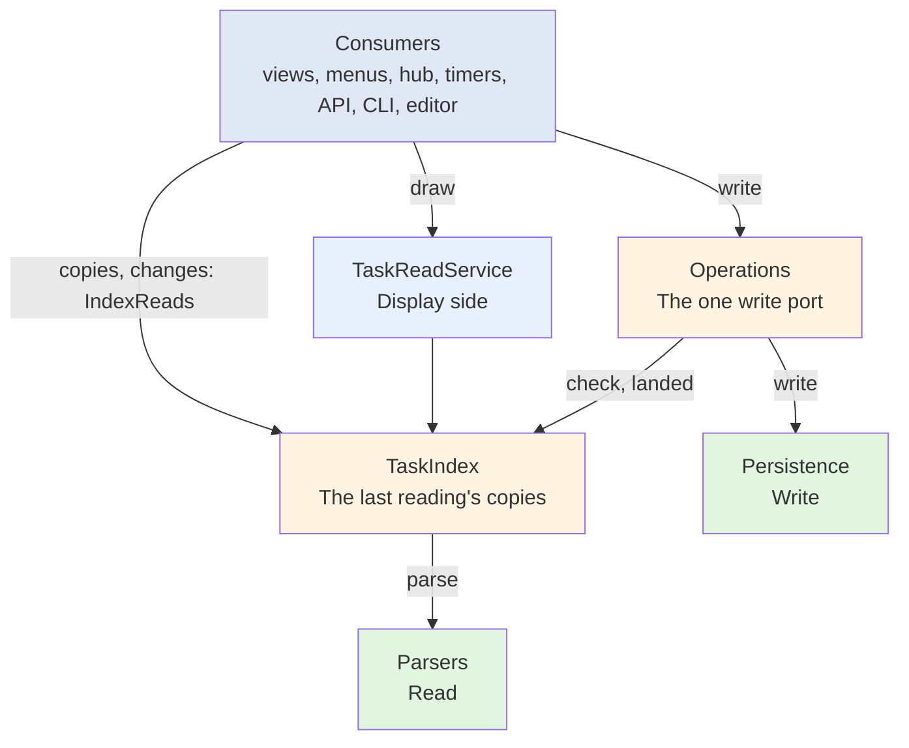

# Developer Documentation

## Task Card Rendering Architecture (v0.13.1+)

### Module layout

```
src/views/taskcard/
  TaskCardRenderer.ts              # Orchestrator for one task card
  ChildItemBuilder.ts              # Task/childLines -> ChildRenderItem[]
  ChildRenderItemMapper.ts         # Maps child data to ChildRenderItem[]
  ChildSectionRenderer.ts          # Child markdown/toggle rendering
  CardRows.ts                      # Where one draw of a card reads rows: the index, or rows its caller hands in
  CardMarkdown.ts                  # The one call of MarkdownRenderer.render for a card, and where a card puts its own pieces in what it drew
  CheckboxWiring.ts                # Checkbox interaction and status menu
  NotationUtils.ts                 # @notation label formatting helpers
  TaskLinkInteractionManager.ts    # Internal link click/hover handling
  TaskViewHoverParent.ts           # HoverParent decoupling Page Preview popovers from the WorkspaceLeaf
  TopRightFieldResolver.ts         # What a card's top right says (fields of the stated dates, tags, properties)
  types.ts                         # ChildRenderItem / CheckboxHandler (taskcard-local types)
  index.ts                         # Barrel exports
```

### Responsibility boundaries

1. `TaskCardRenderer` is the entry point used by Timeline/Schedule renderers.
2. `ChildSectionRenderer` owns child markdown render pipeline and notation injection.
3. `CheckboxWiring` owns all checkbox event binding. Every checkbox, parent or child, is a task and is wired the same: every write goes through `Operations.updateTask(taskId, { statusChar })`, and the click marks the status it writes as `data-task` on the box and its list item at once, where `_checkboxes.css` reads a status from. A tick alone would be drawn in Obsidian's checked look (the theme's accent) until the card is drawn again from the file. A write not made puts back the tick and both marks.
4. `ChildItemBuilder` walks `getChildEntries(parent)` of the card's rows (`CardRows`) — the single source of truth for child render order.
5. A card is drawn whole when `TaskCardRenderer.render` returns: it is synchronous, and lays the body, the children, their notation, the links and the mask in one go. No view waits on a card. `renderCardMarkdown` is the one call of `MarkdownRenderer.render`; that the body is in the element when the call returns is how Obsidian's renderer behaves, not what its API promises, so an empty element right after the call is logged once a session. The promise the call returns tells only when truly asynchronous content (images, embeds, math, code, mermaid, other plugins' post-processors) is in; the mask is laid again then, if the card still shows that draw.
6. What Obsidian draws of a card is the task's lines: the parent's status, its overdue mark and its name (`buildParentMarkdown`), and the children's lines. What the card puts after a line's text is put into the drawn DOM at the end of that line (`appendToLine`: after the item's text, before a list nested in it, inside its paragraph when the list is loose), and never written into the markdown. These are the link to the task's note (`task-card__file-link`: ` : ` and an `a.internal-link` shown by the note's basename, the link alone when the task has no name) and a child's notation or ⋯ button. Written after the name, the link's path would be read with the name as one inline: an `_` in each makes an emphasis that takes the link apart. The note's link is put in before the links are bound, so it opens and previews as the links the user wrote do; the mask hides it with its separator, and the user's links too.
7. How a card is drawn is said by `RenderOptions`, one field per policy: `expandChildren` (no collapsed section), `alwaysLinks` (links live whatever `enableCardFileLink` says), `doubleTap`, `mask`, and `rows`: the rows the card reads in place of the index (a task not written yet, a row's draft in a move). Drawn from them, nothing is done on the card whatever the others say: no menu, no double tap, no checkbox wired, no child's ⋯, no link bound. The index has no row of theirs to write to, so the one option says both, and a card of such rows cannot be drawn to be acted on. An inert card is marked `data-inert` and made `inert` (`TaskStyling.applyInert`), so Obsidian's own handling of its checkboxes and links takes no press either, and none of them takes the focus: a keyboard's Space would tick a box with nothing written. They are drawn as they are, not faded as a read-only card's. The renderer has no branch for any caller; the hub's preview passes its set and puts its own `task-card--in-hub-preview` class on the card.
8. A card's top right is made in one place, `TopRightFieldResolver`, for every view. It shows the dates the note states (`DisplayTask.stated`, made by `statedDates` in `utils/TaskDates.ts`): the line's values, and its section's and frontmatter's where the line has none, in the form they are written. A value the rules fill in (`05:00` for a bare date's start, the end of `@2026-10-04`, the default hour's end of `@2026-10-04T10:00`) is not written, so it is not shown. `stated` is made before a task is split, so both segments of `@2026-10-04T22:00>2026-10-05T08:00` show `22:00>08:00`. What a card shows is a `TopRightSpec`: `none`, or the fields of a `TopRightConfig` (fields, separator, prefix, suffix). A saved list passes its own config; Timeline, Calendar's cards of a day and Schedule pass `TIME_TOP_RIGHT`, the one field `times` (`10:00`, or `10:00>11:00`; empty with no start time). `composeTopRight` gives the pieces, each with a role (`start`, `end`, `sep`, `seg`); the card draws them with the class of their role (`renderTopRight`, `task-card__time-<role>`), and its signature holds their text. They are drawn in units (`topRightUnits`, `task-card__time-unit`), the end (`>11:00`) one of its own, in a box one line high across the card's top row that wraps between units: a unit after the first that does not fit goes whole to the line the box cuts away, with what follows it. So the end shows whenever it fits and is never cut, in every view, with no width to keep; the first unit stays and is cut only when it alone does not fit.
9. The renderer gives the card all of its look and its menu, on every draw before the signature is compared: the content, the color, the line style and the read-only mark (`TaskStyling`, which takes a value off when the task has none, so a kept card loses a color its task lost), and the context menu (`CardActions.bindMenu`). A view places the card and marks its split; it decorates nothing else. What a card does when used (details, menu, a child's menu, open in the editor, the double-tap action) is given once, as `CardActions`, when the renderer is made. Every view, and the plugin for a hub opened outside the views, makes its renderer, its `MenuHandler` and the hub they open together with `createCardRendering` (`views/sharedUI/CardRendering.ts`).
10. A card reads rows from one source per draw (`CardRows`): the index (`TaskReadService.getChildEntries`, `getDisplayTask`), or the rows its caller hands in (`RenderOptions.rows`, read by `cardRowsOf`). `render` picks it once, at its start; the children and theirs (`ChildItemBuilder`), the counts of the compact card and the collapsed section, and the overdue mark a child not done keeps (`cardOverdueLevel`) all read it, none knowing which it is. So a card never shows a child of one source with a count of the other.

### Child rendering rule

1. The renderer consumes `getChildEntries(parent): ChildEntry[]` (`'task' | 'line'`). A `'line'` entry is never a checkbox: every checkbox line is a task of its own. A `- [ ]` inside a code fence is an example and renders as plain text (no checkbox, not counted in the card's n/m). A `- [[note]]` child is an ordinary link line.
2. Each entry carries an absolute `bodyLine`, so render code does no line-number arithmetic.
3. Every body line is one task's at most: the extraction (`NoteTasks`) leaves a child task's subtree and a task's own `- ==>` lines out of its `childLines`. The data layer (`buildChildEntries`) only merges `childIds` and `childLines` by line, so neither it nor the renderer deduplicates.
4. `ChildItemBuilder` walks the entries depth-first: a `'task'` entry renders the child and recurses into its own entries (depth-capped, cycle-guarded); a `'line'` entry renders the raw line.

### Line write rule

Raw `updateLine(file, line, text)` is reserved for editor-cursor callers (`TaskMenuExtension`) and persistence internals. Card and hub UI write through `updateTask` only.

### Shared type policy

1. `src/types/index.ts` is reserved for cross-layer models/settings only.
2. Split helpers (`DisplayTask`, `shouldSplitDisplayTask`, `splitDisplayTaskAtBoundary`) are in `src/services/display/DisplayTaskConverter.ts`.
3. Task-card-local render helper types are defined in `src/views/taskcard/types.ts`.

### Task content invariant

1. `Task.content` stores raw user-provided content only.
2. A bare `- [ ]` keeps `content` as an empty string.
3. UI fallback labels (file basename / `Untitled`) must be resolved in view helpers (`src/services/display/TaskContent.ts`), not in parsers.
4. API normalizer (`TaskNormalizer`) passes `content` through as-is (`t => t.content`); it does not fall back to file basename. Basename fallback is a display-only concern handled by `getTaskDisplayName` (`src/services/display/TaskContent.ts`).

---

## Architecture Overview

### Layer separation



| Layer | Responsibility |
|-------|----------------|
| **Consumers** | UI rendering and user interaction, the API, the CLI, timers, the editor's extensions |
| **TaskReadService** | The display side of the read: cached DisplayTask conversion, date ranges, filters and sorts, a row's children in order. It passes no copy through |
| **TaskIndex** (`services/core`) | The copies of the last reading of each note, looked up by name, anchor and line; whether a copy is what the disk holds; the telling of a change. Its read port is the type `IndexReads` (`PluginContext.getIndex`), which has no method that writes a note. The copies are written by the scan and by what a write of ours left (`landed`), nothing else. It knows nothing of the operations |
| **Operations** (`services/operations`) | The one way a consumer writes (`PluginContext.getOperations`): checks the copy it plans from against the disk (`planCopy`, the read-only check included), orders the writes asked of one row (`onRow`), writes through the repository with the row's fire (a completion's planned inside the write, a deletion's planned before it, both by `FlowExecutor`), tells the user a refusal once and a flow that was not run (`FlowNotices`). Daily and periodic notes (`putInDailyNote`, `openPeriodicNote`) and template notes (`saveTemplateNote`) are written here too; the write channel does not leave it |
| **Parsers** | Convert markdown to Task objects |
| **Persistence** | Write rows back to files: each write checks the lines it planned from and writes them in one `vault.process` (`TaskRepository`, `writers/`, `FileLines`, `Notes`) |

A write does not change the index's copy. What it left comes back to the index as its next reading (`landed`), and that reading's notification draws it. A view that shows new values before then shows them from its own state (the hub's draft, the box a click changed).

**Notification.** The index tells its `onChange` listeners through two ports only, both of its coalescer (`NotifyCoalescer`): `schedule`, merged over one frame (16ms), and `flushNow` (`TaskIndex.notifyImmediate`), for a view that has to match the index in this frame (the end of a drag, the overdue watch). It tells only when what it holds changed: a scan that committed, a write that landed, a note forgotten, the settings. A reading of the whole vault is told to each listener in a task of its own (`staggered`).

**Delete notification.** `IndexReads.onTaskDeleted` hears each name that ends: a row the index held that it holds no more, under that name or the one a write of ours carried it to (`getTask`). A delete of ours ends the rows it took away; an edit from outside ends every row of its note, as it ends their names; a note deleted or renamed ends all of its rows. It is told in the task after the change, whoever made it, apart from the drawing notification. The selection (`SelectionController`) and a card's open children (`TaskCardRenderer`) let go of the name.

---

## Directory Structure

```
src/
├── main.ts                    # Plugin entry point (onload / onunload)
├── types/                     # Cross-layer types and settings (Task, DisplayTask, TaskViewerSettings, etc.)
├── settings/                  # Settings UI (9 tabs: Basic, Behavior, Views, View Details, Notes, Note scope, Parsers, Log, About)
├── constants/                 # Constants (layout, hover, styles, status options)
├── i18n/                      # Internationalization (locale files)
├── api/                       # Public API (TaskApi, TaskApiTypes, TaskIds, TaskNormalizer, OperationSchemas: the parameters; Reference: the help texts; QueryShorthand: the params as conditions; FilterParamsBuilder, FilterFileLoader)
├── cli/                       # CLI handlers (CliRegistrar: registers Reference's CLI_COMMANDS; CliParamValidator, CliFilterBuilder, CliOutputFormatter, handlers/)
├── services/
│   ├── core/                  # The index (TaskIndex, IndexReads, TaskStore, TaskScanner, NotifyCoalescer, Reading, RowNames, ReadingCheck, DiskReconciler, etc.)
│   ├── data/                  # The display side of the read (TaskReadService), children in order, effective properties, NoteOps, NotePlaces (what a destination is, read off the vault alone, before what a send meets there; the plugin's one, `getNotePlaces`, which NoteOps and the place dialog read through), CreatePlaces
│   ├── operations/            # The one write port (Operations), DuplicateShift
│   ├── display/               # Display conversion (DisplayTaskConverter, TaskSplitter, SegmentIds, TaskDateCategorizer, TaskContent)
│   ├── parsing/               # Parser layer (TaskParser: lineParsers; TaskLineFormat: formatTaskLine, formatRow; FileParsePipeline)
│   │   ├── tv-inline/         # Line-level parsers (TVInlineParser, DayPlannerParser, TasksPluginParser, ReadOnlyParserBase)
│   │   ├── strategies/        # ParserChain, ParserStrategy
│   │   ├── tree/              # A note's sections and rows (NoteSections, NoteTasks, Sections, SectionPropertyResolver, BuiltinPropertyExtractor)
│   │   └── utils/             # Parser utilities (ChildLineClassifier, CodeFenceTracker, InlineNotation, Outline, PropertyLines, TagRule, TagExtractor, TagInput, TaskLineClassifier)
│   ├── persistence/           # Write layer (FileLines: one target type `RowRef`, `createFile`; Notes: a block put in a note, a note made; FiringTrials: which fires of a completion are written; TaskRepository, InlineTaskWriter)
│   │   ├── writers/           # FrontmatterWriter, InlineTaskWriter, SendWriter, SendRows (which rows a send takes)
│   │   └── utils/             # FrontmatterLineEditor, Placement (where a write puts lines, and a child's indentation)
│   ├── export/                # View image export (ViewExporter; ExportRegistry: what each view expands; ExportSave: where an export is saved; ExportService: the CLI's export-image)
│   ├── filter/                # Filter types, serializer (the one reader), FilterExpr (the tree evaluated), engine, FilterEdit (edits as new values), PinnedListQuery, value collector, TaskValues (what the filter and the sort compare)
│   ├── sort/                  # Task sorting (TaskSorter, SortTypes)
│   ├── template/              # View template load/save (ViewTemplateLoader/Writer; TemplateNote: a template note, saved)
│   ├── flow/                  # ==> フローの計画と通知 (FlowExecutor: 計画だけで書かない; FlowPlanner/GenBodyRenderer/ScheduleEngine/FlowTrigger; FlowNotices: 発火しなかったことを告げる)
│   └── lang/                  # 式と文の言語 (Lexer/ExprParser/ExprEvaluator/StmtParser, Diagnostic)
│       └── flow/              # ==> フロー記法の言語 (FlowAst/FlowParser/FlowChecker/FlowSegments/FlowSerializer/diagnosticText)。lang、i18n、types だけに依存する
├── editor/                    # Editor extensions (TaskMenuExtension, DiagnosticsExtension, GenHighlight, etc.)
├── views/
│   ├── ViewDescriptors.ts     # The view table (VIEW_DESCRIPTORS); see "View Skeleton"
│   ├── base/                  # TaskViewerView, ViewStore, ViewSettings (the settings menu), ViewedDay
│   ├── timelineview/          # Timeline view (including renderers/, TimelineDays)
│   ├── scheduleview/          # Schedule view (including renderers/, utils/)
│   ├── calendar/              # CalendarView, MiniCalendarView, CalendarGrid, WeekNumberCell
│   ├── kanban/                # Kanban view
│   ├── taskcard/              # Task card rendering (see section above)
│   ├── sharedUI/              # Shared UI components (ViewToolbar, TaskListSections, DateGridLane, PeriodicNoteLink, etc.)
│   ├── sharedLogic/           # Shared logic (ViewEvents, MinuteClock, ViewUriBuilder, GridTaskLayout, EmptySpaceActions, etc.)
│   ├── customMenus/           # Filter/Sort popover menus, IntervalTemplateCreator
│   ├── sidebar/               # ViewSidebar, SidebarToggleButton, SidebarFrames, MarkdownFrameSections, MarkdownFrameReader, MarkdownFrameView, MarkdownFrameCard
│   └── TimerView.ts           # Timer view (Pomodoro / Countdown / Countup / Interval)
├── timer/                     # Timer widget and all timer services (including AudioUtils, TimerTargetIdUtils)
├── interaction/
│   ├── drag/                  # Drag & drop (DragHandler, DragStrategy, strategies/, ghost/)
│   └── menu/                  # Context menus (MenuHandler, MenuPresenter: every menu shown; MenusOnScreen: the menus not gone yet; PropertyCalculator, PropertyFormatter, builders/)
├── modals/                    # Dialogs (CreateTaskModal, the hub, the send dialog's logic, the place dialog, the questions in modals/ask/)
├── suggest/                   # The lists of candidates under fields (ShownSuggest, ValueSuggest, TaskNameSuggest, NoteSuggest), the notes they suggest and how a candidate is drawn (NoteCandidates, ObsidianFiles, candidateView), what `[[` and `#` complete to (LinkTagCandidates), and a frontmatter color's and line style's values in the editor and the Properties view (ScopeValues, color/, line/)
├── utils/                     # Layer-less leaves used by two or more layers (DateUtils, LineBreak, HostWindow, etc.; see "utils placement rule")
│   └── values/                # Input codecs: how typed text is read into a value (Read<T>, Normalize, DateValues, NumberValues, ChoiceValues, IssueText)
└── styles/                    # CSS (BEM naming, --tv-* tokens)
```

---

## DOM Class Taxonomy

CSS / DOM クラス名の付け方を 4 層 + state/modifier 規則で固定する。新規追加時はこの規約に必ず従う。

### Block prefix layers

| 層 | prefix | 例 | 対象 |
|---|---|---|---|
| **Shared primitive** | `tv-` | `tv-sidebar`, `tv-grid-row`, `tv-section-toggle` | 複数 view が利用する layout / widget |
| **View shell** | `<view>-view` | `timeline-view`, `schedule-view`, `kanban-view` | view ルート (Obsidian 慣例) |
| **View-specific block** | `<view>-` | `schedule-grid`, `calendar-week-row`, `kanban-view__cell` | その view 内でのみ使う |
| **Domain block** | `<domain>-` | `task-card`, `pinned-list`, `allday-section`, `cal-week-row` | view を跨ぐドメイン要素 |

迷ったとき: その class 名を **2 つ以上の view で生成** するなら shared primitive (`tv-*`) または domain block。**1 view 専用**なら view-specific (`<view>-*`)。view shell に `__*` element をぶら下げるのは妥当だが、層を跨いで参照される素材は domain block に切り出す。

### Element / modifier / state

- **Element**: `<block>__<element>` (BEM 二重アンダースコア)
- **Modifier (`--*`)**: 永続 variant — data-driven、render 時点で決まる
  - 例: `task-card--allday`, `task-card--multi-day`, `tv-sidebar--mobile`, `cal-week-row--mini`
- **State (`is-*` / `has-*`)**: 動的 state — JS の `classList.toggle` で出し入れする ephemeral な印
  - 例: `is-today`, `is-selected`, `is-current-week`, `is-dragging`, `has-overdue`

判別: ある属性が **タスクの不変 attribute** なら `--*`、ユーザー操作や時間で変わるなら `is-*` / `has-*`。

### Frozen names (歴史的に taxonomy 違反だが据置)

外部 API / 公開 CLI / Obsidian 提供のため rename しない:

- Obsidian 提供 (絶対に触らない): `view-content`, `internal-link`, `task-list-item`, `task-list-item-checkbox`, `is-checked`, `contains-task-list`
- プラグイン提供だが据置: `task-card` (ドメイン block、各 view から大量参照されるため stable な API として扱う)
- toolbar 周り: `view-toolbar` (shared primitive 相当だが歴史的に `tv-` 接頭辞なし。新規追加なら `tv-toolbar` 推奨)

### 参考: 過去のリファクタ

統合リファクタで解消した命名の負債の代表:

- `view-sidebar-{layout, main, backdrop, panel}` 5 ブロック分裂 → `tv-sidebar` 1 ブロックに統合
- `section-toggle-btn` + `schedule-section__toggle` 二系統 → `tv-section-toggle` + `--axis`/`--header` modifier
- `timeline-row` (timeline と schedule で共有) → `tv-grid-row` (shared primitive)
- `selected` (unscoped state) → `is-selected`
- `mini-calendar-*` 独自再実装 → `cal-*` + `--mini` modifier で共有化

---

## Subsystem Responsibility Map

Quick reference for locating the right layer when implementing a feature.

| Subsystem | Primary file | Responsibility |
|-----------|--------------|----------------|
| **TaskIndex** | `services/core/TaskIndex.ts` | The copies of the last readings, their lookups (`IndexReads`), the vault's change events, the drag's hold, the check of a copy against the disk (`checkCopy`, `checkFile`, `learnFrom`), the report of a write of ours (`landed`, `followLine`, `readingOf`), and the two notifications (`onChange`, `onTaskDeleted`) |
| **Operations** | `services/operations/Operations.ts` | The one write port: rows (`updateTask`, `updateByAnchor`, `deleteTask`, `duplicateTask`, `insertLine`, `replaceSubtree`, `send`, `writeLine`), the editor's hosts, notes (`putInNote`, `putInDailyNote`, `openPeriodicNote`, `saveTemplateNote`, `setFrontmatterKeys`), and the checks a caller asks before it acts (`confirmTask`, `rowSnapshot`, `freshByAnchor`, `assessFlowDelete`) |
| **TaskStore** | `services/core/TaskStore.ts` | In-memory copies and the `(file, anchor)` table; written by the scanner only, tells no one |
| **TaskScanner** | `services/core/TaskScanner.ts` | File scanning → `FileParsePipeline` invocation (parse/name/commit); the one writer of the store, and what hands the index the names a change dropped |
| **NotifyCoalescer** | `services/core/NotifyCoalescer.ts` | The index's listeners and the two ports that tell them (`schedule`, `flushNow`) |
| **ReadingCheck** | `services/core/ReadingCheck.ts` | Whether the index's reading of a note is the note on disk, asked before an operation is planned from a copy (`checkCopy`, the same `followLine` question as a write's first check) or a row is looked up by anchor (`checkFile`). `Operations.planCopy` and `freshByAnchor` act on the answer; a stale reading is refused through `reportRefusal` |
| **DiskReconciler** | `services/core/DiskReconciler.ts` | Brings the index's readings to the disk when a change notice never comes: on start, focus, a plugin view, a refusal, a stale check and each minute (desktop), stats the notes Obsidian holds (`DiskProbe`; the whole vault on desktop, the notes the index has read elsewhere), reads again what moved through `queueScan`, forgets what is gone, and logs where Obsidian's stat of a note lasted apart from the disk (`modified`, `deleted`). Obsidian's model is only observed, never mended; a note Obsidian never heard created stays out of the index |
| **FlowFireExtension** | `editor/FlowFireExtension.ts` | Fires a completion made in the editor, in the same transaction (see Flow Firing) |
| **ParserChain** | `services/parsing/strategies/ParserChain.ts` | Tries multiple parsers in order (Strategy chain); parses only, never writes |
| **TVInlineParser** | `services/parsing/tv-inline/TVInlineParser.ts` | Parses `@date` inline notation (line-level); cuts the `==>` command off the content without reading it (`readFlow` does) |
| **TaskRepository** | `services/persistence/TaskRepository.ts` | Assembles the writers and the index's channel; its ports: `write(file, target, ops, { fire?, refused? })` (the one write of ops to a row, duplicates included as a `copies` op), `applyOps`, `replaceSubtree`, `send`, `setFrontmatterKeys` |
| **Notes** | `services/persistence/Notes.ts` | The one way a new row (`NewRow`) is put in a note's section or at its end (`NoteSpot`, read by `noteSpot`, which a send's rows go through too), with its property lines as one block, the note made when the caller gives its seed (`putInNote`; `NoteSeed`: empty, or the daily note's template for a day, read by `seedOf`), the one way a note is made of lines (`createNote`, over `createFile`, the only `vault.create`), and periodic notes opened, made from their template when not there (`openPeriodicNote`, called by `Operations`). Writes to one path run one at a time |
| **PeriodicNotes** | `utils/PeriodicNotes.ts` | The description of a daily or periodic note (`PeriodicNote`) and the pure answers of which note a date names: `notePath`, `linkTarget`, `label`, `dateOfPath` (formats with `/` included), `findNote` |
| **FrontmatterWriter** | `services/persistence/writers/FrontmatterWriter.ts` | Surgical frontmatter key writes (`setKeys`, used by the Properties view's color / line-style suggests and its color picker) |
| **FrontmatterLineEditor** | `services/persistence/utils/FrontmatterLineEditor.ts` | Low-level YAML line operations; never touches unrelated lines |
| **InlineTaskWriter** | `services/persistence/writers/InlineTaskWriter.ts` | Direct inline task line rewriting |
| **TaskValues** | `services/filter/TaskValues.ts` | What the filter and the sort compare for each property: the effective value, one table (`of`, `length`, and `property`: a custom property's value as read, absent when no layer writes the key), the text a sort rule compares (`sortKey`) and each value in words for the references (`words`). The API's `leaf` (`list` and `today`) is its `children`. A flow's expression is not read through it: `start`, `end` and `due` in `at(due+7d)` are the row's own, since the value is written to the next instance's line and an inherited due would be written out onto it (`FlowPlanner`) |
| **FilterExpr** | `services/filter/FilterExpr.ts` | `compileFilter(state)`: the saved FilterState compiled into the tree the engine evaluates — groups, `not`, `ancestors` (some ancestor) and positive atoms. A negative operator is `not(positive)`; with `target: parent`, `not(ancestors(positive))`. An unfinished condition (no value chosen) is `ALWAYS`. Never saved |
| **TaskFilterEngine** | `services/filter/TaskFilterEngine.ts` | Evaluates a compiled `FilterExpr` over the values `TaskValues` gives, in a required `FilterContext` (start hour, week start, task lookup, now). A property condition is compared by `PropertyMatch` (「プロパティの条件」) |
| **FilterSerializer** | `services/filter/FilterSerializer.ts` | Filter state serialization (v4 recursive group format). `parse(raw)` is the one reader of every saved or handed-in filter: it returns `{ state, issues }`, dropping a condition of an unknown property, an operator the property does not take, or a value of the wrong shape into `issues` (the API throws them, a view drops them with a notice), and dropping conditions on retired properties (`kind`) silently; a group left empty stays, and evaluates as true. `SortSerializer.parse` does the same for sorts |
| **TaskSorter** | `services/sort/TaskSorter.ts` | Task sort processing, over the values `TaskValues` gives; without rules, `DEFAULT_SORT_ORDER` (due, startDate, content) |
| **FilterEdit** | `services/filter/FilterEdit.ts` | The filter menu's edits as functions that return a new tree (`updateConditionAt`, `replaceAt`, `appendTo`, `toggleLogic`, `withOperator`, ...), a node addressed by its path from the root (`NodePath`). `FilterState` and `SortState` are `readonly` values: no holder changes one in place, so none copies one to protect itself |
| **PinnedListQuery** | `services/filter/PinnedListQuery.ts` | Which tasks a pinned list shows: `resolve(list, viewFilter)` (the list's filter, and the view's when `applyViewFilter`) for the views' lists and Kanban's cells; `fromTemplate(template, listName?)` for a filter file, the template read by its view's schema and its lists by the schema's `listsOf` |
| **ViewTemplateLoader/Writer** | `services/template/` | View template read/write |
| **TaskReadService** | `services/data/TaskReadService.ts` | The display side of the read: filter, sort, date ranges, DisplayTask conversion, children in order. A question's `QueryOptions` name whether the invalid tasks are in and the start hour: the setting's copies are cached, another start hour's drawn anew and not kept (`displayTasksAt`). `windowContext(startHour)` is the one context a window is placed by |
| **DisplayTaskConverter** | `services/display/DisplayTaskConverter.ts` | Task → DisplayTask conversion (stated dates, span, drawn), the split at a day boundary |
| **TaskSplitter** | `services/display/TaskSplitter.ts` | Visual-date / date-range task splitting |
| **SectionClassifier** | `services/display/SectionClassifier.ts` | Single owner of the allDay / timed kind decision (`classifyForSection`); `bucketBySection` for section dispatch |
| **TaskDateCategorizer** | `services/display/TaskDateCategorizer.ts` | Per-date bucketing: delegates kind to `classifyForSection`, owns date membership (the visual days a task is drawn over) and sort via TaskRenderOrder |
| **TaskRenderOrder** | `services/display/TaskRenderOrder.ts` | The canonical order of each section's bucket, which every view draws in; a tie goes by where the task is written (file, then line as a number, then ID). See "Canonical order within a section" |
| **ViewExporter** | `services/export/ViewExporter.ts` | Clones a view's container, draws each canvas's picture into its clone (`ExportUtils.copyCanvases`; a canvas of no size or holding another origin's picture is left empty), grows what scrolls (each view's `ExportTargetSpec` in `ExportRegistry`) and captures it as a PNG |
| **ExportSave** | `services/export/ExportSave.ts` | Where an export is saved and saving it, for the view menu and the CLI alike: `exportFolderOf(settings, override?)` (the folder asked for, else the setting, else `DEFAULT_SETTINGS.exportFolder`), `saveExportImage` (a vault-relative folder through the vault, an absolute one through Node's `fs`, desktop only) |
| **PropertyValues** | `services/parsing/utils/PropertyValues.ts` | The one reading of a property's value (`PropertyValue`): `fromText` for a line, `fromYaml` / `fromFrontmatter` for the frontmatter, `display` for what is shown and compared, `spelling` for what a line writes; see "プロパティの値" |
| **EffectiveProperties** | `services/data/EffectiveProperties.ts` | `getEffective*()` derived helpers merging raw + cascadeContext for properties/tags/style; see "Inheritance pipeline" |
| **TaskValidator** | `services/core/TaskValidator.ts` | Task validation |
| **NoteSections** | `services/parsing/tree/NoteSections.ts` | A note's sections from `outline.headings` as a tree under its root (the whole body, whose own lines are those above the first heading), each with its own property lines and its head (the root and section scopes of the cascade) |
| **PropertyLines** | `services/parsing/utils/PropertyLines.ts` | The one reading of property lines: which lines are a task's or a section's (`ofTask`, `ofSection`), what they say and what is wrong with them (`read`: values, the line of each, `PropertyFinding`); see "プロパティ行" |
| **PropertyDiagnostics** | `services/parsing/tree/PropertyDiagnostics.ts` | The editor's diagnostics on property lines: every section's and task's `PropertyFinding` as a diagnostic on its line, with one sentence per kind; see "プロパティ行" |
| **NoteTasks** | `services/parsing/tree/NoteTasks.ts` | A note's rows: every line that opens a task, its parent, child lines, flow, properties and section cascade, read once |
| **FlowLineScanner** | `services/parsing/utils/FlowLineScanner.ts` | `readFlow(outline, taskLine)`: the one place a flow program is read from a note (the task line's tail and its own `- ==>` lines); the extraction and the editor diagnostics both use it |
| **DayPlannerParser** | `services/parsing/tv-inline/DayPlannerParser.ts` | Day Planner compatible parser (read-only) |
| **TasksPluginParser** | `services/parsing/tv-inline/TasksPluginParser.ts` | Tasks plugin compatible parser (read-only) |
| **TaskApi** | `api/TaskApi.ts` | Public API (13 methods). Checks every parameter once (required, whole numbers, dates); the CLI passes its flags on unchecked. `list`, `today` (`list` with `date=today`) and the two range operations answer through one path (`resolveQuery`, then `TaskReadService.getFilteredTasks`), and a query's `startHour` draws the copies and places the windows of that call |
| **OperationSchemas** | `api/OperationSchemas.ts` | The parameters of each operation (`ParamSpec`: key, required, a whole number's range, description), bound to the param types by `satisfies`; the shared blocks `SIMPLE_FILTER_SCHEMA`, `FILTER_SOURCE_SCHEMA`, `SORT_PARAM`, `LIMIT_PARAM` |
| **Reference** | `api/Reference.ts` | `api.help()` and the CLI's `help`, made from the tables: the operations (`OPERATIONS`, whose CLI side `CLI_COMMANDS` the registrar registers), `ALL_FIELD_NAMES`, `PROPERTY_OPERATORS` with `FILTER_VALUE_DOC`, and the sort properties with `TaskValues.words` |
| **Input codecs** | `utils/values/` | How a value typed by a person or a script is read: `Read<T>` (a value, or an `Issue`), `typed` (NFKC, trimmed) and `dashed` (hyphen-like characters as `-`, dates only), `DateInput` (a day that exists), `TimeInput` (`9:40` as `09:40`), `DateTimeInput`, `IntInput` / `IntValue` (whole numbers, a range), `FloatInput`, `BoolInput`, `ChoiceInput`, and `issueText` (the English sentence of an issue). The API, the CLI, the URI and saved view state (`FieldCodecs`' `F.*`) read through them; the note's notation does not |
| **TaskNormalizer** | `api/TaskNormalizer.ts` | Task → NormalizedTask conversion for API output |
| **FilterFileLoader** | `api/FilterFileLoader.ts` | Filter file (.json/.md) loading |
| **FlowExecutor** | `services/flow/FlowExecutor.ts` | Plans what a `==>` command (every / + / at / x / until / move) writes, and writes nothing: a completion's fire from the lines the completing write holds (`planFire`, as a `fire` op: `fireOp`), a deletion's next instance and removal (`planDeletion`). Reads the notes only through `FlowReads` (a generation block, a row by id). A `move` carries the row to a heading of its own note (`[[#heading]]`) as one `move` op; a heading that is not one place in the note fails the plan |
| **FlowNotices** | `services/flow/FlowNotices.ts` | What the user is told of the flow: for each completed row whose flow was not run, why (`notRunsOf(outcome)`, the one rule for a card's write, a send and the editor), and a delete its fire stopped (`deletionStopped`); the same failure once per window |
| **FiringTrials** | `services/persistence/FiringTrials.ts` | `firingTrials`: the one rule of which fires of a completion are written — every fire, else none, else each put back from the top and kept or set aside with its refusal — for `InlineTaskWriter`, `SendWriter` and the editor's fire alike (`FiringOutcome`) |
| **DragHandler** | `interaction/drag/DragHandler.ts` | Delegates pointer events to `DragRouter` (Strategy selection) / `DragSession` (gesture lifecycle) |
| **MenuHandler** | `interaction/menu/MenuHandler.ts` | Context menu facade coordinating multiple Builder classes |
| **TimerWidget** | `timer/TimerWidget.ts` | Floating timer UI; starts timers and owns their board, lifecycle and recorder |
| **IntervalTemplateLoader/Writer** | `timer/IntervalTemplateLoader.ts` et al. | Interval template read/write |
| **AudioUtils** | `timer/AudioUtils.ts` | Web Audio API notifications with serialized context management |
| **KanbanView** | `views/kanban/KanbanView.ts` | Kanban board view: the grid of its lists, their rows and columns (see "Saved lists, lanes and note links") |
| **TimerView** | `views/TimerView.ts` | Standalone timer view (Pomodoro / Countdown / Countup / Interval) |
| **TaskCardRenderer** | `views/taskcard/TaskCardRenderer.ts` | Task card rendering orchestrator (see section above) |
| **TaskLinkInteractionManager** | `views/taskcard/TaskLinkInteractionManager.ts` | Internal link click/hover handling within task cards |
| **ViewSidebar** | `views/sidebar/ViewSidebar.ts` | The sidebar of Timeline and Calendar: its layout, built once as the view opens, whose main area is the one element the view's draw empties and draws into, and whether it is open, held apart for each width. Beside the view (wide width) it is `showSidebar`, which only the toggle at wide width writes. Over the view (narrow width) it is a value the sidebar holds and never saves, closed whenever the view is seen not narrow (wider, or a tab behind another, which has no width), so each time the view is shown narrow the sidebar starts closed; the toggle, the backdrop and the back open and close it there and leave `showSidebar` as it was, so the URI and the templates copy the wide position alone. Its look follows the open state when the user opens or closes it (sliding), when the view's width changes and when `showSidebar` changes otherwise (a state the workspace or a URI hands in, shown once the view is wide), not at the view's draw. It takes no key: Escape is left to the rest of the app. At narrow width it lies open over a backdrop, and a click on the backdrop and the back (Android's back, the mouse's back button: `HistoryBack`) close it as the toggle does: the back is held while it is open and narrow, and only then, so beside the view, and in a tab behind another (no width), the back is the rest of the app's. What it holds is the panel of the sidebar's frames (`SidebarFrames`, `views/sidebar/SidebarFrames.ts`), made in the panel's body |
| **SendDialog / NoteField** | `modals/noteops/` | The send dialog: rows and their subtrees sent to a heading of a note or to its end, its logic (`SendDialog`) apart from how it looks (a `SendSurface`) and from the rows' drafts. It is held by a row's hub moving the row (`RowMove`), which draws it in the place of where the row stands; it holds rows enough for a send of many, as `NoteOps` does. The dialog holds no editor: it asks its host for each row's draft as it is now (`SendHost.drafts`, a subtree's replacement or none, none for all while one cannot be written) as a send is asked, as it draws and as the timers are asked, and is told by `draftsChanged` to draw again. Why a draft cannot be written is its host's to say. The note is one field (`NoteField`) searched among the vault's notes, aliases and unresolved links (`NoteSuggest`); it holds the text and the note picked (`NoteAsk`), the note picked while the field holds the text the pick put in, typed back or not, and none while the text differs (`TextPick`, which the section dialog's heading field holds its heading picked by too); a form may open it on a note by its path, held as a pick is. `NoteName.find` reads it as a link's text is read: the note picked, the vault's at its path, case aside, or, while none is there, a new note at the path as held, whatever the text says; a name, the vault's one note by it or a new note in the folder for new notes; a path, the note at it from the root or the one whose path ends in it, or a new note there. More than one note is no note, and no send until one is picked. The heading field (`DestinationField`) opens on the settings' heading (`taskHeading`), so a send left as it opens goes where a task goes when nothing names its heading; a heading typed or picked names its section, at the settings' level and side; the field emptied names the note's end, under no heading, which the field says in its place. The note field and the heading field each end in a × (`ClearButton`, `modals/form/`, the × of the timer's and the filter's date and time fields too; the hub's date fields have none, their … taking the value out), shown while the field holds a value and out of the Tab order, which empties the field as deleting its text does (`createClearableInput`: the value '' and an `input` event, met by the field's owner and its list alike) and leaves the focus in it; the section dialog's fields have it too. The destination's fields and the values offered are drawn by one part (`SendFields`), held by the dialog and by a row's hub moving the row. A dialog opens on the fields it is given, or the preview's defaults (`SendOptions.initial`), and a dialog on one row told where it stands (`SendOptions.stands`) sends it nowhere there: its note under the heading it stands under, or the note's end for a row in a note with no heading. That reading is `NotePlaces.readFields`'s alone, for every form that holds the fields; `NoteOps.destinationFacts` adds what the rows meet there. Under the field the dialog always says which note the rows go to; under the heading, where in it. What it says of the note alone (why the field names none, the note made and its folder, its namesakes) is `DestinationText`'s, said alike by the place dialog; what hangs on the rows (their own note, the values, the timers, the references) is the send dialog's own |
| **PlaceFields / PlacePane / PlaceShown** | `modals/place/` | Where the task of a hub on a task to make goes, a group at the end of the form's basic tab (a `HubPlace`). Under a row (Add child task) it shows the note, heading and parent with no field (`PlaceShown`). In a note: a note and where in it (a heading's section, or its end) the task is made, its logic (`PlaceFields`) apart from how it looks (`PlacePane`). Its fields are the send dialog's (`DestinationField`), read as theirs are (`NotePlaces.readFields`, a new note by a name in the folder for new notes), the last asking's answer alone taken (`LastAnswer`). As they open and each time they are typed in (a key, a pick from a list, a ×), and at no other time, they tell the hub's host at once that they are being read (`reading`), and then the answer to what they hold now (`answered`: the note and its spot, why they name no note, or `unread` where the read failed or threw), which the host moves the draft by. Each `reading` is followed by one answer to what the fields hold then, unless a later `reading` came first, whose answer it is then: an asking overtaken hands on nothing, its read answered or failed. The host's create waits on this. Opened on a place (`CreatePlaces.askOf`), the note field holds the note's name and its path as picked, so a note not made yet (a daily note's) is still the note at that path. Under the fields only errors and warnings are said: a name no note can have, more than one note by the name, more than one heading by the name; a note made (no path said), the folder made with it, its namesakes, a note the views do not show. Where the task goes is said by the line above the create alone; an empty note field says nothing under it. An Enter in a field does nothing. Its focus (`HubPlace.focus`) is on the first field an error is said under, the note's and then the heading's, else on the note field, the caret after its text; its fields and their × are shut with the form's |
| **SectionDialog / SectionModal** | `modals/section/` | The section dialog: a note and a heading of it, or the whole note, chosen for a markdown frame of the sidebar, to add the frame or to choose its section again (see "Saved lists, lanes and note links"). Its logic (`SectionDialog`) apart from how it looks (`SectionModal`); its fields are `SectionField` (`NoteField` and the heading field, with its own list of the note's headings) |
| **TaskHubPanel** | `modals/hub/TaskHubPanel.ts` | Single "open task" destination, and where a task is made: live card preview + per-field instant-save property form (content/status/dates/tags/color/linestyle/mask/custom). Self-hosted surface (not an Obsidian Modal) in the filter-popover family: own backdrop/close/Escape, root carries `tv-ctrl`. Its fields' lists are Obsidian's (`ValueSuggest`), its status button opens the card menu's statuses (`addStatusItems`). Two entries: card double-tap and menu Properties items (with field focus) open it on a row by `openRowHub`, as do the editor's ··· menu and the timer's name from outside the views (`PluginContext.openTaskHub`, with no selection to clear and no mask), whose host (`RowHost`) writes and follows the row, and which builds the source mode the panel is handed; a day's empty space on a Timeline or a Calendar (its menu's Create Task for Daily Note, and Create Task in a Note, on no place for the note to be chosen in its note field) and Add child task open it on a task not written yet (`PluginContext.openDraftHub`) by `openDraftHub`, whose host (`DraftHost`) writes nothing until its create. The hubs on rows are open one at a time (`OneAtATime`); a hub on a task not written yet is not one of them, and opens over the hub open now, which stays as it was once it closes. With no hub to wait for, the call that opens a hub returns with it open and its card drawn: 「ハブのホスト」. Its fields stand in two tabs of the form, General (the name, the status, the dates and the place) and Details (the tags, the colour, the line style, the mask and the properties): 「ハブのタブ」. Its property fields: 「ハブのプロパティの欄」 |
| **OverlayShell** | `views/sharedUI/OverlayShell.ts` | The one surface of the plugin's dialogs and popovers (centered: a dialog, a bottom sheet on a phone; anchored: a popover). The body alone scrolls: a dialog puts its title in the panel's head and its row of buttons in its foot (`OverlayFrame`), above and below the body, which stay in sight in the sheet and in the box alike and show only while they hold a child without the `hidden` attribute (the hub, its source mode's row among it, the send, the place, the section and the start-offset dialogs, and the questions). Every overlay is given Obsidian's keymap and keeps its hotkeys out while the focus is in it (`HotkeyShield`); a frame after it opens, it puts the focus on the field the body names (`initialFocus`), else on the panel itself. The field is focused without the browser's scroll (`preventScroll`: on iOS that scroll moves the window's visual viewport too), so a field in the body is first brought into the body's sight, scrolled no further than to show it whole, or its top at the body's top where it is taller (`bringIntoView`, `views/sharedUI/BodySight.ts`, which the hub's source switch uses too): the hub opened on a field under a tall card, on a phone's sheet, has the field below the body's bottom otherwise, and a keyboard rising for it moves the body from where it was brought. The body says, by the field's kind, how its text is met there, and the shell does that knowing no field (`FieldFocus`, `utils/FieldFocus.ts`): a value of fixed shape (a date, a time, a line style, a colour, a number of minutes) is retyped whole, so its text is selected; a free text (a name, a tag, a mask, a property, and the note and the heading of the section, send and place dialogs, whose names have no fixed shape) has the caret after it, the field's own text scrolled to its end and nothing around it, and a button or an editor is focused alone. In the hub the kind of each field is one rule (`selectionOnFocus` in `TaskHubForm`), which the hub opening on a field and its menu asking for one (`focusField`) go through alike. The first focus is put through `placeFocus` (「FocusPlacement」 below), the panel holding it meanwhile: while the overlay opens (`opening`, from its opening to the frame after, then until the animations running then on its panel and its backdrop alone have stopped: the sheet sliding up, the box popping in, the backdrop fading in; what animates in the body, and what starts on them once they have come in, is not waited for: `watchOpening`, over `Animations`) and while a menu of the plugin is on the screen (`placeFirstFocus`). While the on-screen keyboard covers the window (`KeyboardWatch`, `utils/KeyboardWatch.ts`: Capacitor's `keyboardHeight`, which tells how much of the window the keyboard covers and 0 where it covers none, or the `visualViewport` shrinking or scrolling; Capacitor tells it only on a show, so the main window is listened to from the plugin's load and a popout window from its first use. Each window is listened to once, and on each event the height it carried is kept first, then the parts following the keyboard (`watchKeyboard`: the overlay's keyboard room, the anchored panel, the popover, the timer widget) are told in the order they began to follow, so the overlay is given the overlap before its anchored panel is placed), `KeyboardRoom` (`utils/KeyboardRoom.ts`, reading and writing the overlay through `RoomLayout`) gives the overlay's root that overlap as `--tv-keyboard-overlap`, as the keyboard is told. The overlap is read in whole px and is none under 1px (`keyboardOverlap`: the window's `innerHeight` is a whole number and the `visualViewport`'s height need not be), and the keyboard is up while there is any: a keyboard covering a pixel or more of the window lays the overlay out and has its field measured, and a `visualViewport` scrolled down until it ends at the window's bottom is no keyboard. The overlay still covers the whole window, its backdrop among it. The sheet takes the overlap as a padding of its panel, its surface running on under the keyboard: the foot sits right over the keyboard, the body shrinks and scrolls inside, the room kept under the foot for the window's bottom (24px, or the home indicator's inset where more) gives way to the keyboard down to the 12px above the row, and the room kept above the sheet (`--tv-sheet-room-above`, 120px) gives way to it by what it covers, down to `--tv-overlay-edge` (32px); this holds for the anchored panels that are sheets on a phone (the filter, the sort, the top-right settings, the interval template) too. The box keeps its size, at most the window's height less 64px, and its place in the window's middle, 32px (`--tv-overlay-edge`) kept above and below it, and rises only by what it lacks to end 32px above the keyboard's top, as far up as 32px from the window's top: its top is max(32px, min(its centred top, the keyboard's top − 32px − its height)), laid out by two empty items around it in the root, the one below at least as tall as the overlap where the keyboard's move ends (`--tv-keyboard-overlap-to`, which has no transition); a box taller than the room above the keyboard stands at 32px from the top, its foot left under the keyboard. The sheet moves over the overlap's transition, which lays it out as it moves. The box moves over its shift: as the overlap is written (`RoomLayout.writeOverlap`), the box is laid out at once where the overlap ends, and its translate (`--tv-box-shift`, registered on the root) is given how far that moved it, read from the panel's `offsetTop`, which neither the translate nor the opening's transform moves (`OverlayShell` gives `KeyboardRoom` the panel with the body); the shift then moves to 0 over the same move, so the box moves from where it is seen, at rest or on its way, over the whole of the move and slowing to its stop, whichever way the keyboard goes. A root that shows the overlap at once (an overlay not laid out yet, opened over an open keyboard) has the box there at once, with no shift. The overlap and the shift take their length and curve (250ms) from one place, `--tv-keyboard-move` on `.tv-overlay`. At rest the shift is 0, and where the box and the sheet stand is the stylesheet's alone. The body moves along with them: as the keyboard begins to rise (or changes height, or an overlay whose root was laid out as its body was built opens over an open keyboard, its overlap moving in from none and its box drawn up from the middle), where things will stand once the overlap has come is read, the root's transitions held off while the overlap is given and read, the box laid out by it with no shift, and what the root shows given back before they are let run again so that they still move from there (`RoomLayout.readAt`); the body is then scrolled at each frame by how far the field has come of what it lacks (`scrollAlong`: the field stays while the keyboard is short of it and then rides 10px above the keyboard's top, the position being the stylesheet's alone and read at each frame), and a field the keyboard will not hide has the body held where it stood, the browser's own scroll written over at the next frame. Where the body comes to rest is reckoned from where it stood before the keyboard moved it, whatever came on the way (another height, another field, the keyboard turning back as it went), or from where the user took it. The body is moved so from the keyboard's will show until its did show (`keyboardMoving`, at most 1000ms) and the transitions of the overlap and the box's shift have all ended, the shift come to 0 among them, at most 1000ms; while the overlay still opens nothing is read and the body is held, and it moves along once the overlay has opened. A panel placed by script (the anchored popover) is measured at the frame after the keyboard's event instead. Once the keyboard is up, a field focused or a caret moving below the keyboard's top has the body scrolled at the next frame at once, a field lacking a pixel or less being left; a field focused with the keyboard closed starts nothing. The field typed at (an input's bottom, the caret in an editor) is kept 10px above the keyboard's top and the body's visible bottom; only where the keyboard covers the body's bottom (a box taller than the room above the keyboard: told by where the body ends, not by the layout) its height is locked as it stands, as a max-height too since a flex item sized by its content takes no height, and its bottom padded as far as it needs to scroll there, how far it scrolls read after each padding written (`RoomLayout.padFor`), since a content laid out by the body's height (the hub's General tab, off, cut to the room left above the padding) gives way to the padding rather than lengthening the scroll by as much; each write adds what is still lacking, twice the last step where that step gained nothing, and the padding goes no further than what was lacking and the body's height, since what gives way stands in the body's room; what such a step took the scroll past is then taken off the padding, kept so only where the body still scrolls as far, so the padding is the least found that reaches there. Where the body rests once the keyboard is up (its scrollTop, the lock and the padding) is the body as it last stood at rest, the keyboard closed or up, measured once so where things stand then, whatever was planned on the way (`restOf`); on the way, the body keeps the lock and the padding that reach both where it stands and where it rests, so it does not move as it is given those it rests with. As the keyboard closes, the body moves back along with the overlap to where it stood as the keyboard opened, and the height and the padding are put back once the overlap is gone; the focus leaving the fields (200ms after, or once the keyboard is up where it still rises) or the overlay closing puts them back at once, the body back where it stood as the keyboard opened, or as the overlay opened over an open keyboard. Once the user scrolls the body (a wheel or a finger moving on it, listened to since a `scroll` event does not tell the user's scroll from the plugin's and the browser's), it is no longer written and stays where the user took it; once the keyboard is up, it is given back the lock and the padding it had as the keyboard began to move and measured from there. The anchored popover is placed above the keyboard by script (`positionElement`, by `keyboardTop`), again as the keyboard shows or hides and as the `visualViewport` resizes, not as it scrolls (placing the popover brings its focused field into view, which scrolls the `visualViewport` again). It gives the focus back on close to what had it before it opened, while the focus is still its own, through `placeFocus` too: at once with nothing to wait for, and once a menu still on the screen has gone (an item that closed it), the focus taken out of the closing overlay meanwhile so that what is typed does not go into it (`giveFocusBack`). A close the user asks for (×, Escape, the back, outside, a swipe) asks the body first (`beforeClose`, a `CloseAnswer`: close, stay, or a promise waited for; `CloseGate`). Overlays opened over one another stand on the body in the order they opened, and only the top one takes a press outside it and Escape (`LayerOrder`, `overlayAbove`); the back comes to the top of Obsidian's stack, where each is put as it opens (`HistoryBack`) |
| **FocusPlacement / MenusOnScreen** | `views/sharedUI/FocusPlacement.ts`, `interaction/menu/MenusOnScreen.ts` | `placeFocus(focus, { hold, stillWanted, focusOptions })`: the one way a focus is put on a field, which raises the on-screen keyboard, once nothing moves around it. It waits for two things: the plugin's menus on the screen to go (`MenusOnScreen`: each menu `MenuPresenter` shows is told shown, and gone as its `onHide` comes, which on a phone's layout, a window less than 600px wide or high, is once its sheet has slid away, elsewhere inside `hide()`; a menu not told gone within `MENU_GONE_BOUND_MS`, 700ms of the first wait for it, is let go of and no longer waited for), and the plugin's overlays opening to have opened (`OverlayRegistry.whenOverlaysOpened`). With neither, the focus is put at once, in the caller's task. In a document the last ask wins, an earlier one still waiting dropped. When the wait ends the focus is not put on a field gone from the document, nor once the user has moved the focus since the ask to anything but `hold` or the body (`stillWanted` says otherwise where given: the overlay's first focus is wanted while the overlay is open and the focus has not moved within its surface). Meanwhile `hold` (an overlay's panel) holds the focus, which raises no keyboard. A wait is logged at debug (`[kb] focus placed|superseded|field gone|not wanted after= menus= opening=`). Each place that puts a focus goes through it: an overlay's first focus and its focus given back on close, the hub's field asked for from its menu (`TaskHubForm.focusField`), its create and keep, its source mode's editor, the start-offset dialog's field, a field's ×, and a pinned list's rename, whose field shows at once and takes the focus once the menu has gone. What calls `.focus(` itself is listed with its reason in `tests/unit/utils/FocusCalls.census.test.ts`, which fails on a place not listed: the parts of putting a focus, what only answers where the focus goes (an `initialFocus`), a focus kept as a part is drawn again or moved on to the next field as the user types (the keyboard is up, and a wait would close it), the source editor's own keys, a button, and the native picker's fallback |
| **TabStrip** | `views/sharedUI/TabStrip.ts` | A row of tabs over the panes they choose between, knowing nothing of what the panes hold. It builds the row and then the panes' element (`tv-tabs__panes`) at the end of the element it is given, for the stylesheet of the place it is used in to find them there. It is used by the hub's form (two tabs sharing the row's width) and the settings tab (nine, the row scrolling sideways as its tabs keep their names' width, `_settings.css`); where the row scrolls, the button of the tab chosen is scrolled into the row's sight as the strip is built, as a tab is chosen and as the row's width changes, the row alone scrolled. Each tab is a `button` (`role="tab"`, so Enter and Space choose it) naming its tab's id (`data-tab`), by which a test or a caller finds a tab rather than by the ids the strip numbers; the arrows go to the next and the previous tab, round at the ends, Home and End to the first and the last, choosing it and moving the focus to its button, and the tab chosen alone is in the Tab order. Every pane is built once and kept, the panes not chosen marked `inert` and `is-hidden`: how a pane off is hidden, and whether the panes keep one height, is the stylesheet's of the place it is used in (`_tabs.css` by default: it takes no room, as in the settings; the hub's form lays both panes in one cell of the hub's body, `_task-hub.css`). A focus in the pane left goes to the button of the tab chosen, which raises no keyboard; one on the row stays. `reveal` chooses the tab whose pane holds an element the caller is about to put the focus on, which a pane off would not take; `focusTab` chooses a tab and puts the focus on its button, as the arrows do, for a caller with no field to put it on. `onSelect` tells the tab chosen, once it changes |
| **askChoice / confirm / askText** | `modals/ask/` | The questions put to the user, on OverlayShell's centered panel (a sheet from below on a phone), each answered once when it has closed (`ask`): a choice of buttons opens with the focus on cancel and answers `'cancel'` however else it closes (×, Escape, the back, outside, a swipe); a text opens on its field (a number's text selected, any other text with the caret after it), says under it what does not read (`issueWords`), and waits for its `submit` before closing. Their button row is `FormActions` (`modals/form/`) |
| **TaskMenuExtension** | `editor/TaskMenuExtension.ts` | The editor's line button (`lineMenuOf`), drawn again when the document, the part shown, the index or the settings change. The index and the settings ask for it by a transaction of the plugin's own (`askToRedraw`), never into an editor the IME is composing in: CodeMirror on iOS reads the IME's input on the next frame, and a transaction before then drops that input and loses the composition. The editor composing holds the change and draws it at its first update after the composition (`redrawsOn`) |
| **onFormEnter** | `modals/form/formEnter.ts` | The one answer to whether a field's Enter is the form's: not an IME's commit (`isComposing`, `keyCode` 229, the field's own composition flag; Windows sends `Process`), nor one a list open on the field takes (`takesEnter`, e.g. `ShownSuggest.listShown`). Every field of ours puts its Enter through it; the commit Enter of an IME commits only, and the next Enter is the form's |
| **ShownSuggest / ValueSuggest** | `suggest/` | Every list of candidates under a field of ours is Obsidian's input suggest, with Obsidian's keys, as Obsidian's own fields have them (the `[[`, a property's text value, the tags): on a field that holds text the first item selected as it opens, on an empty field (its text empty but for spaces and line breaks) none, ArrowDown selecting the first; Enter puts the selected item in (the one opened on, moved to by an arrow, or under the pointer), an Enter with none selected closes the list and is the field's, so an empty field's Enter puts no item in; a value that is no item goes in by Escape then Enter. `ShownSuggest` says whether its list is open (`listShown`, an Enter the field yields), selects none as the list opens on an empty field (`showSuggestions`) and lets an Enter with none selected on to the field (a first handler in the list's scope, before Obsidian's keys), takes every key its list does not so the hotkeys behind stay out, picks nothing on an IME's committing Enter (`isFormEnter`), and keeps the list on its field while the field moves: Obsidian places the list, by the field and within the room it keeps it in (the window less the `--safe-area-inset-*`, where Android's keyboard is while it is up), as it opens, as the field is typed in and on a scroll only, so while the list is open what Obsidian places it by is read on each frame of the field's window and once that changed the list is opened again (`open`, which places it as typing does and runs what a subclass adds, `TaskNameSuggest`'s place at the `[[` and its footer); a subclass says what picking does (`pick`). `ValueSuggest` is a field's list of values (the hub's tags, style and properties, the filter's keys, values and pills, a list's top-right fields): what is picked is committed by the field's `pick`. `HotkeyShield` follows the focus in the capture phase of `focus`, so a list that opens as its field takes the focus has its scope above the shield's |
| **NoteCandidates / candidateView** | `suggest/` | The notes a list suggests, in one place, as Obsidian's `[[` suggests them: the vault's notes, and what the caller chooses besides (`NoteCandidateKinds`: other files, aliases, unresolved links); matched fuzzily on the name first and the path a point lower, the most recently modified first when nothing is typed, a hundred at most (`noteCandidates`, a copy of Obsidian's unpublished `getFileSuggestions`). `ObsidianFiles` is the one reader of Obsidian's unpublished `isSupportedFile` and `isUserIgnored`, each with the answer it falls back to. `candidateView` draws a candidate as Obsidian's complex item (`mod-complex`: the name, its folder under it, an alias's mark, a heading's level), so Obsidian's CSS sizes it, in a field's list and in the source editor's completion alike. `NoteSuggest` is the list of a field that names a note (the settings' templates, the note of a row's move and of the section dialog). |
| **LinkTagCandidates / NoteLink** | `suggest/`, `utils/NoteLink.ts` | The `[[`, `[[note#` and `#` of the task name (`TaskNameSuggest`) and of the source editor (`SourceCompletion`), answered in one place: the trigger before the caret and the range a pick replaces, the candidates (a `[[` holds every kind `NoteCandidates` holds, as Obsidian's does; a note's headings matched fuzzily; tags), and what a pick writes (`linkTagWrite`). A link is written as Obsidian's `[[` writes it (`NoteLink.pickedLink`, a copy of its unpublished writer: a file named by `fileToLinktext`, its name shown when a path names it but for an image, an alias shown, a heading's characters a link cannot hold as spaces, a Markdown link when `useMarkdownLinks`), from the note the link is written in, which the field's owner names (`linkSource`): the task's note in the hub (`Task.file`: for a task not written yet, the note its line goes in, `CreatePlaces.noteOf`) and the row's in its source mode. `NoteLink.noteLink` is the link a sent row leaves where it stood (`generateMarkdownLink`) |
| **FrontmatterValueSuggest / PropertyValueSuggest** | `suggest/` | A frontmatter color's and line style's values (`ScopeValueKind`: the key, the candidates, the drawing), in the editor on the key's line where the reading finds the frontmatter, writing the value alone (`FrontmatterLineEditor.valueRange`), and in the Properties view with its color picker (`WindowAttachment`), writing to the note of the leaf the field is in (`fileOfElement`), not the active one |
| **PropertyUpdatePlanner** | `services/persistence/PropertyUpdatePlanner.ts` | Pure diff: `Partial<Task>` updates → `PropertyOp[]` (`set` a text or a list's items, `hide`, `delete`) for non-time properties, against the task's own (「プロパティの書き込み」) |
| **ChildPropertyLineEditor** | `services/persistence/utils/ChildPropertyLineEditor.ts` | Writes a task's property as its block (its line, a list's items under it), keeping what is written before each value; refuses a block the reading finds wrong (「プロパティの書き込み」) |
| **TaskParser** | `services/parsing/TaskParser.ts` | `lineParsers(settings)`: the ParserChain the settings read lines with, built by whoever reads (FileParsePipeline, editor diagnostics); no chain is held. `lineParsersFingerprint` says when settings read lines differently |
| **TaskLineFormat** | `services/parsing/TaskLineFormat.ts` | `formatTaskLine(fields)`: the one spelling of a task line the plugin writes (new or rewritten); `formatRow(task)`: a read row written back (tv-inline via `formatTaskLine`, read-only notations return `originalText`) |

---

## Parse Pipeline

`FileParsePipeline` (`services/parsing/FileParsePipeline.ts`) owns the parse order contract for each file. `TaskScanner` delegates the whole file to it and only handles the surrounding parse/detect/commit orchestration. The pipeline runs:

```
0. Outline.read(lines)                 — the note's one reading (items, subtrees, code, headings, body start)
1. Frontmatter → tv-ignore check
2. NoteSections.read(outline)          — the root (the whole body) and the sections of outline.headings nested in it, each with its own property lines
3. SectionPropertyResolver.resolve()   — Cascade properties down the tree from the root (on the frontmatter's built-ins, read by BuiltinPropertyExtractor.fromFrontmatter)
4. NoteTasks.extract()                 — every line that opens a task, read once, with its section's values attached
```

Parsing spells no name. A line parser answers an unnamed task (`UnnamedTask`); `NoteTasks` finds each row's parent and children by line and names them with the `RowNamer` its caller hands the pipeline. The index's scan passes `namesOfReading(path, reading)` (`services/core/RowNames.ts`), so a row is named once, by the reading that read it; a reader outside the index (a fire's plan, a send's preview) passes `namesOutsideIndex(path)`, whose names never reach the store.

The name layer lives in `services/core/RowNames.ts`: the spelling of a name (`nameOf`, `readName`) and the namers. A namer gives a row its reading (`Task.reading`) together with its name, so a write takes the reading from the copy (`plannedOn`) and reads no name's spelling. What outlives a reading is a row's anchor (`Task.anchor`, set by the scan); `TaskStore` keeps a `(file, anchor) → name` table with the tasks, and `TaskIndex.getTaskByAnchor` is one lookup in it. A segment of a task split at the day boundary (`<name>##seg:YYYY-MM-DD`, `services/display/SegmentIds.ts`) is a key within the display: a caller acting on one hands its row's name (`getOriginalTaskId`), and the write side does not take segments apart.

Frontmatter makes no task. It is only the base of the cascade below: its scope keys (`tv-start`/`tv-end`/`tv-due`/`tv-color`/`tv-linestyle`/`tv-mask`) and `tags` are inherited by every task in the note. Its other keys are the note's own metadata, which other plugins and scripts write and read as they mean them (a daily note's `体重[kg]:`), and no task inherits them. A custom value every task of the note inherits is a property line of the root, above the first heading, which is the plugin's notation: the frontmatter and the root do not share a role.

### Inheritance pipeline (File / Section)

Properties / tags / styling cascade through two scopes, each with a dedicated resolver:

| Scope | Resolver | Basis | Responsibility |
|-------|----------|-------|----------------|
| **File** | `BuiltinPropertyExtractor.fromFrontmatter` | Frontmatter object | Read every key as a `PropertyValue` (`PropertyValues.fromFrontmatter`), then read the built-in keys as a section's are (`ExtractedBuiltins`), and no other key; the tags are read off the YAML as Obsidian reads them (`TagRule.ofFrontmatter`). Used as the cascade base by `SectionPropertyResolver`. |
| **Section** | `SectionPropertyResolver` | The root (the whole body; `heading: null`), the heading hierarchy (`## A` → `### B`) nested in it, and each section's property lines (`PropertyLines`) | FM → root → nested sections, child-wins cascade for the dates (a date and its time each on its own), `color`/`linestyle`/`mask`/`tags`/custom properties; a layer's no value wins too and hides the value above (「継承と値のない値」). Output stored on `SectionNode.resolvedX` (null for a value hidden so), and the layer each value came from on `SectionNode.resolvedSources` (per tag layer, the tags it adds; the frontmatter's by its key's line). |

**Tasks do not inherit from parent tasks.** Inheritance flows exclusively from document structure (frontmatter → root → sections); the task tree (`parentId`/`childIds`) never contributes properties, tags, or styling — the same principle dates established with `cascadeContext`. A task's values are fully determined by its own lines plus its section context, so property resolution completes locally during extraction with no cross-task post-pass.

**Three-layer value model (raw / cascadeContext / effective).** Dates and properties/tags/style share the same layering:

| Layer | Dates | Properties / tags / style | Written by | Read by |
|-------|-------|---------------------------|------------|---------|
| **raw** | `task.startDate` etc. | `task.color`/`linestyle`/`mask`/`tags`/`properties` | Parser, from the task's own lines only | `formatTaskLine`, all writers (round-trip fidelity) |
| **cascade** | `task.cascadeContext.startDate` etc. | `task.cascadeContext.color`/`tags`/`properties` etc. | `NoteTasks`, from `SectionNode.resolvedX`; where each came from as `task.inheritedFrom` (the section's `resolvedSources`) | Merge step below; the hub's source labels (`CascadeSource`) read `inheritedFrom`, never the metadata cache |
| **effective** | `DisplayTask.stated` (merged), `span` and `dueMs` (resolved — needs `startHour`) | `getEffective*()` derived helpers (`services/data/EffectiveProperties.ts` — merge closes over the Task alone) | — | Display, filter, sort, API output |

Merge rules: style is the row's own where it says one, a value or none (null), else the cascade's; tags are a sorted union; custom properties are per-key child-wins spread, a key's case aside (「プロパティのキー」), a null value winning as any value does (「継承と値のない値」). The cascade layer stores every value the layers above give, whether raw says the same field or not (`NoteTasks.inheritance`, a draft's too), and no built-in a section hides; each reader takes raw first, so a value raw says stands over it, and a hub's field can show what it would fall back to. The row's own start date emptied with its time kept, say, is read with the section's date, as a line `@10:00` is.

**Builtin vs custom properties.** Builtin (the three dates, `color`/`linestyle`/`mask`/`tags`) have a fixed schema, validation, and dedicated UI rendering; their FM keys are configurable via `ScopeKeys` (setting `scopeKeys`). Custom properties are user-defined free-form key-value pairs stored in `task.properties: Properties`: by key folded to lower case, each with its key as written (「プロパティのキー」). Both are read on a section and a task by the one `BuiltinPropertyExtractor.extract`, and inherit by the merge rules above; the frontmatter gives its built-ins alone, read by the same rules (`fromFrontmatter`); the structural difference is type-level (separate Task fields vs `Properties`). The dates are the exception on the task's layer: a task's dates are its line's `@` alone. A date key on a task's own property line (`- tv-start:: …`) is not read (`PropertyLines.read`, a `date-key-under-task` finding), so the section's date still shows through.

### プロパティ行

節とタスクのプロパティ行は `PropertyLines`（`parsing/utils/PropertyLines.ts`）の1か所で読む。どの行が誰のものかを `ofTask` と `ofSection` が決め、何を言っているかを `read` が決める。パーサ（`NoteTasks`、`SectionPropertyResolver`）、書き込み（`ChildPropertyLineEditor`）、送る処理（`InheritedValues`）は、どれもこの答えを使う。

- プロパティ行は、持ち主の直下にある `- key:: value` の項目である（`PROPERTY_LINE`）。記号はフロー行と同じく、すべての箇条書きの記号（`LIST_BULLET_SOURCE`: `-` `*` `+` と番号）を受ける。コードの中の行はならない
    - タスク: 読みがタスクの項目の直下と読む項目（`directItems`）
    - 節: 節の自分の行（入れ子の節を除く）の最上位の項目。節の中のどこに書いてもよく、最初のタスクより下でもよい
    - それより深い `- key:: value` は、どの層のプロパティにもならない
    - 根の節（`heading: null`）は本文全体の節で、最上位の見出しの節はその子である。根の自分の行は最初の見出しより上の行（frontmatter の次の行から。見出しが無ければ本文全体）で、そこのプロパティ行の値はノートのすべてのタスクに届く。根は見出しのレベル 0 の節として、ほかの節と同じ規則で自分の行と届く範囲が決まる。本文が空でも、最初の行が見出しでも、根は1つある
- キーは、記号の後の空白から最初の `::` までの文字列で、前後の空白を除いたものである。規則は `PROPERTY_KEY_SOURCE`（`parsing/utils/PropertyKey.ts`）の1か所にあり、`PROPERTY_LINE` はこれで組む
    - `:`、`[`、`]`、`` ` `` を含むキーは読まない。`[` と `]` はチェックボックスの行とリンクの行を、`` ` `` はインラインコードでプロパティ行を引用した説明文の行（`` - 見出しの下に `- tv-color:: red` を書く ``）を除くためである
    - 空のキーと空白だけのキー（`-  :: x`）も読まない
    - 規則は正規表現の段階で効くので、こうした行はプロパティ行でなく、ふつうの項目である。リストの項目にもなり、プロパティ行の形の所見（`property-shaped-item`）も出ない。`ChildLineClassifier`（`classify`、`carriesMeaning`）、エディタの診断、書き込みの検査も同じ答えを出す
    - `**k**` と `#tag` は記号ごとキーの文字である。`- k::: v` はキー `k`、値 `: v` である
- `- properties::` は、ふつうのプロパティ行である
- 値のある行（`- key:: value`）の値は `fromText` で読む。下の行は読まず、メモとして残す
- 値のない行（`- key::`）は、直下の項目をリストとして読む。各項目の文字は行の値と同じく `fromText` で型を決める
    - チェックボックスの項目はタスクとして読み（`TaskLineClassifier.opensTask`）、リストの項目にしない
    - 項目の下に入れ子にした行は読まず、上の項目は読む
    - プロパティ行の形をした項目（`- name:: Kawa`）は、テキスト `name:: Kawa` の項目になる
    - 空の項目と値なしの項目（`- null`）、項目でない行（本文の続き、引用、コード）はリストに入れない
    - 読める項目が1つも無ければ値なし（`null`）である。空のリストは、行では書けない
- 同じ持ち主が同じキーを2行以上に書いたら、そのキーをどの行でも読まない。大文字と小文字だけが違うキー（`Area::` と `area::`）も同じキーである（「プロパティのキー」）。上の層の値が届く。ほかのキーは読む。別の層に同じキーがあるのは継承の上書きである
- タスクの下の日付のキー（設定 `scopeKeys` の start、end、due。`TV-START::` も）は読まない。タスクの日付はタスク行の `@` だけが決める
- プロパティ行の下の行は、プロパティの一部として読むか、所見（`PropertyFinding`）になる。所見は、出す行、関わる行の範囲（`end`）、キー、プロパティ行、持ち主を持つ
    - エラー: `duplicate-key`（同じ持ち主の重複したキー）
    - 警告: `date-key-under-task`、`lines-under-value`（値のある行の下の行）、`property-shaped-item`、`not-a-list-item`（リストの項目として読めない行）、`unreadable-value`（組み込みのキーの読めない値。行を読まない。「継承と値のない値」）
- 所見はエディタの診断になる（`propertyDiagnostics`、`parsing/tree/PropertyDiagnostics.ts`）。`DiagnosticsExtension` が、日付のブロックやフローの診断と同じ波線で出す
    - 文書の内容から、すべての節（根の節を含む、`NoteSections.read`）とすべてのタスク（`NoteTasks.taskLines`）のプロパティ行を、パーサと同じ `read` で読む。設定の日付のキーが変われば、文書が同じでも読み直す
    - 波線は所見の行（`line`）に、字下げの後ろから行末まで引く。値のある行の下の項目なら、プロパティ行でなく項目の行である。所見が覆う下の行（`end` まで）には引かない
    - 文は所見の種類ごとに1つで、プラグインがしたことと直し方を書き、意図を推測しない。英語は `PropertyDiagnostics.ts` の表に、日本語は `ja.json` の `flowDiag.property.<種類>` に置く（`diagnosticText`）。文の材料はどの種類も同じで、キーの綴り（`key`）と、所見の行の字下げと記号を除いた文字（`text`）である。種類を足すときは、表と `ja.json` に文を足すだけでよい
- タスク自身の所見は `Task.propertyFindings` に載る（無ければ欠ける）。ハブのように、ノートを開かずにタスクを見せる所が使う。所見がどのプロパティのものかはキー（`PropertyKey.same` で照合する）とプロパティ行で引く。行番号はタスクの `line` と同じく、その読みの中の座標である
- 節の頭（`SectionNode.head`）は、最初のタスクより上にあるプロパティ行の部分木の後ろである。見出しの下に行を足す書き込み（`Placement.into` の `head`）はそこに置く。プロパティ行を見出しの直下にまとめて書く形を保つためで、読みは位置に依らない。最初のタスクより下のプロパティ行は頭を動かさない
    - 根の頭も同じ規則で、無ければ本文の最初の行である。送る処理が根の行を足す口（`Placement.rootHead`）はそこに置く。本文の最初に段落（`Inherit properties:` のようなラベル）があれば、そこで試した行は段落の続きとして取り込まれるので、`settle` が段落の下へ送る

### プロパティのキー

プロパティのキーは、すべての層で大文字と小文字を区別しない。Obsidian がプロパティの型、Properties ビュー、検索、組み込みのキーでキーを区別しないのに合わせる。比べ方は `PropertyKey`（`parsing/utils/PropertyKey.ts`）の1か所にあり、キーを比べる所はすべてこれを通す。

- 比べるときは `toLowerCase` で小文字にするだけで、文字の幅は揃えない。`ａｒｅａ` と `area`、`担当１` と `担当1` は別のキーで、全角の `ｔａｇｓ::` はタグにならない。Obsidian もキーを `toLowerCase` だけで比べる
- カスタムプロパティは `Properties` に持つ。小文字にしたキーで引き（`PropertyKey.get`）、各項目は書かれたキーの綴りと値を持つ（`Property`）。タスク自身の値（`Task.properties`）、継承した値（`cascadeContext.properties`、`SectionNode.resolvedProperties`）、出所（`ResolvedSources.properties`）、読んだ値（`PropertyReading.values`、`lineOf`）が、どれも小文字にしたキーを使う
- 継承では、根の `area::`、見出しの節の `AREA::`、タスクの `Area::` は同じプロパティで、近い層が上書きする。表示とキーの綴りは、効いている値を書いた層の綴りである。カード右上、ハブ、メニュー、API の `properties` は、この綴りを出す
- 同じ持ち主が大文字と小文字だけが違うキーを書いたら、重複したキーとしてどちらも読まない（`duplicate-key`）
- frontmatter も、YAML としては別のキーの `TV-COLOR` と `tv-color` を両方書いたら、どちらも読まない（`PropertyKey.ofMapping`）。Obsidian はこのとき2つの値を残すが、プロパティは値を1つしか持てない。frontmatter の所見はプラグインから出さない。`tags` と `Tags` は例外で、タグの規則のとおり先のキーのタグを読む（`TagRule.ofFrontmatter`）。`tv-ignore` も同じ規則で読む
- 組み込みのキー（`tags` と設定 `scopeKeys` のキー）も区別しない。`TV-COLOR::`、`Tags::`、frontmatter の `TV-Color:` は組み込みとして読み、カスタムプロパティにならない。予約したキー（`reservedPropertyKeys`）も小文字にした形で持つ
- フィルタ（`TaskValues.property`）、API の `property=`、カード右上の `prop.<key>` は、キーを区別せずに照合する。`property=area:lab` は `Area:: lab` に当たる。フィルタのキーの候補（`FilterValueCollector.collectPropertyKeys`）は1つのプロパティを1つにまとめ、最も多く書かれた綴り、同数なら先に出た綴りで出す
- 書き込みは、タスクの行（`ChildPropertyLineEditor`）も frontmatter（`FrontmatterLineEditor.findKeyRange`、`valueRange`、`hasKey`）も、キーを区別せずに行を探し、既にある行のキーの綴りを保つ。新しく足す行は、渡されたキーの綴りで書く。ハブは、タスクが書いているキーの綴りか、受け継いだ値なら受け継いだキーの綴りで書く
- 入力では、ハブの新しいキー（`PropertyKeyInput`）と設定のキー（`ScopeKeyInput`）を、プロパティ行がキーを読む規則（「プロパティ行」）と同じ規則で読む。空のキーと、`:`、`[`、`]`、`` ` `` を含むキーは、どちらも `PropertyKey.charsNotIn` が答える文字を挙げて拒む。行に書いて読み返せないキーを、欄が受けないためである
    - ハブの新しいキーは、さらに予約したキーを大文字と小文字によらず拒む
    - 設定のキーは、さらに予約したキーとほかの設定のキーを、大文字と小文字だけの違いでも拒む。読み込んだ設定がこれに当たれば、設定のキーは既定に戻る

### 継承と値のない値

値のないプロパティ（行の `- key::` で下に読める項目のないもの、`- key:: null`、frontmatter の組み込みのキーの `tv-color:`）は、その層では値がないという宣言である。近い層の値が勝つ規則のまま、値なしも値として勝ち、上の層の値を隠す。組み込みのキーにもカスタムプロパティにも同じ規則を当てる。層は外側から frontmatter、根、見出しの節（上の階層から）、タスクの順で、根の `- tv-color::` は frontmatter の `tv-color:` に勝つ。

- 組み込みのキーの値は `readBuiltin` が読み、次の3つのどれかを返す
    - 値: 色、線種、マスクの文字、日付と時刻、期限、タグ
    - 値なし（null）: 値のない値。上の層の値を隠す
    - 読めない値（undefined）: 書いていないものとして扱い、上の層の値を通す。リスト（タグを除く）、空のテキスト、CSS が色と読まない `tv-color`（綴りを誤った `rde`。`ColorCheck`、「プロパティの値」）、知らない線種、日付も時刻も指さない値、実在しない日や時刻、日付のない期限がこれに当たる。行なら `PropertyLines.read` がその行を読まず、`unreadable-value` の警告を出す。frontmatter の所見は出さない
- 型では、組み込みの欄の undefined が「書いていない」、null が「値なしと書いた」を表す（`ExtractedBuiltins`、`ExtractedProperties`、`SectionNode.resolved*`、`Task.color`、`linestyle`、`mask`）。カスタムプロパティの値なしは、値の型の null（`PropertyValue`）である
- 値のない日付のキー（`- tv-start::`）は、日付と時刻の両方を隠す。値を書いたときは、日付と時刻を別々に受け継ぐ（`tv-start:: 11:00` は時刻だけを言い、日付は上の層から来る）
- タグは和集合で、隠す操作がない。値のない `- tags::` は何も足さず、上の層のタグも残る
- カスタムプロパティのリストは1つの値で、近い層のリストが上の層のリストを丸ごと置き換える
- 節が隠した組み込みの値は、タスクの `cascadeContext` に入らない。どの層が隠したかは出所に残る。値なしを書いた層も、値を書いた層と同じく出所になる（`resolvedSources`、`Task.inheritedFrom`）
- ハブでの値なしの出し方は「ハブのプロパティの欄」にある
- frontmatter の出所（`ValueSource` の `frontmatter`）は、そのキーの行を持つ（`frontmatterKeyRange`。書き込みが編集する行と同じ答え）。キーの行を読めないときは null である
- API は値なしを `null` で出す

### プロパティの書き込み

タスクのプロパティを書くのは、ハブ、API、カードの更新（`updateTask`）である。`PropertyUpdatePlanner` が更新とタスク自身の値（own）の差から操作（`PropertyOp`）を作り、書き込みの `update`（`TaskOps`）の中で `ChildPropertyLineEditor` が行に書く。書く行は、パーサがタスクのものと読む行（`PropertyLines.ofTask`）で、プロパティはそのブロック（プロパティ行と、値のない行の下のリストの項目）を単位に書く。

- 操作は3つで、キーは大文字と小文字を区別せずに行を探す（「プロパティのキー」）
    - `set`: 値を書く。テキスト（`{ text }`）は入力された綴りのまま行に書き、型は行と同じ規則で綴りから決まる（`123` は数、`"123"` はテキスト）。引用符を足すのは、型が分かっている値を写すときだけで、受け継いだテキスト `123`（`- id:: "123"`）をタスクの値にするなら、その綴り（`"123"`）を書く。リスト（`{ items }`）は、値のないプロパティ行の下に1項目1行で書く
    - `hide`: 値のない行（`- key::`、下に項目なし）を書き、上の層の値を隠す
    - `delete`: 自分の行を下の項目ごと消し、上の層の値が届くようにする
- プランナーの規則
    - 色、線種、マスクは、文字が `set`、null が `hide`、undefined か空の文字が `delete` である
    - タグは、本文の `#tag` を除いた残り（`TagExtractor.declaredTags`）を `#a #b` で `set` し、残りが無ければ `delete` する。下にリストを持つ `- tags::` には、`- #a` の項目で書く
    - カスタムプロパティは、綴りが空の null が `hide`、項目のあるリストが項目の `set`、ほかの値が綴りの `set`、無くなったキーが `delete` である。項目の無いリストは行に書けないので `delete` になる
    - own と比べるので、受け継いだ値と同じ値も、確定すれば自分の行として書く。ハブの欄がいつ確定するかは「ハブのプロパティの欄」にある
- 書き方
    - 既にある行は、値の前（字下げ、記号、キー、`::`）を書かれたまま保ち、値だけを書き換える。リストの項目も記号と字下げを保つ
    - リストは項目を上から1対1で書き換え、余った項目を消し、足りない項目を最後の項目の後ろに足す。並べ替えは行の順序の書き換えになる。値のある行にリストを書くと、行の値を消して下に項目を置く。リストの行にテキストを書くと、項目を消して行に値を書く
    - 新しい行は、タスクの最後のプロパティ行の部分木の後ろか、タスクの最初の子に置く（`Placement`）。リストの項目は、子の行の字下げの規則（Persistence Layer の「Child line indentation」）で行の1段下に置く。下に子の無い行の最初の項目は `Placement.childOfPut` が決める
- 所見のあるブロックには書かない。`PropertyLines.read` がそのキーの行に所見（重複したキー、値のある行の下の行、リストの項目として読めない行、組み込みのキーの読めない値など）を出していれば、操作を書かず、書き込み全体を `property` の拒否で終える（通知に、キーと所見の行が出る）。ほかの操作も書かない。重複したキーを1行にまとめることもしない。利用者がエディタで直す
- リストの項目は、書き込みの検査（`checkWrite`）で意味のある行として扱う（`ChildLineClassifier.carriesMeaning`）。リストの行だけを消して項目を残す書き込みは `disturbs` で拒否される
- フローの次のインスタンスには、子の行を写さない（プロパティ行も写さない）。次のインスタンスが持つ子の行は、生成ブロック（`use`）に書く。複製は部分木の全行を写す

送る処理（`InheritedValues`）は、行が受け継いだ値を、送り先のノートがすべての行に言う形で書く。書く先（`InheritedValue.to`）は値の種類で決まる。

- 組み込みのキー（日付、色、線種、マスク、タグ）は、どの層から来ても送り先の frontmatter のキーにする（`frontmatter`）
    - frontmatter の値は、そのキーの行をそのまま写す。解決した値は正規化されていて（数の綴り、コメント）、行はそれが失ったものを保つ
    - プロパティ行の値は文字列で書く（`escapeYamlScalar`）。プラグインのキーは、どの型で書いても表示の文字から読むためである
    - 日付と時刻は別の層から来うるので、解決した日付と時刻からキーを組む。タグは解決した和集合をリストで書く
    - 値なし（隠した組み込みのキー）は、値のないキー（`tv-color:`）で書く。送り先でも上の層の値を隠す
- カスタムプロパティは、出所が必ずプロパティ行（見出しの節か根）なので、送り先の根の行にする（`root`）
    - 出所のプロパティ行を写す。1行目は `- key:: value` に綴り直し（記号を `-` にする）、値は綴りのまま写す。リストの項目は、1行目からの字下げの差を保って写す（`Outline.shiftIndent`）。送り先でも同じ型に読まれ、値なしは `- key::` になる
    - 行の下のリストの項目でない行は値の一部でないので、写さない
- 送り先が既に言うキーの値は書かない（`SendWriter.saidIn`。ダイアログには `NoteFacts.present` で出す）。`root` の値は、送り先の根の行にそのキーがあれば書かない。`frontmatter` の値は、送り先の frontmatter か根の行にあれば書かない。根の値は frontmatter に勝つので、根にあるキーを frontmatter に書いても効かないためである
- 書き込み（`SendWriter.placeInNote`）は1回で、frontmatter のキーを足し、根の行を根の頭（`Placement.rootHead`）に置いてから、行をセクションかノートの末尾（`SendTo.spot`、`Notes.noteSpot`）に置く。新しいノートでは frontmatter の直後に根の行が来て、見出しはその後ろに作られる
- 移動の欄（`SendFields`）は候補を書く先ごとに見出しで分け、「frontmatter に書く値」の下に組み込みのキーを、「ノートの先頭に書く値」の下にカスタムの値を置く。どの候補も既定でチェックする。候補は移動先を読んだ答えから出す（`SendDialog.candidatesOf`）。初めの答えが来るまでは出さず、欄を打ち替えて読み直している間は前の答えのまま出すので、1字打つたびに行が出入りしない。答えが行と同じノートなら出さず、1 つのノートに決まらない答え（ノートにできない名前、見分けられない複数のノート）の間は、全部をどれも書けるものとして出す。行と同じノートで開くダイアログ（ハブの位置の行から入る移動）で、読むまでの間だけ候補が出て消えることはない。行の `- aliases:: x` は Obsidian の別名でなくカスタムプロパティなので、ほかの値と同じく扱う

### プロパティの値

プロパティの値は `PropertyValues`（`parsing/utils/PropertyValues.ts`）の1か所で `PropertyValue` に読む。`PropertyValue` は型で分かれる判別共用体で、テキスト、数、真偽値（この3つがスカラー）、値なし（`null`）、スカラーのリストのどれかである。スカラーと値なしは `spelling` に行で書く綴りを持ち、型ごとの値（`text`、`number`、`boolean`）を別の欄に持つ。読み手は型の欄を読み、綴りから真偽や数を決め直さない。

- 行の値（`- key:: value`、プロパティ行の下のリストの項目、ハブの入力）は `fromText` で読む。型は、同じ綴りを引用符なしの YAML 1.2 の core スキーマ（Obsidian が frontmatter を読む規則）が読む型である
    - 数: `-5`、`+5`、`.5`、`5.`、`1e3`、`0x1F`、`0o17`、`.inf`、`-.inf`、`.nan`。`017` は10進の 17
    - 真偽値: `true` `True` `TRUE` と、その false の3つ
    - 値なし: 空、`null` `Null` `NULL`、`~`
    - それ以外はテキストである。YAML 1.1 の `1_000`、`1,000`、`10:30`、`yes`、`on` もテキストになる。行のリストは入れ子の項目だけで書くので（「プロパティ行」）、`[a, b]`、`a, b`、`[[x]]` もテキストである
    - 値全体を `"` か `'` で囲めば、中身のテキストになる（`"123"`）。エスケープは読まない。全角の引用符と、値の一部だけを囲む引用符は文字のまま残る
- frontmatter は `fromFrontmatter` で読む。型は YAML のパーサが決めたもので、引用符の付いた `"true"` はテキストである。値の綴りは行がそのまま読み返せる形にする。テキストは行が別の型に読むなら引用符で囲み（`"123"`）、数は YAML が書く形にする（`.inf`、`.nan`）
    - 値のないキー（`key:`、`key: null`）は、値が null のプロパティである。行の `- key::` と同じく上の層の値を隠す（「継承と値のない値」）。大文字と小文字だけが違うキーとの重複は、値がなくても重複として数える
    - 連想配列の値はプロパティにしない。リストは、スカラーの項目だけを項目にする。値なし、入れ子のリスト、連想配列の項目は読まない。テキストの項目は前後の空白を除き、空なら捨てる
    - 日付のキー（`tv-start` など）も同じ規則で読み、組み込みとして表示の文字から日付を読む。数（`tv-end: 630`）は日付として読めない値で、その層の値にならない
- 表示は `display` が決める。テキストは引用符を外した中身、数、真偽値、値なしは書かれた綴り（`0x1F`、`True`）、リストは項目の表示を `, ` でつないだものである。カード、ハブ、メニュー、候補はこれを出す。フィルタは型で比べ、この文字は `contains` が数と真偽値を探すときに使う（「プロパティの条件」）
- 書き戻しはスカラーの `spelling` を書くので、利用者の綴りは変わらない。リストは項目ごとの綴りを入れ子の項目に書く（「プロパティの書き込み」）。ハブとプランナーは型と綴りで差を取る（`PropertyUpdatePlanner.sameWritten`）
- API は型どおりに出す。数は `number`、値なしは `null`、リストは項目ごとに同じ型の配列である。CLI の出力は、JSON の数で書けない数を YAML の綴りの文字列（`".inf"`）にする
- `tv-ignore` も同じ規則で読む。YAML の真偽値の true だけがノートを外す。YAML が壊れたブロックでは、キーの行（末尾の ` # コメント` を除く）が `true` `True` `TRUE` のどれかのときだけ外す
- frontmatter として読むのは、YAML が連想配列に読むブロックだけである。Obsidian の metadata worker と同じく、リスト（`- a`）やテキストに読むブロックは frontmatter ではない
- frontmatter に書くテキストは、Obsidian の `stringifyYaml` と同じ綴りにする（`FrontmatterLineEditor.escapeYamlScalar`）。YAML 1.2 がテキストに読む `yes`、`on`、`2026-06-09`、`a, b` は引用符なしで、別の型に読む `123`、`true`、`null` や、YAML の記号で始まる値は引用符で囲む。改行を含むテキストは、キーの行に収まるようにエスケープした二重引用符で書く
- frontmatter のキーの行は、YAML がブロックの連想配列のキーを読むとおりに探す（`frontmatterKeyLine`）。二重引用符と一重引用符のキー（`"my key":`）と、空白や `:` を含む引用符なしのキー（`two words:`、`a:b:`）も読む。書き換えはキーの綴りを引用符ごと保つ

組み込みのキー（色、線種、マスク、日付3つ、`tags`）の振り分けは、frontmatter、節、タスクのどの層も `BuiltinPropertyExtractor` の1本が `fieldKey` の表で行う。組み込みの値の読みは `readBuiltin`（`parsing/utils/BuiltinValues.ts`）の1か所にあり、値、値なし、読めない値のどれかを返す（「継承と値のない値」）。値は型によらず表示の文字（`display`）から読み、引用符で囲んだ `"red"` は `red` である。ただしタグは、Obsidian が読む所から読む。frontmatter のタグは `parseFrontMatterTags` の手順で YAML の値から読む（`fromFrontmatter`、`TagRule.ofFrontmatter`）。キーは大文字と小文字を区別しない `tags` の最初のもの（`Tags`、`TAGS` も）で、どれもカスタムプロパティにならない。文字列は1項目のリストで、YAML が文字列と読んだ項目だけを取り（`true`、`null`、`123` は取らない）、先頭の `#` を1つ除いてタグの語になるものだけを残す。プラグインのキー（`tv-color` など）も、ほかのキーと同じく大文字と小文字を区別しない（「プロパティのキー」）。前段の判定（`TaskScanner.mayContainTasks`）も同じキーの規則で `tags` と設定のキーを探す。節とタスクの `tags::` は値の中の `#tag` だけを読み、`tags:: a, b` はタグを持たない（`extract`）。値のない `- tags::` の下のリストは、項目ごとに同じ規則で読む（`- #a` はタグ a、`- b` はタグにならない）。どちらの層かは入口が決める。

色の判定は `ColorCheck.isColor`（`utils/ColorUtils.ts`）の1か所にある。3桁と6桁の16進は自前で読み、それ以外は CSS に問う（`CSS.supports('color', …)`）。CSS の色の名前（大文字と小文字によらず）、`rgb()` などの色の式が色になる。どの層の `tv-color`（`readBuiltin`）も、ハブの色の欄（`ColorInput`）も、この答えで決める。ハブの欄は `rgb(0 0 0)` を打った綴りのまま受ける。DOM の無い単体テストでは、判定を `ColorCheck.use` で差し替える。差し替えなければ色の名前だけを色とする。

### プロパティの条件

フィルタの `property` の条件は、値を型に合わせて比べる。比べ方は `PropertyMatch`（`services/filter/PropertyMatch.ts`）の1か所にある。比べる値は `TaskValues.property` が出す受け継ぎを含む値で、キーは `PropertyKey` で大文字と小文字を区別せずに引く。

- 条件の値も、行の値と同じく `fromText` で型を決める。`compileFilter` が条件を木に写すときに読み、原子（`propertyEquals`、`propertyContains`）が型の付いた値を持つ。引用符で囲んだ `"123"` はテキストとしての指定である
- `equals`
    - 数どうし、真偽値どうしは値で比べる（`1` と `1.0`、`True` と `true`）。`.nan` は `.nan` に等しい
    - テキストは、引用符を外した中身を大文字と小文字を区別せずに比べる
    - 引用符なしの数と真偽値は、その綴りのテキストにも当たる。`123` は数の 123 とテキストの `"123"` に当たり、`"123"` はテキストだけに当たる
- `contains` は、表示の文字（`display`）を大文字と小文字を区別せずに探す。数と真偽値は書かれた綴りで探すので、`contains 1` は `10` にも `0x1F` にも当たる。引用符で囲んだ条件の値は、テキストだけを探す
- リストは項目ごとに比べ、どれかの項目が当たれば当たる。空のリストは何にも当たらない
- `isSet` は値があるかを問う（`PropertyMatch.isSet`）。値なし（null）は当たらず、`""` と空のリストは当たる。値なしは `equals` にも `contains` にも当たらない
- 条件の値が値なしの綴り（空、`null`、`~`）なら、その綴りのテキストとして比べる。`equals ""` は空のテキストに当たり、値なしには当たらない
- 否定の演算子は肯定の否定のまま組む（`FilterExpr`）。`isNotSet` は値なしとキーの無いタスクに当たり、`notContains` はどの項目にも含まれないタスク、値なしのタスク、キーの無いタスクに当たる
- API と CLI の `property=key:value` は `contains` の条件の略記である（`QueryShorthand`）
- フィルタメニューの値の候補（`FilterValueCollector.collectPropertyItemsForKey`）は、リストを項目ごとに出し、値なしを出さない。どの候補も、`equals` で選べば候補を出したタスクに当たる。ハブの値の候補（`collectPropertySpellingsForKey`）は、リストを項目ごとに出し、値なしを出さず、各値を行に書く綴りで出す（「ハブのプロパティの欄」）

### ハブの欄の部品

ハブのフォーム（`TaskHubForm`）は、欄を部品に分けて並べる。部品は名前（`NameField`）、状態（`StatusField`）、日付（`DateFieldGroup`）、タグ、色と線種とマスク、プロパティで、`modals/hub/fields/` にある。

- 部品は、値を読む口（`FieldGroupContext.task`）と値を渡す口（`put`）だけを知る。2つの口はフォームのホストの同じ名の口につながり、いつノートに書くかはホストが決める（「ハブのホスト」）
    - 部品は値の写しを持たない。`put` はホストの値を先に書き換えるので、部品は渡した値をすぐ読める
    - 外の変更は、ホストがフォームの `refresh` を呼び、フォームが各部品の `refresh` を呼んで取り込む。打ちかけの欄と IME の変換中の欄は取り込まない（`bindField`）
- 閉じる手順では、保存するものを持つ部品が `ClosingPart` を持つ。保存できない値を挙げる（`unsaved`）、捨てる（`discardUnsaved`）、blur を待たずに確定する（`save`）、読めるかに依らず打った値を全部捨てる（`discardTyped`）。最後のものは、[キャンセル] がホストのまだ書いていないものを捨てるときに、止まっている欄も含めて使う。状態はメニューで選んだときに書くので、持たない
    - 保存できない値が残れば、閉じずに問う。今あるタスクのハブは、その値の欄の名前を挙げて、捨てるかを問う
    - ホストがまだ書いていないものを持つ間（`HubHost.draft`）は、閉じると失うのはその全部なので、問いはそのものが持つ文（`HubDraft.discardAsk`）の1種類である。まだ書いていないタスクは「まだ作成していません。捨てますか」、移動の間の行は「まだ移動していません。変更と移動先を捨てますか」である。打ちかけの欄を保存した後に、何か与えていれば（`HubDraft.changed`）問う。読めない値が残っていても、同じ問いになる。下書きに拒まれた変更だけでは問わない。拒まれた欄は下書きの値に戻っていて、失うものが無いためである。保存の後に問うのは、名前を打って blur せずに閉じたときに、問わずに名前を失わないためである
    - フォームの全部が止まっている間は、何も保存せず、問わずにホストに閉じてよいかを聞く（`HubHost.closing`）
    - 行の値の欄だけが止まっている間は、止まっている欄を保存しない。ホストがまだ書いていないものを見て（`HubDraft.changed`）問う。[戻る] は、ホストが編集している所にフォーカスを引き受ければ（`HubDraft.keep`）そこに置き、引き受けなければ名前の欄に置く
- 欄が受けない間は、フォームが各部品の `setEnabled` を呼ぶ。部品は確定のときにも `isShut` を見る。どこまで止めるかと理由は、ホストが 1 つの答え（`HubShut`、`HubHost.shut`）で返す
    - `reach: 'form'` はフォームの全部を止める。位置の欄も止まり、閉じる操作は保存も問いもせずにホストに聞く。ホストがまだ書いていないものを持つ間にこれに当たるのは、その書き込みの途中（`HubDraft.writing`）だけで、[キャンセル] も閉じる操作として頼む。どちらのホストも、閉じる操作は書き込みの終わりを待ち、書けたら閉じ、書けなければ取り消される。途中に頼まれた [キャンセル] が、下書きを捨てることはない。移動の間でないソースモードが開いている、行が消えた、移動している、まだ書いていないタスクを作っている、移動の間に入る途中が、これに当たる
    - `reach: 'values'` は行の値の欄（名前、状態、日付、色、タグ、プロパティ）だけを止める。位置の欄と、その中の受け継ぐ値のチェックは直しを受ける。移動の間にソースモードが開いている間が、これに当たる（`RowMove.shut`）
    - `why` はタブの上に出す文である。null なら文を出さない（移動の間に入る途中は、読めるほど長く待たない）
- 値の欄（日付と時刻、期限、色、線種、マスク、カスタムプロパティ）の見た目、… のメニューの項目、欄を空にして確定したときの書き込みは、欄の状態から 1 つの表（`FieldStates`、`modals/hub/fields/FieldState.ts`）で決まる。状態は、欄の自分の行が言うもの（無い、値、値なし）と、上の層が渡すもの（無い、値、値なし。自分の行が勝つかに依らない）の組である。種類の違いは、値なしを書けるか（日付は書けない）と、キーがいつも在るか（組み込みは在る）だけを表に渡す
    - 見た目：自分の値は実線の枠で字に出し、上の層が渡すものは破線の枠（`tv-form__control--inherited`）の placeholder に出す。字の色は 2 段である。自分の値は濃い字（`--tv-text`）で、継承した値は、書式の案内、「値なし」、隠した値と同じ薄い字（`--tv-text-faint`）で出す。継承かどうかは破線の枠が示す。自分の値なしが隠している値は、欄に重ねた字（`tv-form__struck`）に線を引いて出す。線の高さ、伸び、色、太さは `_form.css` の 1 つの規則の変数で決める。当てるのは `FieldLookView` である
        - 重ねた字は input の後に置き、input の placeholder にも同じ値を透明の字で入れる。重ねた字を出すかは CSS（`:placeholder-shown`）が決める。そのため、欄に字が入れば、打った字でも、候補やピッカーが入れた字でも、重ねた字は隠れる。JS は字の入り方を聞かない。Chromium の `:placeholder-shown` は空の placeholder には効かないので、placeholder を空にしない
    - メニュー：上の層が何かを渡す欄では、先頭に押せない行（`FieldMenus.heads`）と「継承元の行を開く」を出す。押せない行は、出所の行、継承した値の行、自分の行が値か値なしで継承を上書きしていれば「継承した値は上書きされています」の順である。継承した値の行は、欄が継承に従うときに出す字で値を言い（期限は日付と時刻の両方、リストは項目をつないで、値なしは「値なし」）、`HEAD_VALUE_LENGTH`（24 字）を超えれば切って「…」を付ける。どの欄も `FieldStates.menu` の `head` から同じ道で決まる。自分の行を消す操作は 1 つで、消した後に見えるもので名前を分ける（値を消す、キーを削除する、値を消して継承した値に従う、継承した値に従う）。「値なしにする」は隠せる継承した値があるときだけ、「継承した値をこのタスクに書く」は継承だけの欄に出す。期限の 2 つの欄は `due` 1 つの状態を共有し、項目は期限の全体に効く。時刻の欄の「値を消す」だけは時刻だけを消す
    - 空にしたとき：組み込みは自分の行を消す。カスタムプロパティは、上の層が値か値なしを渡していれば自分の行を消し、何も渡していなければ `- key::` を書く。自分の値の無い欄は何も書かない。カスタムプロパティの欄に `null` や `~` と打ったのは空にしたのではなく、打った字のとおりに書く
        - 表を通るのはカスタムプロパティ（`PropertyRows.emptiedOf`）だけである。色、線種、マスク、日付は、空にしたら自分の行を消すと部品が直に書く。組み込みのキーはいつも在るので、表の答えと同じになる
    - … のボタン（`FieldMenuButton`）は欄の右端に重なり、Tab の順に入らず、開くキーも無い。項目が無い間は隠れる。所見で止まった欄には出ない
    - … は、メニューの項目が値を入れる欄（その欄。期限は日付と時刻の 2 つ。リストは項目と追加の欄）を `menuOver` で押下の決まりに渡す（「ハブのボタンの押下」）
- 受け継いだ値の出所は、値の欄では … のメニューの先頭の押せない行（`FieldMenus.heads`）で言い、欄の横に字では出さない。受け継いだタグの札は、ツールチップで `CascadeSource.label` の文を言う。行を開くのは `openSource`（`HubHost.openSource`）で、ハブが閉じる
    - ホストに開ける行が無いとき、`openSource` は null である。部品は出所を言うだけで、押しても何もしない。値の欄の … のメニューは「継承元の行を開く」を灰色で押せない項目として出し、メニューの形を変えない。受け継いだタグの札は、もともと押せる見た目を持たないので、listener だけを付けない。所見には「行を開く」を出さない
- 所見と、所見が止める欄（`findings`、`locked`）は、フォームがホストの値から `hubFindings` で求める。値から決まる純粋な値なので、ホストの口にしない

### ハブのボタンの押下

ハブのパネルは、ボタンの押下を 1 か所で受ける（`holdPresses`、`views/sharedUI/PressCommit.ts`。`OverlayShell` の `holdsPresses` で当て、今はハブだけが当てる）。ボタンが mousedown でフォーカスを取ると、欄の blur の確定が click より先に走る。確定で欄が組み直されるか伸びると、押したボタンが消えるか動いて、click が届かないためである。

- パネルの文字を打つ欄（text の input と textarea）にフォーカスがある間は、ボタン（`button` と `role="button"` の要素）を押してもフォーカスを取らない。打ったかどうかに依らない。欄とキーボードはそのまま残る。日付のピッカーの input やソースのエディタにフォーカスがあるときは、今までどおりボタンがフォーカスを取る
- 押されたら、欄に打った字を Enter と同じ確定（`ownCommit` の表。`bindField` の欄と、プロパティを足す欄）で先に書き、続けてボタンの動きをする。書き込みを持たない欄（ノートの欄と見出しの欄。打つたびに読む）は、確定を呼ばない
    - 確定がその場で断られたら（読めない値、規則に反する値）、ボタンは動かない。フォーカスと欄の下の理由は欄に残る。ボタンの動きが、打った字を捨てるか（組み直し、ハブを閉じる）、書けなかった値の上で値を変えるからである。表示を切り替えるだけのボタン（`showsOnly`：タブ、作成の行を出し入れするボタン）は、値を変えず打った字も欄に残るので、断られても動く。
    - 欄の … は、断られたのがそのメニューの項目が値を入れる欄（`menuOver`）なら、断られたままメニューを開く。メニューは書き込まれている状態のものである。開くだけでは何も捨てず、何も書かない。項目を選ぶと、断られた字を捨ててから（`FieldCommit.drop`）項目が値を入れる。項目を選ぶのは、その欄の字を置き換えると決めたことだからである。「継承元の行を開く」は値を入れないので、字を捨てない（開くとハブが閉じ、閉じる手順が問う）。ほかの欄の確定が断られたときは、ほかのボタンと同じく開かないノートへの書き込みの拒否は後から届くので、待たずにボタンの動きをする
    - 確定で、押したボタンが組み直されたら、今の DOM で同じキー（`pressKey`）のボタンを押し直す。リストの項目の位置がずれるときは、書き込みが古いキーを新しい位置へ写す（`carryPressKeys`）。古いボタンは、組んだときの値で動くので動かさない
    - 押したボタンを探すのは、確定が引き起こす描き直しが済んだ後である。確定の後に、パネルの `drawNow`（`PressHold`、`PanelHost.drawNow`）を呼んでから探す。まだ書いていないタスクのホストは描き直しをマイクロタスクに積み、積んだままだと、ブラウザはそれを押下の listener とボタンの listener の間に流す。押したボタンの listener は外れるか（…）、外れた古いボタンの上で動く（×）。移動の間のホストは確定の中で描き直す。すぐ書く状態のホストは索引の通知の後に描き直すので、ボタンは今の値の上でそのまま動き、描き直しは後から来る。click の処理は同期のままである
    - 日本語入力の変換の途中に押されても、変換中の字を含む欄の値を打った字として書く。変換はそのまま続き、変換が確定した字が書いた字と同じなら、次の確定は何も書かない
- 先に確定しないボタン
    - 欄自身の ×（`ClearButton` が `ownControl` で載せる）。その欄にフォーカスがあるときの決まりは × のものである。ハブで × を持つのは、位置の欄（ノートの欄と見出しの欄）とリストの項目である。値の欄には × が無く、値を消すのは欄の … のメニューで、… は先に確定するボタンである
    - 自分の道で打った字を保存するか捨てるボタン（`takesTyped`）：モーダルの右上の ×（`beforeClose`）、フォームのボタンの行（[キャンセル]、[作成]、[移動]、問いの答え）、「タスクの位置を変更」のボタン、「閲覧」と「ソース」の切り替え（ソースを開くどの席も、初めに打った字を保存する。ノートの行の席は、保存できない値を欄に残して開く。移動の間の席は、保存できなければ開かず、フォーカスは欄に残る）。先に確定すると保存の道が 2 本になり、捨てる答えでは捨てるはずの字を書いてしまう
- カードの中の押下は、カードのものとして受けない（`leavePresses`）
- フォーカスが欄に残らないボタンは、ボタンの決まりのままである。タブは中身が `inert` になるので、フォーカスはタブのボタンへ移る
- … のメニューの項目を選んだ後、部品はフォーカスを動かさない。どこに残るかは欄の種類で違う。日付、色、線種、マスクは欄を組み直さないので、押す前にフォーカスがあった欄に残る。カスタムプロパティは行を組み直すので、フォーカスはどの欄にも無くなる。ステータスのメニューは、フォーカスをどの欄にも置かない


### ハブのホスト

ハブのフォームは、値の読み書きをホスト（`HubHost`、`modals/hub/HubHost.ts`）に頼む。ホストは2つある。今あるタスクのホストは `RowHost`（`modals/hub/RowHost.ts`）で、ハブを開く入口 `TaskHubPanel.openRowHub` が作る。分割したタスクの区間から開いたときは、区間の行を名前で引いて値にする。`RowHost` は2つの状態のどちらかにある。欄の直しをすぐ書く状態と、行を移す間（移動の間）に直しを下書きとして持ち、[移動] で移動先と一緒に1回で書く状態である（下の「`RowHost` の移動の間」）。まだ書いていないタスクのホストは `DraftHost`（`modals/hub/DraftHost.ts`）で、入口 `TaskHubPanel.openDraftHub` が、行を置く場所（`CreatePlace`）と初めの値（`DraftSeed`）から作る。

行を置く場所（`CreatePlace`、`services/data/CreatePlaces.ts`）は2種類ある。ノートの位置（`note`）と、タスクの子の先頭（`childOf`）である。
- ノートの位置は、どのノートか（`PlaceNote`）と、ノートの中のどこか（`NoteSpot`：見出しの節か、ノートの末尾）で決まる。ノートは、ある日のデイリーノート（`daily`、日付）か、パスのノート（`path`）のどちらかである
    - ノートのパスと、ノートが無いときに何から作るか（`NoteSeed`）は、どちらもこの1つの値から読む。デイリーノートはその日のテンプレートから、パスのノートは空のノートとして作る。パスと作る元を組で持たないので、パスの日とテンプレートの日が食い違う組は作れない
    - ビューの「デイリーノートにタスクを作成」の場所は、その日のデイリーノートの設定の見出しの節である（`CreatePlaces.dailyNote`）
    - ビューの「ノートを選んでタスクを作成」は、場所を持たずにハブを開く。場所は、ハブの位置の欄（`PlaceFields`）の答え（`NoteDestination`）から作る（`CreatePlaces.fromDestination`）。答えのノートは、パスのノートになる。まだ無い別の日のデイリーノートを名前で選んでも、空のノートとして作る。答えから場所を作るときは、ハブを開いたときの場所を渡す。答えのパスがそのノートと同じときは、そのノートのまま位置だけを替える。デイリーノートなら、無いときはテンプレートから作るままである。比べるのは開いたときの場所だけで足りる。デイリーノートの場所は開いたときの場所からしか来ず、位置を変えた後の場所はどれもパスのノートで、答えのパスだけから同じ場所に戻るためである
    - 位置の欄を開いたときの場所で開くときの値は、`CreatePlaces.askOf` が作る。ノートの欄はノートの名前と、選んだノートとしてのパス、見出しの欄は節の見出しか、末尾なら空である。2つの場所が同じかは `samePlace` が、ノート（日付かパス）と位置で比べる
- 場所の様子（`CreatePlaces.facts`）は、ノートの行を読み、ノートが無ければ書き込みと同じ作る元（`Notes.seedOf`）の行を読む。見出しとビューが読まないノートかは、送る先の読みと同じ関数（`NotePlaces.spotIn`）で読む。受け継ぐ値は、行を書き込みと同じ所（`putBlock`）に置いてから、索引と同じ読み（`FileParsePipeline.resolveSections`）で読む
    - 子の先頭の様子は、親の行の文字（`parent`）、親のノートのパス（`path`）、親の行が立つ節の見出しの文字（`under`）を持つ。見出しはいちばん近い上の見出しで、ノートの初めの見出しより上の行なら null である。受け継ぐ値と見出しは、同じ節（`sectionAt`）から読む
- 書き込み（`CreatePlaces.create`）は、ノートの位置なら `Operations.putInNote` に、パス、位置、作る元を渡す。子の先頭なら `insertLine` である

フォームから見たホストの口：
- `task`：今の値。欄が出す値で、渡した変更を重ねてある
- `put`：変更を渡す。書けたかを答え、拒まれたときは、欄が打った値を残してよいかも答える（`Written`）。ノートへの書き込みの拒否は、読み直した版へもう一度確定すれば通ることがあるので残す（`false`）。下書きの拒否は下書きの行から決まり、同じ値では通らないので残さない（`'dropped'`）。欄はこの答えに従うだけで、どちらのホストかを見ない。拒まれた理由はホストが言う
- `shut`：欄が受けない理由の文。受けるなら null
- `openSource`：出所の行を開き、ハブを閉じる。開ける行が無いホストでは null で、部品は「継承元の行を開く」を押せない形で描く（「ハブの欄の部品」）
- `draft`：ホストがまだ書いていないものと、それを1回で書く書き込み（`HubDraft`）を、その時々に答える関数である。フォームは作るときに形を決めず、描き直しを頼まれるたび（`showDraft`）と、それに働くたびに聞き直す。口は、右のボタンの文言と書いている途中の文言（`label`、`busyLabel`）、捨てるかの問いの文（`discardAsk`）、書き込みを頼めるか（`canWrite`）、書き込みが途中か（`writing`）、書く（`write`）、捨てる（`discard`）、閉じると失うものがあるか（`changed`）である。`DraftHost` はいつも、まだ書いていないタスクを答え、右のボタンは [作成] である。`RowHost` は移動の間だけ移動（`RowMove`）を答え、右のボタンは [移動] である。すぐ書く状態では null を答え、フォームは [キャンセル] も右のボタンも出さない
    - 答えがある間だけ、フォームは [キャンセル]、右のボタン、その上の文の行（`CreateLine`）を出す。無い間は、文の行と右のボタン（と文の行を出し隠しするボタン）を殻の下の場所から外し、[キャンセル] を隠す。ボタンの行は閉じるときの問いのためだけにある。答えが無いからある、あるから無い、あるまま文言だけ変わる、のどれでも、フォームは作り直さないので、欄の打ちかけ、フォーカス、選んでいるタブ、出ている問いは残る
    - [キャンセル] は捨てることを頼む。`discard` が null のとき（まだ書いていないタスク。ハブはそれだけを持つ）と、書き込みの途中は、× と同じ閉じる手順を通る。そうでなければ、フォームは閉じるときと同じく欄を保存し、失うものがあれば捨てるかを問い、捨てるならハブを開いたまま `discard` を呼び、欄に打った値を全部捨てる（`ClosingPart.discardTyped`）。欄はホストの今の値を見せる
- `closing`：フォームが欄を保存した後に、閉じてよいかを答える。欄が止まっている間は、フォームは何も保存せずにすぐ聞く
- `bind`：フォームが自分を渡す。ホストは `HubForm` の口（`refresh`、`showShut`、`sayPut`、`sayWrite`、`sayPlace`、`showDraft`、`write`、`putTyped`、`saveTyped`、`notWritten`）でフォームに伝える。`sayPlace` は行き先を、`showDraft` は `draft` を聞き直してボタンの行を描き直させる
    - 拒まれた理由は、何が拒まれたかで出す所を分ける。欄から渡した変更の拒否（`sayPut`）は、欄が変更を渡している間に言われたら（下書きの拒否）その欄の下に、後から言われたら（ノートへの書き込みの答え）フォームのタブの行の上に出る。まだ書いていないものの書き込みの拒否（`sayWrite`）は右のボタンの上の文の行に出る。後から届く書き込みの拒否は、どの欄のものかをフォームが知らないので、どちらのタブを見ていても見える所に出す
    - `putTyped` は、打ちかけの欄を閉じるときと同じく保存させ、問いを出さない。保存できない欄があれば何も保存せず、その欄のタブを選んでフォーカスを置き、false を答える。移動の間に入る1段目である
    - `saveTyped` は、打ちかけの欄を blur と同じく保存させる。読める値を書き、保存できない値は欄に残す。問いを出さず、止めもしない。ノートの行の席がソースを開く1段目である
    - フォームが打った字を保存する入口は 4 つあり、保存できない値があるときの扱いで分かれる。`saveTyped` は残して進む。`putTyped` と右のボタン（`write`）は何も保存せず、その欄にフォーカスを置く。閉じる手順（`beforeClose`）と [キャンセル] は止まって捨てるかを問う。どの入口も、保存は `saveTyped` を通る

パネル（`TaskHubPanel`）は、ホストを `PanelHost` として持つ。フォームから見た口に、次の4つを足したものである。パネルは `RowHost` も `DraftHost` も名指ししない。
- `cardRows`：カードを描く行を、索引の代わりに答える（`TaskLookup`）。索引に値の行が値のとおりには無いときで、カードはその行から子と進み具合の数と期限切れの印を描き、何もできない形になる（`RenderOptions.rows`）。`DraftHost` はいつも下書きの値だけを答え、`RowHost` は移動の間だけ移動の下書きの行（`RowMove.cardRows`）を答える。null なら、カードは索引から描く
- `attach`：overlay が開いた後に、パネルの口（`HubPanel`）を渡す。ホストは `redrawPreview` でカードを描き直させ、`close` でハブを問わずに閉じる
- `dispose`：ハブが閉じたときに呼ぶ。ホストは何も追わなくなり、後から届いた拒否は通知で言う
- `drawNow`：渡された変更のうち、後で描くものをその場で描く。ボタンの押下が、欄の確定の描き直しが済んでから押したボタンを探すためである（「ハブのボタンの押下」）。`DraftHost` はマイクロタスクに積んだ描き直しを流す。`RowHost` は何もしない。すぐ書く状態の描き直しは索引の通知が来てからで、移動の間は下書きが変更を取ったその場で描くためである

パネルの constructor は private で、パネルを作るのは2つの入口だけである。入口は、ホストと、ハブの形（`HubShape`）を渡す。ハブの形は、ソースモードを作る関数、同時に1つだけ開くハブの組（`OneAtATime`）、位置を作る関数（`PlaceMaker`）、題である。
- 殻の上の場所に、ハブの題を出す。`openRowHub` のハブは「タスクを編集」、`openDraftHub` のハブは「新しいタスクを作成」である。題はハブの種類で決まり、ホストがまだ書いていないものを持つかでは変わらない。ソースモードの間も、閉じるときの問いの間も出したままにする
- `openRowHub` のハブは組に入る。開いているハブを利用者が閉じるのと同じ手順で閉じてから開き、そのハブが問いで残れば、後からも開かない。閉じるのを待つ間に別のハブを求めれば、後のほうが開く
- `openDraftHub` のハブは組に入らず、開いているハブの上に重なって開く。閉じると下のハブがそのまま残る。ソースモードを作らない。カードは下書きの値から描くので、何もできない形である（`cardRows`）。殻の下の場所に [キャンセル] と [作成] を出す。[キャンセル] は × と同じ閉じる手順を通る
    - [キャンセル] と [作成] の行の上に、文の行（`CreateLine`、`modals/hub/CreateLine.ts`）を置く。文の行は、[作成] を押すと何が起きるか（行の行き先と、ビューが読まないノートの警告）、押せない理由、作成が拒まれた理由を言う。押せない理由が、押せない [作成] の隣に見えるためである。作っている間に欄が止まっている理由は、欄についての文なのでフォームのタブの行の上に残す
    - ボタンの行の左端（`FormActions` の `lead`）に、文の行を出し隠しするアイコンのボタンを置く。閉じると文の行の全部が隠れ、殻の下の場所はボタンの行だけになる。ハブを開くたびに開いた状態で始まり、閉じた状態は覚えない。アイコンは、開いている間が `chevron-down`、閉じている間が `chevron-up` で、閉じている間に隠れた文に誤りか警告があれば、その色の `alert-triangle` になる。ボタンの名前は、右のボタンが何をするかの説明を出し隠しすると読み、右のボタンの文（`HubDraft.label`）から1つの鍵（`modal.hub.actLine`）で作る。[作成] なら「作成の説明を隠す」、[移動] なら「移動の説明を隠す」で、閉じている間は「〜の説明を表示」に、隠れた文の誤りか警告を添える。閉じた後に文の中身（文の並び、文字、tone）が変わったら、文の行を開く。同じ中身を言い直しても閉じたままにする
    - 閉じるときの問いがボタンの行に出ている間は、出し隠しのボタンを隠す。問いがボタンの行の先頭の1行を占めるためである
- 閉じるのを待つハブが無ければ、開く呼び出しが返る時点でハブは開き、カードを描き終えている
- パネルは、読み取り専用でないタスクのハブでフォームを作るときに、本文に `task-hub__body--tabs` を付ける。フォームのタブを、カードと同じ本文の grid に並べるためである（「ハブのタブ」）。読み取り専用のタスクにはフォームもタブも無い
- パネルは、入口の渡す位置を作る関数（`PlaceMaker`）と、初めのフォーカスの欄（`TaskHubPanelOptions.focusField`）をフォームへ渡す（`TaskHubFormDeps.place`、`opensOn`）。パネルはタブを知らない
- `openDraftHub` は、場所がノートか、場所が無い（null）ときに、位置の欄（`PlacePane`）を作る関数を渡す。欄の `reading` と `answered` を `DraftHost` の同じ名前の口へつなぎ、欄の読みは新しいノートのフォルダをどのノートからも数えない（`NoteName.defaultFolder(app, '')`）
    - 場所が子の先頭のハブ（「子タスクを追加」）は、位置を変えられない。作るのは表示だけの行（`PlaceShown`、`modals/place/PlaceShown.ts`）で、ノートのパス、見出し（初めの見出しより上なら「なし」）、親タスクを出し、その下に位置を変えられない理由を言う（`PlaceShownOptions.why`）。値は `DraftHost.shown` から読み、読めていない間、親が消えた後、読めなかった後は、行を残して値を空にする。値は省略せずに折り返す。このハブでノートのパスを言う所はほかに無いためである。初めのフォーカスは名前の欄である
    - 場所がノートのハブは、欄を `CreatePlaces.askOf` の値で開く。初めのフォーカスは名前の欄である
    - 場所が無いハブ（「ノートを選んでタスクを作成」）は、ノートの欄を空に、見出しの欄を設定の見出しにして開く。初めのフォーカスはノートの欄である
- `openRowHub` は、行の位置（`RowPlace`、`modals/hub/RowPlace.ts`）を作る関数を渡す。すぐ書く状態では表示だけの行（`PlaceShown`）で、値は `RowHost.shown` から読む。ノート、見出し、親タスクの順で、親タスクの行は行に親タスクがあるときだけ出す。位置を変えられない理由は言わない。ノートの行の末尾に、移動の間に入るボタンを置く（下の「`RowHost` の移動の間」）。読み取り専用の行のハブにはフォームが無いので、パネルが読み取り専用の知らせの下に位置を作り、欄の無いフォーム（`PlaceOnly`）としてホストに渡す。ホストがフォームを描き直させると、位置も描き直る

ソースモードは入口が組む。パネルは、ソースモードを作る関数（`SourceMaker`）を受け取り、切り替えの置き場、ソースを開けない理由の置き場、カードの枠、ソースの置き場、ボタンの行を置く殻の下の場所（`SourceSlots`）を渡して1回呼ぶ。関数を渡されなければ、どの置き場も作らない。パネルがソースモードに頼むのは、閉じる前の問い（`beforeClose`）、Escape と戻るを譲るか（`yieldsEscape`、`takesBack`）、片付け（`dispose`）だけである（`HubSource`）。
- 閲覧とソースの切り替えは、殻の上の場所の題の後ろに置く（`task-hub__head`）。題の行は、中央に表示するモーダルでは題、切り替え、× の順で、殻の上の場所が × の分を端に空けるので、切り替えは × と重ならない。スマホのシートには × が無く、題、切り替えの順である。題と切り替えは縦の中心をそろえる。本文はカードから始まり、ソースモードの間も切り替えは題の行にある
- 題の行はスクロールしないので、切り替えは本文がどこまでスクロールされていても押せる。切り替えでカードとソースを入れ替えたら、`TaskHubSourceView` が、出したほう（ソースを開いたら編集器の枠、閲覧へ戻したらカード）を本文の見える所へ寄せる（`bringIntoView`、`views/sharedUI/BodySight.ts`。オーバーレイの初めのフォーカスと同じ関数）。閲覧へ戻す切り替えを押してもソースが残ったとき（文がタスクとして読めず、理由を編集器の下に出す）も、編集器の枠を寄せる。寄せる量は、全体が見えるまでで、本文より高ければ上端を本文の上端に置く。見えていれば動かさない
    - 寄せるのは描くときで、編集器にフォーカスを渡す前である。スマホでキーボードが編集器のために上がるときは、`KeyboardRoom` が寄せた後の位置から本文を運び、キーボードが下りると、ユーザーが本文をスクロールしていなければ寄せた位置へ戻す。カードはソースの枠と同じ位置に立つので、閲覧へ戻した後にキーボードが本文を戻しても、カードの上端は見える所にある
- ソースを開けない理由は、切り替えのソースのボタンのツールチップと、カードの上の文の行（`task-hub__mode-shut`）で言う。文の行は理由があるときだけ出し、無いときは高さを取らない。題の行は題と切り替えで埋まり、長い理由の文を置けないためである
- ソースモード（`TaskHubSource`）は閲覧とソースの切り替えで、段階（閲覧、開く途中、ソース）、開けない理由、編集器、補完への譲り、写す文を持つ。ソースの文をどこから開くか、閲覧へ戻す切り替え、Mod+Enter、閉じる操作で問うか、ソースの下にボタンの行を出すかは、ソースの文の持ち主（席、`SourceSeat`）が決める。切り替えは、開くときに席をホストに聞き（`SourceHost.seat`）、開いた席の答え（`SeatView`）のとおりに描く。切り替えに、席の種類で分ける枝を置かない
    - どの席も、開くときに初めにフォームに打ちかけの欄を保存させる（`SourceSeat.open`）。ソースは打った字の上で開く。切り替えが打った字を保存するのはこの 1 か所で、切り替えのボタンは先に欄を確定しない（「ハブのボタンの押下」）
    - ノートの行の席は `saveTyped` を使う。読める値を書き、保存できない値（読めない日付など）は欄に残して、理由を欄の下に出したまま開く。ソースが開くのはノートの行で、残した値はその行に無いためである。開いている間の問いは取り下がり（`showShut`）、閲覧へ戻ると欄に打った字があり、閉じるときに捨てるかを問う
    - 移動の間の席は `putTyped` を使う。ソースが開くのは打った字を入れた下書きなので、保存できない欄があれば開かず、その欄にフォーカスを置く
- `RowHost` は、移動の間は移動の席（`MoveSource`、`modals/hub/MoveSource.ts`。`RowMove.seat`）を、そうでなければノートの行の席（`SourceApply`、`modals/hub/SourceApply.ts`）を答える（`RowHost.seat`）。答えを替えるのはこの 1 か所で、移動を持ったときと離れたときに切り替えを描き直させる（`redraw`）。`SourceApply` は `RowHost` が作り、フォームの `saveTyped`、`RowHost` の `drained`、`setSourceOpen` と、操作の `confirmTask`、`replaceSubtree` を繋ぐ。打ちかけの欄を保存させ、書き込みを待ち、`confirmTask` で確かめてから索引の部分木で開き、[適用] で書き、同じ文の2回目を書かず、閲覧へ戻す切り替えと閉じる操作で捨てるかを問う（`DraftGuard`）
- `openRowHub` は、`TaskHubSourceView` と `TaskHubSource` を作り、ソースの下のボタンの行と、行を見失ったときの捨てるボタンを `SourceApply` に繋ぐ
- ソースモードに行の変化を伝える口（`redraw`）と、ホストが行を押さえる口（`hold`）は、`RowHost` を作るときに渡す（`RowSourceLink`）。パネルの口には無い。行そのものは席が答える（`SourceSeat.row`）。`SourceApply` の行は値（行が消えた後は無い）、`MoveSource` の行は移動の下書きの行である
    - ホストが行を押さえる間（移動の間に入る途中と、移動している途中）は、ソースのボタンを押せなくする。文は足さない。入る途中のソースは、押さえられるとカードへ戻る。移動している途中に開いているソースは、そのまま残る
- 移動の席（`MoveSource`）は、ソースの文を移動の下書き（`RowDraft`）の見せ方にし、何も書かない。下書き、印（`RowDraft.mark`）、取り込み（`RowDraft.take`）、取り込んでいない文があるかの判定は、移動と席が持ち、ホストとフォームには出さない
    - 開く：フォームに打ちかけの欄を保存させ（`putTyped`。保存できない欄があれば開かない）、下書きの今の行で開き、そのときの印を取る。移動している途中は開かない。開いている間、移動は `reach: 'values'` の止め方を答え（文は「ソースの編集中です。閲覧に戻すと、この欄を編集できます。」）、欄の直しを受けない（`RowMove.put` は false）。印を取った後に欄の直しが下書きを変えると、次の取り込みが例外になるためである
    - 閲覧へ戻す：編集器の文を、開いたときの印の上で下書きに取り込み、問わずにカードへ戻る。取り込めなければ（タスクの行でない、タスクの行が 2 行になった、部分木の外の行を変える）、ソースのまま編集器の下に理由を出し、編集器にフォーカスを置く。開いたときの文へ打ち戻した文は、開いたときの行（`SubtreeFrame.unchanged`）で取り込む。1 回取り込んだ後は、下書きが開いたときと違うためである
    - 席はボタンの行を持たない（`SeatView.foot` は null）。[キャンセル] と [移動] はフォームの行にある。[移動] と Mod+Enter は、先に編集器の文を取り込み（`RowMove.write`）、取り込めなければ送らない。送った後もソースは開いたままで、書けなかった移動は、続けて直して同じ印の上で取り込み直せる
    - 閉じる操作では席は問わない。フォームが、まだ取り込んでいない文（編集器の文から作る行が下書きの今の行と違う、または取り込めない）も直しに数えて問う（`RowMove.changed`）。問いの [戻る] は編集器にフォーカスを置き（`RowMove.keep`）、編集器に打つと問いは取り下がる（`HubForm.edited`）。捨てれば、移動の [キャンセル] はソースも閉じる
    - 行が外で変わった、または見失ったときは、文を残し、写すボタンの行に「このタスクの行がハブの外で変わりました。ソースの文はコピーできます。」と出す。捨てるボタンは出さない。出口は [キャンセル] で、閲覧へも戻せる
    - 補完のリンクは、移動先の欄の答えが 1 つのノートを指す間はそのノート（`SendDialog.notePath`）から、答えが無い間（読む途中、空、複数）は行のノートから綴る。[移動] は文を移動先に書き、送るダイアログは移動先から解けないリンクを警告するためである

`RowHost` が持つもの：
- 書き込み：渡された変更を値に重ねてから、すぐに `updateTask` を頼む。続けて渡された書き込みは同時に頼み、順は操作の層が守る（`onRow`）
- 答え：通知を出さない書き方で頼み（`tellRefusal: false`）、拒まれたら理由をフォームのタブの行の上に出して、値を索引の写しに戻す。書けたら前の拒否の文を取り下げる。ハブが閉じた後に届いた拒否は通知で言う
- 閉じるときの待ち：書き込みが途中なら全部の答えを待ち、全部書けたら閉じ、1つでも拒まれたら開いたままにする。欄が止まっていれば（ソースモードが開いている、行が消えた）、すぐ閉じる。ソースモードは書き込みが済んでから開き、消えた行には待つものが無いためである。ソースモードに入るときも、打ちかけの欄を保存させた後、途中の書き込みを待つ（`drained`）
- 索引の購読：ハブが開いてから閉じるまで、行の変更を値にし、パネルのカードを描き直させ、フォームに取り込ませ、作るときに渡された `redraw` でソースモードを描き直させる。行が索引から消えたら欄を止め、戻ったら開く
- ソースモードによる封鎖：ソースモードが開いている間は欄を止める。1つの行を2つの書き方で書くと片方が拒まれるためである。理由の文はソースモードを行の消えたことより先に言う
- 表示だけの位置（`shown`）：ノートのパスと親タスクの文字は、値と索引から読む。見出しは、ハブが開いた後と行が変わるたびにノートの行（`cachedRead`）を読み、作る処理と同じ節の読み（`CreatePlaces` の `sectionAt`）で求める。いちばん近い上の見出しで、初めの見出しより上なら null（「なし」）である
    - 行が、読んだときと同じ読みの同じ行に立つ間は読み直さない。自分の書き込みの echo のたびにノートを読まないためである
    - 読んだノートの行が索引の読んだ行と違えば、答えを取らずに前の見出しを残す。索引がまだ読んでいない書き込みの後で、索引が読めば行の変更として伝わり、そこで読み直す
    - 読み終えるまでと、ノートを読めなかったときは、見出しの値を空にする。最後に頼んだ読みの答えだけを取り、答えが来たらフォームを描き直させる
    - 親タスクの行が変わったときも、フォームを描き直させる。親の文字を出しているためである
    - 行が索引から消えたら（名前が替わった）、位置の値を全部空にし、行は残す。外からノートを書き換えると索引は行の名前を追えないので、このときに当たる

`RowHost` の移動の間（`RowMove`、`modals/hub/RowMove.ts`）：
- 状態は、`RowHost` が移動を持つかだけで分かれる。場合分けは `task`、`put`、`draft`、`closing`、`openSource`、`shut`、`seat`、索引の購読に集まる
- 入る途中（`beginMove` が待っている間）は、どちらの状態でもなく、欄の直しを受けない（`put` は false）。欄は止めるが、理由の文は出さない（`shut` は空の文字列）。待つのは書き込みの答えとディスクの読み 1 回で、文は読めるより先に消えるためである
- 入る（`beginMove`）：位置の行のボタンが `'here'` で呼び、ハブの中のカードのメニューの「タスクの位置を変更」が `'defaults'` で呼ぶ（`TaskMenuHooks.onBeginMove`。ハブを重ねない）。移動の間のカードはメニューを出さないが、入る前に開いたメニューが残っていれば呼べるので、移動の間は入らない。欄の初めの値を、今の位置（今のノートと今の見出し。初めの見出しより上の行では見出しの欄は空）にするか、送るときの既定（`initialAsk`）にするかを、入口が選ぶ（`MoveStart`）
    - 行が消えた後、読み取り専用、ソースモードが開いている間、入る途中は、入らない。入る間はソースモードを押さえる
    - 順に、フォームが打ちかけの欄を保存し（`putTyped`。保存できなければ入らない）、途中の書き込みを待ち（拒まれたら入らない）、`NoteOps.previewSend` でディスクと同じと確かめた写しを取る（null なら入らない。理由は操作が言う）。待つ間にハブが閉じたか欄が止まったら入らない。入らなければ欄は元どおり開く
    - 移動を作った後に、フォームの欄の止め、欄、カード、ボタンの行を描き直させる。移動は作られるときに1回描くが、そのときホストはまだ移動を持たないためである
    - 初めのフォーカスは、それを全部描いた後に、ホストがフォームに頼んで置く（`HubForm.focusPlace`）。位置（`RowPlace`）は欄に替わるときにフォーカスを置かない。下のボタンの行と [移動] の上の文の行は位置の後に描かれ、本文を縮めるので、先に置くと、ブラウザが縮む前の本文に合わせてスクロールし、欄が下のボタンの行の裏に隠れるためである。フォームは、メニューから欄を頼まれたときと同じく（`focusField('place')`）、位置のタブ（基本）を選んでから `placeFocus` で置き、ブラウザがフォーカスで本文をスクロールする。詳細のタブでカードのメニューから入っても、基本のタブに替わる。画面のキーボードが上がるときは、`KeyboardRoom` がこの位置から本文を運ぶ
- 移動の間で開く（`RowHubOptions.move`）：ハブの外のメニュー（ビューのカード、エディタの ··· ）の「タスクの位置を変更」は、ハブを `{ move: 'defaults' }` で開く。`openRowHub` が先に `NoteOps.previewSend` で行を読み、null なら何も開かない（理由は操作が言う）。読めたら、ホストにその写しを渡し（`MoveOpening`）、ホストはハブが開いた時点（`attach`。フォームはできている）で移動を持つ。フォームは「基本」のタブで作り、初めのフォーカスは移動先のノートの欄である（`focusField: 'place'`）。置くのはオーバーレイの初めのフォーカスで、ホストは置かない。欄は本文の見える所へ寄せてから置く（「OverlayShell」）。表示だけの行が描かれてから欄に替わる間に、画面は描かれない
    - 読んでから開くまでの間に（前のハブが閉じるのを待つ間など）索引の行が変わっていれば、移動は開いたときに比べて [移動] を押せなくし、理由を出す
    - [キャンセル] と [移動] の後は、ハブの中から入った移動と同じである
- 移動の間の値は、移動の下書き（`RowDraft`）の読む値である。欄の直しは下書きに渡し、ノートへ書かない。下書きが拒めば、拒まれた欄は下書きの値に戻り、理由をその欄の下に言う（`sayPut`）。プロパティを足す欄は、キーと値の両方が空に戻る。受け継ぐ値は今の位置のもので見せる
    - 欄に見える値は、いつも下書きの値である。下書きの拒否は下書きの行から決まり、同じ値をもう一度渡しても、下書きが変わらない限り通らない。通す道はソースで行を直すことなので、拒まれた値を欄に残しても渡し直す先が無い
    - 下書きの値に戻すのは拒まれた欄だけで、ほかの欄の打ちかけとフォーカスはそのままである。Enter で確定した欄はフォーカスを持ったまま値が戻る
    - 理由の文は、次に下書きが変わるか（`sayPut(null)`）、移動の間が終わるまで残る。下書きが変わるまでに拒まれた欄が複数あれば、それぞれの欄の下に出る
- 位置の行は、移動先の欄（`SendFields`）に替わる。欄の下の文、受け継ぐ値のチェックは送るダイアログと同じで、処理は `SendDialog` が持つ。親タスクの行は出さない。移すと、行は親の下から抜けるためである。移動全体についての文（タイマーの理由、警告、移動しなかった理由、行が外で変わった、行を見失った）は [移動] の上の文の行に出す（`sayPlace`）
- [移動] を押せるのは、`SendDialog` が送れると言い、移動先が今の位置と違うときである。ソースに下書きへ取り込んでいない文がある間（`SendHost.draftsTaken`）は、下書きの行に依る条件（タイマーが引く行）を聞かない。押すと文を取り込み、取り込んだ下書きでタイマーに聞き、引き止められれば理由を同じ文の行に出す。取り込んでいない文が出来たか無くなったかで、押せるかを描き直す。押せないまま取り込み直せなくなることを避けるためである今の位置（`SendOptions.stands`）は、行のノートで、見出しの欄が今の見出しと同じ間である。見出しの欄が空（ノートの末尾）を今の位置とみなすのは、見出しが1つも無いノートの、見出しより上の行だけである。見出しのあるノートの末尾は最後の見出しの節の中なので、初めの見出しより上の行をそこへ移せる
    - 今の送る書き込みは、同じ節の中でも行を節の先頭（設定では末尾）へ動かし、親の下の行を親から抜くので、今の位置へは送らない
- 書けたらハブを閉じる。書けなければ移動の間のまま、理由を出す。送る処理が例外で終わったときも書けなかったときと同じで、`SendDialog.send` が送れる状態に戻し、「移動しませんでした」の文を出し、例外はログに書く。一部だけ書けたら理由を出し、[移動] を押せなくする。移動している間は欄を止め、閉じる操作と [キャンセル] は結果を待つ。書けなければ取り消され、下書き、移動先、ソースの文が残る
- [キャンセル] と閉じる操作は、下書きか移動先が入ったときと違えば、捨てるかを問う（`HubDraft.changed`）。[キャンセル] の問いの捨てるボタンは「捨てる」と読む。ハブは閉じないためである。閉じる操作の問いでは「捨てて閉じる」と読む。捨てれば、すぐ書く状態に戻る。値は索引の写しに戻り（行が消えていれば欄を止める）、欄に打った値は、プロパティを足す欄の打ちかけも含めて捨てる。位置は表示だけの行に戻り、前の拒否の文と移動の文は消え、フォーカスは位置の行のボタンに戻る
- 索引の変更は値に重ねない。索引の通知はどのノートの変更でも来るので、通知が来たことでなく、索引の今の行と開いたときの部分木（ファイルと `subtreeLines` の文字）を比べて、違えば [移動] を押せなくして理由を出す。行を見失ったときも同じで、出口は [キャンセル] である
- 移動の間は、出所の行を開く口（`openSource`）を null にする。下書きの行はディスクに無いためである
- 移動の間のカードは、親も子も孫も、進み具合の数と期限切れの印も、下書きの行（`RowMove.cardRows`：下書きの行と `RowDraft.descendants` を名前で引く）から描く。下書きの子の名前は索引に無いので、カードは何もできない形で、メニュー、チェックボックス、子の ⋯、リンクは働かない。入った時点と [キャンセル] で出た時点でカードを描き直し、出た後は索引から押せる形で描く
- 部分木をソースで開けない行（`SubtreeFrame.open` が `shallow`）も、下書き（`RowDraft`）は行のまま持てるので、どの入口からも移せる。ソースは移動の間も開けず、理由の文は移動の間でないときと同じである
- 欄の直しが下書きに拒まれたとき、プロパティの行は「このタスクの下の n 行目」で言う。下書きの行はディスクに無く、ノートの行の番号では見つからないためである。ソースを開ける行では「ソースで直してください」、開けない行では「移動をキャンセルしてから、エディタで直してください」で結ぶ

`DraftHost` が持つもの：
- 書き込み：渡された変更を下書きの値にすぐ重ね（`applyToDraft`、`services/data/TaskDraft.ts`）、ノートには書かない。カードとフォームは、変更を渡した欄の処理が済んでから描き直す（マイクロタスク）。パネルに頼まれたら（`drawNow`）、まだ描いていない変更をその場で描き、積んだ描き直しは何もしない。作成が進行中の間は変更を受けない
- 置き場の問い：ハブが開いた後（`attach`）と作成が拒まれた後に、置き場が何で、そこに置いた行が何を受け継ぐかを聞く（`CreatePlaces.facts`）。最後に聞いた答えだけを取り、下書きをその置き場に置き直す（`withPlace`）。受け継ぐ値は変わり、与えた値は残る。行の行き先と、ビューが読まないノートの警告は [作成] の上の文の行に出す（`placeIssues`、`placeText`）。行き先の文は、見出しの節の先頭か末尾、見出しを作る、ノートの末尾、ノートを作る（デイリーノートか新しいノートか）を言い分け、同じ名前の見出しが複数あれば誤りとして言う。新しい空のノートを作る文は警告の色で言う。名前の打ち間違いでノートを作ることに、詳細のタブからも気づけるためである。テンプレートから作るデイリーノートは通常の色である
- 作成：置き場が答え、行がそこへ置けるときだけ頼める（`canCreate`）。下書きから行とプロパティ行を作り（`TaskDraft.newRowOf`）、1回の書き込みで置く（`CreatePlaces.create`）。書けたらハブを閉じる。拒まれたら、通知を出さずに理由を [作成] の上の文の行に出し、置き場を聞き直す
    - 作成は、[作成] を押した時点から、書けたか、書かないと決まるまで進行中である（`creating`）。進行中は欄を止め、[作成] を「作成しています…」にし、閉じる操作は結果を待つ。押した後に打った値は書かれず、ハブが閉じると失うためである。待つ作成と書き込みは1つの進行中の作成（`making`）で持ち、書き込みを作ったかを印に持つ
    - フォームは [作成] を押されると、読めない打ちかけの欄があれば、作らずにその欄へフォーカスを置く。次に、欄の今の値を今の受け継ぐ値で見て日付の規則が破れた欄があれば、同じく作らずにその欄へフォーカスを置く（`TaskHubForm.write`、`DateFieldGroup.ruleBroken`）。規則が破れた値では作らない。確定した日付は確定したときの受け継ぐ値で規則を見ており、置き場を聞き直して受け継ぐ値が変わると（時刻だけを確定した後に、受け継ぐ開始日が無くなる）、後から破れることがあるためである。閉じるときの問い（`unsaved`）は打ちかけの欄だけを見る。今あるタスクのハブで、規則を破る行を閉じるたびに問わないためである
- 閉じるときの待ち：作成が進行中なら終わるのを待ち、書けたら閉じ、書かなかったら開いたままにする。ハブが閉じた後に届いた拒否は通知で言う
- 位置の欄の答え：位置の欄は、打たれるたびに `reading` を呼び、その後に必ず今の値の答え（`answered`）を返す。答えがノートを指せば、開いたときの場所を渡して場所にし（`fromDestination`）、今の場所と違えば置き場を聞き直す。ノートを指さなければ（欄が空、使えない名前、同じ名前のノートが複数）、場所の無い下書きにし、理由を文の行に出して（`noPlaceIssues`）、作成を頼めなくする。欄が空なら「タスクを作成するノートを選んでください」と言う。欄が読めなかった答え（`unread`）も場所の無い下書きにし、「ノートを読み込めませんでした。」と誤りで言う。欄を打ち直すと読み直す。場所を移すと、前の場所で拒まれた理由の文を消す。場所を持たずに開いたハブは、置き場を聞かず、同じ文を出す
    - 移った先の置き場が読めなければ、前の場所の文とカードのファイル名を残さず、同じ誤りを言って作成を頼めなくする。作成を拒まれた後に同じ場所を聞き直して読めなかったときは、前の答えを残して頼めるままにする
    - 位置の欄の答えか置き場の答えを待つ間、[作成] の見た目は前のままにする。1字打つたびにちらつかないためである。その間に押した作成は、その時点で進行中になり、答えを待つ。答えが来たら、作れる場所なら欄を開けてフォームの書き込み（`HubForm.write`）からやり直す。日付の規則を、新しい場所の受け継ぐ値で見るためである。規則が破れていれば書かず、その欄のタブに替えてフォーカスを置く。ノートを指さない答え、作れない様子、読めなかった答えなら、書かずに欄を開け、理由を [作成] の上に言う。同じ場所の聞き直しが読めなかったときは、その理由を作成の拒否と同じ場所に言う
    - 欄が止まっている間は欄が変わらず、位置の欄は欄が変わったときと開いたときにしか読まないので、書き込みの間に位置の欄の答えは来ない
- 書かずに終わった作成のフォーカス：作成が書かずに終わったら、欄が開き直り、位置の欄の答えと置き場の答えを待つものが無くなった時点で、フォームに1回伝える（`HubForm.notWritten`）。作成の途中は欄と [作成] が止まり、フォーカスが body に落ちるためである。拒まれた作成は、置き場を聞き直した後に伝える。聞き直しで作れない様子に変わることがあるためである。フォームが直す欄を見つけてフォーカスを置いたとき、書けたとき、ハブが閉じた後は伝えない。伝える時点を待つ印（`unwritten`）は、進行中の作成と読みの数からは導けないので、ホストが持つ。次に押した作成は印を消す
    - 伝えられたフォームは、フォーカスがすでにハブの中（パネル自身を除く）にあれば動かさない。ユーザーが開き直った欄を打ち始めているためである
    - 作成を頼めれば（`canCreate`。フォームから見れば `HubDraft.canWrite`）、直すものは無いので [作成] に置く（`FormActions.focusAct`）。書き込みが拒まれた後や、聞き直しが読めずに待っていた作成が落ちた後である
    - 頼めなければ、作れない理由は位置にある。この時点で作成は進行中でなく、ハブも閉じていないので、`canCreate` が見るもののうち残るのは位置だけだからである。フォームは位置の `focus` が答える欄に、基本のタブを選んでから置く（`reveal`、`placeFocus`）。欄が無ければ（「子タスクを追加」の `PlaceShown`）、基本のタブを選んでそのボタンに置く（`TabStrip.focusTab`）。タブのボタンならキーボードが出ず、表示だけの位置の行と [作成] の上の理由の文の両方が見える
    - 欄に置くとスマホと iPad ではキーボードが出る。ボタン（[作成]、タブのボタン）に置くときは出ない
    - 位置の欄の誤りは、欄を打ったときの欄の読み（`PlaceFields`）が出す。拒まれた後の聞き直しはホストだけが読むので、聞き直しで見出しが2つになったときは、見出しの欄の下に誤りが無く、ノートの欄に置く
- 表示だけの位置（`shown`）：最後に読んだ様子が子の先頭なら、ノートのパス、見出し、親タスクを返し、ほかは null を返す（`shownOf`）。フォームの口には無く、入口が `PlaceShown` へつなぐ。様子を読むたびと読めなかったときにフォームを描き直させるので、中身もそのときに描き直る
- 与えた値：閉じると失うものがあるか（`changed`）は、今書けば開いたときと違う行を書くか、場所が開いたときと違うか（`samePlace`）で決める。与えてから取り消した値は数えない
- 開ける行は無い（`openSource` は null）

### ハブのタブ

フォーム（`TaskHubForm`）は、欄を「基本」と「詳細」の2つのタブ（`TabStrip`）に分けて置く。どの欄がどちらのタブにあるかはフォームの知識なので、タブはフォームが作り、パネルは作らない。どちらのハブにも同じタブが付く。
- 基本：名前、ステータスと日付、位置の group の順である。位置の group は、入口の渡す関数（`PlaceMaker`）を基本の中身の日付の group の後ろで1回呼んで作る。位置が無いハブでは、日付の group が基本の最後になる
- 詳細：見出し「組み込みプロパティ」とタグ、カラー、線種、マスクの group、見出し「カスタムプロパティ」と自由なプロパティの group の順である。作るときにあまり触らず、節やノートから与えることの多い欄を集める
    - 見出し（`tv-form__section-label--quiet`）は group の中の先頭に置く。group の上の余白は見出しの上に来て、見出しから初めの行までは行の上の間隔だけが空く。送るダイアログの見出しは基の `tv-form__section-label` のままで、見た目が違う
- フォーム全体の文（`tv-form__says--form`。欄が止まった理由、欄の無い所見、今あるタスクの書き込みの拒否）は、タブの行の上に置く。基本と詳細の両方に掛かり、どちらのタブを見ていても見えるためである
- 位置を作る関数が返す口（`HubPlace`）は、フォーカスを置く欄（`focus`。誤りが下に出ている初めの欄、無ければ初めの欄で、欄が無ければ null）、欄を止める口（`setEnabled`）、ホストの値から出しているものを描き直す口（`refresh`）、片付け（`dispose`）を持つ。`HubPlace` と `PlaceMaker` は、フォームとホストの口と同じ `HubHost.ts` に置く
    - フォームは、位置の欄を自分の欄と一緒に止め、自分の欄に値を入れ直すとき（`TaskHubForm.refresh`）に位置も描き直させる。位置の欄（`PlacePane`）は描き直しで何もしない。欄の値はユーザーが打ったもので、ホストがそれに従う側だからである
    - 位置の欄に打つと、閉じるときの問いを取り下げる。位置の group はフォームの入れ物の中にあるので、問いを取り下げる聞き手はフォームの入れ物の1つで足りる
    - ハブが閉じると、パネルがフォームの `dispose` を呼び、フォームが位置の `dispose` を呼ぶ
- 初めのタブは、初めのフォーカスの欄のタブである（`tabOf`。名前、ステータス、日付、`'place'` は基本、ほかは詳細）。フォームを作るときに決め、作った後に選び直さない。開く入口が渡す欄が無ければ基本である
    - まだ書いていないタスクのハブは、いつも基本で開く。「ノートを選んでタスクを作成」も、基本でノートの欄にフォーカスを置いて開く
    - 今あるタスクのハブは、メニューで選んだ欄のタブで開く。タグ、カラー、線種、マスク、自由なプロパティは詳細で開く
- フォームは、どの欄にフォーカスを置くときも、先にその欄のタブを選ぶ（`TabStrip.reveal`）。選んでいない中身の欄は `inert` でフォーカスを受けないためである。通るのは、メニューから欄を選んだとき、[作成] で読めない値か日付の規則が破れた欄があったとき、閉じるときの問いの [戻る]、書かずに終わった作成である
- 本文（`task-hub__body--tabs`、`_task-hub.css`）は、ソースを開けない理由、カード、ソース、フォーム全体の文、タブの行、中身の行を持つ grid である。フォームの入れ物（`task-hub__form`）と中身の入れ物（`tv-tabs__panes`）は `display: contents` で箱を持たず、2つの中身は本文の同じセルに重なる。セルは選んだ中身の高さ以上で、本文に余裕があるだけいちばん高い中身まで伸びる。そのため、タブを替えてもモーダルの高さは変わらない
    - 選んでいない中身は見えず、セルの下端で切れる。本文は選んだ中身のぶんだけスクロールし、本文の下の padding（キーボードの処理が書く padding-bottom も）は中身の後ろに来る。本文は今までどおり全体がスクロールし、カードとタブの行も一緒に動く

### ハブのプロパティの欄

ハブ（`TaskHubForm`）は、タスク自身のプロパティ行を欄から書く。欄は、組み込みの色、線種、マスク（`StyleFieldGroup`）、タグ（`TagsFieldGroup`）、カスタムプロパティ（`PropertiesFieldGroup`、リストは `PropertyListField`）である。カスタムプロパティの行の並びと、各行が自分の値と継承した値をそれぞれ持つかは `PropertyRows` が決め、`PropertiesFieldGroup` はそれを描く。節、根、frontmatter の値を編集する欄は無い。受け継いだ値は、組み込みもカスタムプロパティも、欄の … のメニューの先頭の行（`CascadeSource`）で示し、メニューの「継承元の行を開く」から値を書いた行を開く。先頭の行は、frontmatter と根の行の値を「ファイルから継承」、見出しの節の値を「セクションから継承」と言う。根も frontmatter もノート全体の値で、どちらの行かは行を開けば分かる

- カスタムプロパティの行は「キー、値の欄」で、… は値の欄の右端に重なる（`FieldMenuButton`）。行の並びと欄の形（文字、リスト、止まった行の空の欄）は `PropertyRows` が、欄の見た目、… のメニューの項目、空にしたときの書き込みは欄の状態の表（`FieldStates`。「ハブの欄の部品」）が決め、`PropertiesFieldGroup` はそれだけを見て描く
    - 自分の値は実線の枠の字で出す。継承しただけの値は、欄を空にして、破線の枠（`--text-faint`。欄の地は塗らない）の薄い字（placeholder）に出す。打った値は、継承した値と同じ字でも、自分の値として書く。継承しただけのリストは、同じ色の破線のチップで出す
    - 継承した値を値なしで隠している行は、隠している値を欄に重ねた字に線を引いて出す（`FieldLookView`）。リストは項目を「、」でつなぐ。隠しているのが値なしなら、継承する値が無い値なしと同じく「値なし」と出す
    - 文字の値の欄には × を置かない。値を消すのは、欄を空にする確定か、… のメニューである。リストの項目の × は残る（「ハブのリストの欄」）。リストの項目の × は、書いた後にプロパティの行を全部組み直す。そのため、フォーカスがそのリストの外のプロパティの欄（別の行の値、別のリスト、追加の行）にあれば、組み直した同じ欄にフォーカスを置き直し、キャレットの位置も戻す（`PropertiesFieldGroup.writeList`）。押下の決まり（フォーカスとキーボードは元の欄に残る）に合わせるためである。× の幅は、どの端末でも 28px にする。タブレットで Obsidian がボタンに付ける左右 20px の余白（`.is-tablet button:not(.clickable-icon)`）は、プロパティの欄の × と … で打ち消す
    - … はプロパティごとに 1 つで、文字の値は欄の右端、自分のリストは追加の欄の右端、継承しただけのリストはチップの並びの右端に置く。Tab の順に入れず、開くキーも無い。項目が無い間は隠す。メニューは、ハブのほかのメニューと同じ `menuPresenter` で … の下に出す。項目を選ぶと行を組み直し、フォーカスを欄へ置かないので、モバイルでキーボードが開かない
    - メニューの先頭には、灰色で押せない属性の行を出し、その下に区切り線を挟む。カードのメニューの長さの行と同じく `setDisabled(true)` とアイコンで出す。属性の行は、型の行、継承元の行、継承した値の行、上書きの行の順で、どれも無い行には区切り線も出さない
        - 型の行は、行が見せている値（自分の値。無ければ継承した値）の型を、行が読むとおりに言う（`PropertyValues.fromText`）。「タイプ：文字」（`type`）、「タイプ：数」（`hash`）、「タイプ：真偽」（`toggle-left`）、「タイプ：リスト」（`list`）で、アイコンはカードのメニューがプロパティの型に付けるものと同じである。値なしの行（自分の値なし、継承した値なし、隠している行）には出さない
        - 継承元の行は、上の層が値か値なしを渡す行に、自分の行が勝つかに依らず出す。「セクションから継承」（`heading`）、「ファイルから継承」（`file-text`）で、出所は `CascadeSource.forProperty` が言う
        - 継承した値の行（`corner-down-right`）と上書きの行（`pencil`）は、値の欄と同じ決まりで出す（「ハブの欄の部品」）
    - メニューの項目は、欄の状態の表の項目（「継承元の行を開く」「継承した値をこのタスクに書く」「値なしにする」と、自分の行を消す項目の 1 つ）に、変換の項目を「継承元の行を開く」の後に差し込んだものである。自分の行を消す項目は、継承が無ければ「キーを削除する」、自分の値で継承があれば「値を消して、継承した値に従う」、自分の値なしで継承があれば「継承した値に従う」である
        - 「リストに変換する」（自分の文字の値の行）は、今の値を 1 つ目の項目にしたリストを書き（`- key::` の下に項目の行）、「単一の値に変換する」（項目がちょうど 1 つの自分のリストの行）は、その項目を値にした行を書く。項目が `3` なら値は数になる。継承しただけの行には、どちらも出さない
        - 値なしの行には「リストに変換する」を出さない。項目が無いリストは、ノートの上で値なしと区別できないからである。項目として読めない値（`[ ] x`、`a:: b`）の行にも出さない。読めるかは、リストの項目と同じく `PropertyItemInput` が決める。書く値は `menuOf` が項目と一緒に返す
        - 「継承した値をこのタスクに書く」は、選んだ時点で、継承した値をその綴りのまま書く（`"123"` は `"123"`。リストも項目のまま）
    - 所見で止まった行は … を出さない。ハブが欄を止めている間は、… を押せない
    - 行の見た目（破線の枠、薄い字と隠した値の線、… の有無）と、メニューの項目と書く値は、描くとき、値を確定したとき、… を押したときの行から決める（`rowNow`）。描いた時点の行を持ち続けない。フォーカスが節の中にある間は要素を作り直さず、行ごとに見た目だけを当て直す（`restyle`）。Enter で確定した欄が、フォーカス、キャレット、IME の変換を保つためである。行の増減と、欄の種類の変わる行（文字とリスト、継承しただけのリストと自分のリスト、止まった行、リストの項目の変わった行）は、当て直さずに残し、フォーカスが節から出たときに組み直す。残した欄と、行が消えた欄は、組み直すまで何も書かない。確定、項目の ×、閉じるときの保存のどれでも、打ちかけがあっても書かない。欄が描いた行と今の行が食い違い、書くと外からの変更を古い値で戻すためである。書くかは、値の欄とリストが書くときに通る `writeField` が、今の行を引き直して 1 か所で決める

- 欄の文字は、行に書く綴り（`spelling`）である。`- id:: "123"` の欄は `"123"` を出す。欄は入力の場所で、引用符を外して出すと、`124` に直したときに型が数に変わるからである。カード、メニュー、候補は引用符を外した表示（`display`）を出す
- 欄の確定は `bindField`（`modals/form/bindField.ts`）が決める。blur とフォームの Enter で確定し、読めない文字は欄の下に理由を出して確定しない
    - 打った値は、確定するまで `pending` に残る。ハブを閉じる手順の保存（`save`）は `pending` を確定するので、blur せずに閉じても書く。ほかの欄が閉じるときに保存するのと揃えている
- 値を空にして確定したときは、上の層がキーを渡していれば（値でも値なしでも）、自分の行を消し、継承した値が破線の枠で出る。上の層が何も渡していなければ、行を残して値のないプロパティ（`- key::`）を書く。継承しただけの値の欄は初めから空で、空のまま確定しても何も書かない。継承を隠す入口は「値なしにする」だけである。触れて何も変えずに離れた欄は書かない。継承の無いキーごと消すのは … のメニューの「キーを削除する」である
- 追加の行は、まだ行の無いキーだけを足す。キーは `PropertyKeyInput` で読み、次のキーは書かずに断り、キーの欄の下に理由を出す。キーは大文字と小文字を区別せずに比べる
    - 行のあるキー。自分の値、継承した値、値なし、所見で止まった行のどれかがあるキーで、行は `PropertyRows.takenBy` が答える。キーの候補が除くのと同じ答えである。理由の文は、キーが既にあるため足せないと言う
    - 箇条書きの記号（`- `、`* `、`+ `、`1. `、`1) `）か `#` か `>` で始まるキー。プラグインの読みは `- - x:: v` をキー `- x` と読むが、Markdown と Obsidian は、入れ子のリスト、見出し、タグ、引用と読む。引用の `>` は後に空白が無くても引用になる（`- >x:: v`）。チルダ 3 つ以上（`~~~`、`~~~x`）で始まるキーも断る。項目の中のコードの囲みになり、プラグインの読みもプロパティ行として読まないからである。バッククォートの囲みは、`` ` `` を含むキーとしてすでに断る
    - 予約されたキー。欄で編集する組み込み（タグ、カラー、線種、マスク、開始、終了、期限。キーは設定の名前で比べる）は、どの欄で入力するかを言う。欄の無いキー（`tv-ignore`、`position`、ファイルのタスクの古いキー）は、予約されたキーだと言う
    - 確定の 3 つの道（blur、Enter、閉じるときの保存）は同じ読みを通る。閉じるときは、断ったキーを保存できない値として出し、捨てるかを問う
    - 追加の行にフォーカスがあるまま足したとき（キーか値の欄の Enter、値の候補を選んだとき）は、組み直した追加の行のキーの欄にフォーカスを置く。続けて次のプロパティを打てる。blur で足したときは、フォーカスは移った先のままである
- 値は `PropertyValueInput` で読む。前後の空白を落とし、行が値を読むとおりに読む（`PropertyValues.fromText`）。値の欄と追加の行が使い、リストの項目の `PropertyItemInput` も同じく空白を落とす
- 値の候補（`FilterValueCollector.collectPropertySpellingsForKey`）は、vault の同じキーの値を、リストは項目ごとに、行に書く綴りで出す。値なしは出さない。綴りで出すので、`"123"` と `123` は別の候補で、見た目でも区別できる。空のテキスト `""` も候補になる

### ハブで値を隠す

- 継承した値を隠す入口は、色、線種、マスク、カスタムプロパティのどれも、欄の … のメニューの「値なしにする」だけである。隠せる継承した値があるときにだけ出る。自分の値なしの行（`- key::`）を書く。組み込みは `TaskUpdateBuilder.styleHidden` が null を渡し、カスタムプロパティは値なしの値を渡し、プランナーが `hide` にする
- 自分の値なしは、空の欄の薄い字で出す。継承した値を隠していれば、隠した値に線を引いて出し、隠していなければ「値なし」と出す。自分の値なしの行を消すのは、メニューの「継承した値に従う」（継承があるとき）か「キーを削除する」（無いとき）である。`- key:: null` のように綴りのある値なしも、`- key::` と同じく、隠していれば線を引いた値、隠していなければ「値なし」で出す
- 受け継いだ値なしも、組み込みでもカスタムプロパティでも、破線の枠の空の欄と「値なし」の placeholder で出す。メニューの出所の行と「継承元の行を開く」が、隠した層を指す。組み込みの出所は `inheritedFrom` の隠した層から言う（`CascadeSource.forField`）。打った値は自分の値として書く
- タグには隠す操作が無い。タグは層ごとに足し合わせるからである
- 追加の行は、行のあるキーを断るので、継承した値を隠す入口にはならない

### ハブのリストの欄

`PropertyListField` は、リストを1項目1行で出す。

- 自分のリストの項目は、その場で編集する。項目の文字の編集、項目の欄の中の × での削除、追加の欄での末尾への追加、取っ手のドラッグか Alt+↑↓ での並べ替えができる。編集のたびにリスト全体を書く（`set` の `{ items }`）。空にした項目は消す。最後の項目を消すと、値を空にしたときと同じく、継承が無ければ行を残して値なしにし（`- key::`。項目の行も消える）、継承があれば自分の行を消して継承したリストを出す
- 書くたびに行を作り直し、focus はあった所に保つ。追加の欄にあれば追加の欄に、項目にあればその項目の新しい位置に、消した項目にあれば追加の欄に置く。リストの入力の外にある focus は動かさないので、項目の × や取っ手に触れてもモバイルでキーボードが開かない。タグの欄と同じ規則である
    - blur の確定は focus が移る前に書く。そのため、移る先は capture の blur で聞いた `relatedTarget` で決める
- 自分のリストの行には、プロパティ全体を消す × を出さない。プロパティを消すのも値なしにするのも、… のメニューである
- 項目の文字は `PropertyItemInput` で読む。行に書いて同じ1項目として読み返せる文字だけを受ける（`PropertyLines.itemOf`）。値なし（`null`、`~`）、チェックボックス（`[ ] x`）、プロパティ行の形（`a:: b`）は、欄の下に理由を出して書かない
- 受け継いだリストは、項目を破線のチップで 1 行に並べて出すだけで、編集しない。操作は … のメニューの「継承元の行を開く」「継承した値をこのタスクに書く」「値なしにする」である。「継承した値をこのタスクに書く」は、選んだ時点で項目をタスク自身のリストとして書く。focus は動かさないので、モバイルでキーボードが開かない
- 新しいプロパティは、追加の行からテキストとして足す。リストにするのは、足した行の … のメニューの「リストに変換する」である。項目が 1 つになったリストは「単一の値に変換する」で 1 つの値に戻せる

### ハブの所見のある欄

タスク自身のプロパティ行の所見（`Task.propertyFindings`）は、`hubFindings`（`modals/hub/HubFindings.ts`）が欄に振り分ける。

- 所見はそのプロパティのブロックの欄のものである。色、線種、マスク、タグは組み込みのキー（`builtinsByKey`）で、ほかのキーはカスタムプロパティ（`prop:<小文字にしたキー>`）で引く
- タスクの下の日付のキー（`date-key-under-task`）は、どの欄のものでもなく、フォーム全体の所見としてタブの行の上に出す。日付の欄はタスク行の `@` を書くので、子の行の `tv-start::` はどの欄とも関係がない。そのため、どの欄も止めない
- 所見のある欄は編集できない（`lockedFields`、`FieldGroupContext.locked`）。値の無いキー（重複したキーで、受け継ぐ値も無い）にも、所見を出すための編集できない行を作る。ほかの欄は書ける。プラグインが意図を判断できないブロックに書かないためで、書き込みの側も同じブロックを断る（「プロパティの書き込み」）
- 文はエディタの診断と同じ文である（`propertyFindingDiagnostic` を `diagnosticText` で訳す）
- 所見の下に「行を開く」（`FormIssue.action`）を出す。所見の行は所見を読んだ読みの座標なので、別の写しで開くときは、同じ種類と同じキーの所見を上から数えて照合する（`lineOfFinding`）
- 重複したキーには所見で止まった行があるので、追加の行は、そのキーを読む段で断る（「ハブのプロパティの欄」）。重複を1行にまとめることはしない

### ハブから出所の行を開く

`openSourceLine`（`modals/hub/SourceLine.ts`）が、受け継いだ値を書いた行か所見の行を開いて光らせる。値の欄の … のメニューの「継承元の行を開く」、受け継いだタグの札、所見の「行を開く」が使う。

- 行はタスクの読みの座標である。今エディタが出している内容（エディタが無ければファイル）に、`IndexReads.followLine` で写す。自分の書き込みはこれで追える
- 写せない（未保存の編集がある、読み直しが済んでいない）ときは、エディタを保存して読み直し、新しい写しで出所を探し直す（`locate`）。それでも写せなければ推測せず、ノートを開くだけにする
- 行は `setEphemeralState({ line })` で開き、カーソルを置いて Obsidian の光らせ方で光らせる
- 根の行の出所は、見出しの節の行と同じく行で開く
- frontmatter の出所は、Properties ビューの `.metadata-property`（キーは大文字と小文字によらず照合）を光らせる。Live Preview では frontmatter の行がエディタに無く、行で開くと本文の先頭にカーソルが行くためである。Properties ビューが無ければ行で開く

### Inline child line extraction

チェックボックス行はすべてタスクになり、`childLines` にはチェックボックスでない行だけが残る。`NoteTasks.extract` は次の規則でタスクと `childLines` を組む。

1. タスクを開く行（`TaskLineClassifier.opensTask`: 読みが項目と読み、コードでないチェックボックス行）を上から1回走査し、各行を連鎖でパースする。日付もコマンドも持たない `- [ ]` も、別のタスクの下の `- [ ]` もタスクになる。連鎖の最後の `tv-inline` はチェックボックス行をすべて受け取るので、拒まれる行は無い
2. 親は、祖先の項目（`itemsAbove`）のうち最も近いタスクである。インデント幅（2 スペース、4 スペース、タブ）にも、間に挟まる非タスク行（`- メモ` など）にも依らない。孫は子の `childIds` に入り、祖父のには入らない。トップレベルの非タスク行の下のチェックボックスは、所有者のいない独立したタスクになる
3. `childLines` は、部分木の行から、子タスクの部分木と自分のフロー行を除いたものである。除外はこの1回で済み、ノートの各行はたかだか1つのタスクのものになる。字下げは部分木の空でない行の最小の字下げで揃える
4. 各 `ChildLine.bodyLine` に絶対行番号を格納する
5. プロパティは自分のプロパティ行（`PropertyLines.ofTask`: `directItems` のうち `- key:: value` の形の行）から読む（「プロパティ行」）。書き込み（`ChildPropertyLineEditor`）が編集する行と同じ集合である

フェンスの中の `- [ ]` はタスクにならず、`childLines` に普通の行として残る。カードではコードブロックの一部として描かれ、チェックボックスにはならない。

#### フローと validation

フロープログラムはタスク行の `==>` の後ろと、直下の `- ==>` 行（`collectFlowLineIndices`: `directItems` のうちフロー行の形の行）の全部から1回で決まる。行のパーサ（`TVInlineParser`）は `==>` から後ろを本文から切り落とすだけで、読まない。`readFlow(outline, taskLine)` が行の尾とフロー行を集めて1回パースし、抽出（`tv-inline` の行）とエディタの診断（`DiagnosticsExtension`、`FlowGroup`）がこれを使う。

フローの式が読む `due`（`start`、`end` も）は行に書かれた値で、節やノートから受け継いだ値（`stated.due`）ではない。式は次の回の行に書く値を作るもので、受け継いだ締切を入れると `at(due+7d)` が受け継ぎを行へ書き出してしまう。絞り込みと並べ替えが比べる値（`TaskValues`、受け継ぎを含む）とは目的が違う。

`Task.validation` の1枠は抽出で1回だけ埋まる。行のパーサが入れた日付の規則、日付ブロックの parse-error を優先し、どちらも無い行だけがフローの最初の診断を受け取る。

#### 日付ブロック

`@start>end>due` は `readDateBlock(text)`（`parsing/tv-inline/DateBlock.ts`）の1か所で読む。`text` は、内容から末尾の `^id` とコマンド（`==>` から後ろ）を除いたもの（`taskContentText`）である。返すものは次のとおり。

- 最初のブロックの区間と値（開始、終了、期限）
- 最初のブロックのうち、実在しない日か時刻を指す区画の区間（`unread`）
- 3つ目以降の `>` の区間
- 2つ目以降のブロックの区間と原文

`@` だけの一致（`@alice`、`@1on1`）はブロックではない。`TVInlineParser` は値を読む。エディタの診断（`DateBlockDiagnostics`）と日をずらす複製（`shiftLineDates`）は、`readLineDateBlock(line)` で行の桁の区間を読む。

区画の日付と時刻は `parseDateTimeField`（`parsing/utils/DateTimeFieldParser.ts`）で読む。日付の形の断片が実在の日を指さない（`DateUtils.readDate` が null。入力の codec と同じ述語）か、時刻の形の断片が範囲の外なら null を返し、その値は日付も時刻も読まない。片方だけ読むと値を推測することになるからである。

2つ目以降のブロックは日付ではなく、内容にも入らず、parse-error の診断が付く。最初のブロックの区画が1つでも読めなければ、そのブロックも日付を与えず、parse-error の診断が読めない区画に付く。2つ目以降のブロックを日付に繰り上げることはしない。日付を読まなかったブロックの原文は、書かれた順に `Task.unreadDateBlocks` に残り、`formatTaskLine` が日付のブロックの直後にそのまま書き戻す（issue #198）。位置は本文の途中から日付のブロックの直後へ移る。それでも読み直しで同じブロックが日付になるので、開始日は入れ替わらない。日付の無いタスクでは、残したブロックの先頭がそれだけで日付として読めるときに限り、先に空の `@>`（日付なし）を書く。先頭が読めないブロックなら書かないので、書き戻しで行に `@>` が増えることはない。`shiftLineDates` は読めないブロックをずらさない。

`@` の外の日付も同じ述語で読む。frontmatter と節のプロパティ行は、読めない値をその層の値とせず、継承の上の層の値になる（`readBuiltin`、「継承と値のない値」）。行を書き直す書き手は無いので文字は残り、節の行には `unreadable-value` の診断が出る。Tasks の絵文字の行（`TasksPluginParser`）は読めない日付を欄に入れず、行の持ち主は形で決めたまま、warning の parse-error を付ける（エディタの診断が無いので、error にしてビューから黙って消さない）。式のリテラル（`Lexer`）は `lex.no-such-day` / `lex.no-such-time` の診断になる。

#### 本文の記法

本文の中の記法は `scanNotation(text)`（`parsing/utils/InlineNotation.ts`）が一度に読む。読み方は Obsidian がメタデータを作るパーサ（remark-parse 8 に Obsidian の記法を足したもの）の行内の読み方を写したもので、各位置で記法を Obsidian と同じ順に試し、どれも取らなければ次にどれかの記法が始まりうる位置までを平文とする。記法は、エスケープ、自動リンク、裸の URL とメールアドレス、HTML のタグ、wikilink、Markdown のリンクと参照、脚注、強調（`**` `*` `_` `~~` `==`）、コード、数式（`$` `$$`）、タグ、ブロック ID、コメント（`%%`）である。返すのはコード、リンク（`!` が付けば埋め込み）、タグで、文字を持つ記法の中（強調、リンクの表示文字列、参照、行内脚注、コメント）のタグも返す。コード、リンクの行き先、数式、HTML のタグの中は読まない。そのため `[[報告書#見出し]]` やコードの中の `#x` はタグにならず、`[#x](u)` と `**#x**` はタグになる。`TagExtractor.fromContent` はこの結果のタグを読む。タスクの内容が行頭でブロックを始める形（`<div>`、`<!--`、フェンス、`$$`）は Obsidian がそのブロックとして読むが、`scanNotation` は行内だけを読むのでこれに合わない。

タグの規則は Obsidian 1.14 のもので、`TagRule`（`parsing/utils/TagRule.ts`）の1か所に置く。本文の読み（`scanNotation`）、frontmatter の読み（`TagExtractor.fromFrontmatter`）、ハブのタグ欄の判定（`TagInput`）、候補の収集（`FilterValueCollector.collectTags`）、フィルタの一致（`TaskFilterEngine`）がこれを参照する。

- タグの語: 空白、`-` `/` `_` 以外の ASCII の記号、U+2000〜206F と U+2E00〜2E7F の句読点のどれかで終わる。日本語の約物、`＃`、絵文字はタグの一部になる。ASCII の数字だけの語（`#123`）はタグにならない
- 本文で `#` がタグを始める位置: 読みが止まる位置である。つまり、本文か記法の中身の先頭、空白（全角空白と NBSP を含む）の直後、直前の記法の終わり（`#a#b`、`[[x]]#y`、`**b**#c`、`$x$#d`、`<b>#e`、`\##f`）。平文の文字や閉じない記号の後はタグにならない（`日本語の#x`、`(#x`、`*#x`）。記法の中身の終わりはタグを終える（`_#a_` は `#a`）
- 一致の検査: E2E（`tests/integration/scanning/tag-rule.test.ts`）が E2E の vault に文字ごとの表、始まりの位置、強調、数式、HTML、ほかの記法、frontmatter の各形を置き、行のタグを Obsidian の `cache.tags` に、ノートのタグを Obsidian の `getTags()` がそのノートについて数えるものに突き合わせる。Obsidian の版が上がって規則が変われば、ここで落ちる
- 大文字と小文字は区別しない。`a/b` は `a` の下のタグである。候補は `getTags()` と同じく1つにまとめ、親のタグも入れる。綴りは最も多く書かれたもの（下のタグの分を含む）、同数なら先に出たものを選ぶ
- 書く側: ハブのタグ欄はタグの語にならない語を拒む（`chars` か `digitsOnly`）。`tags::` の行は常に `#a #b` で書く

リンクの正規表現は同じ断片（`WIKILINK_SOURCE`、`MARKDOWN_LINK_SOURCE`）から組む。使う所は `ChildLineClassifier` の wikilink の子行、`NoteName`、カードの埋め込みの除去（`withoutEmbeds`）である。wikilink の中身は `[` `]` と改行を含まない。

#### ChildLine.bodyLine のセマンティクス

各 ChildLine は、ファイル先頭からの絶対行番号を内包する（`Task.line` と同規約）。レンダラとライタは `DisplayTask.childEntries[i].bodyLine` を直接読む（`buildChildEntries` が `ChildLine.bodyLine` をそのまま entry に転載する）。負の値は無い。フローのセグメント（`FlowChildSegment.bodyLine`）は、読んだものには必ず行があり、発火が計画してまだ書いていない次のインスタンスのものには無い。

---

## Task Type Specifications

### Task type matrix

The plugin recognizes eight task types internally.

| Type | Syntax example | start | end | due |
|------|---------------|-------|-----|----------|
| **SED** | `@2001-11-11>2001-11-12>2001-11-13` | ✓ | ✓ | ✓ |
| **SE** | `@2001-11-11>2001-11-12` | ✓ | ✓ | — |
| **SD** | `@2001-11-11>>2001-11-13` | ✓ | — | ✓ |
| **ED** | `@>2001-11-12>2001-11-13` | — | ✓ | ✓ |
| **S-All** | `@2001-11-11` | ✓ | — | — |
| **S-Timed** | `@2001-11-11T12:00` | ✓ (with time) | — | — |
| **E** | `@>2001-11-12` | — | ✓ | — |
| **D** | `@>>2001-11-13` | — | — | ✓ |

### Display-based task classification

Tasks are classified by **display behavior** — where they appear and what values are inferred.
All times are relative to the configured `startHour` (default 5 → visual day `[05:00, 05:00 the next day)`).
A task's dates are read two ways (`utils/TaskDates.ts`): the dates the note states (`statedDates`, `DisplayTask.stated`), and the time the task occupies, `[startMs, endMs)`, with the moment it is due (`resolveSpan`, `DisplayTask.span` and `dueMs`). `toDisplayTask()` (in `services/display/DisplayTaskConverter.ts`) puts both on the display copy, and the in-place duplicate asks `resolveSpan` for the slot a task fills.
Parse-layer date inheritance is via `cascadeContext` (set by `NoteTasks`, consumed by `DisplayTaskConverter`).

#### 1. Timed tasks (S-Timed / E-Timed / SD-Timed / ED-Timed)

At least one side has an explicit time, and only one side (start or end) is specified.

- **Display**: Timeline lane, 1 h fixed duration
- **Inference**: reverse time on the missing side (startTime + 1 h → endTime, or endTime − 1 h → startTime)
- Examples: `@2026-03-09T10:00`, `@>2026-03-09T11:00`, `@2026-03-09T10:00>>due`

#### 2. All-day tasks (S-All / E-All / SD-All / ED-All)

Only one side specified, no time on that side.

- **Display**: Calendar (all-day) lane, 1 visual-day duration
- **Inference**: one visual day (see the span below)
- Examples: `@2026-03-09`, `@>2026-03-09`, `@2026-03-09>>due`

#### 3. SE / SED All-day (no time on either side)

Both start and end are specified, neither has a time.

- **Display**: Calendar (all-day) lane, spanning the specified days
- **Inference**: from the start of the first day to the end of the last: a bare end date is included (see the span below)
- Examples: `@2026-03-09>2026-03-11` (03/09 to 03/11), `@2026-03-09>2026-03-11>due`

#### 4. SE / SED Timed (at least one side has time)

Both start and end are specified, at least one has an explicit time.

- **Display**: < 23h30m → Timeline lane; ≥ 23h30m → Calendar (all-day) lane
- **Inference**: a side without a time rests on its date (see the span below)
- Examples: `@2026-03-09T10:00>12:00`, `@2026-03-09T10:00>2026-03-10T18:00`

#### 5. D (due only)

Only a due is specified, no start or end.

- **Display**: read as if the due were the end (`spanDates`: `@>>D` as `@>D`, `@>>DT17:00` as `@>DT17:00`). A due date is drawn all day on that day, a timed due on the time grid in the hour before it, in every view, and the window queries find it there
- **Inference**: the span the due gives; the due itself is unchanged
- A due inherited from a heading or the note gives a span too, as an inherited start date does
- A drag writes the span it is drawn with as the line's dates and leaves the due (`dueSpanWritten`, `dragBase`)
- Example: `@>>2026-03-13`

#### Canonical order within a section

`TaskRenderOrder` orders each section's bucket (`TaskDateCategorizer` sorts with it), and the views draw in that order. Schedule's time grid places its cards by `ScheduleOverlapLayout`, which keeps an order of its own with the same rule (start, the longer first, where written).

| Section | Order |
|---|---|
| timed | visual start (minutes from startHour), then the longer first |
| allDay | the start of what is drawn (`drawn.startMs`) |

A tie goes by where the task is written: the file (`localeCompare`), then the line as a number, then the ID (only the segments of one row share a file and a line). The ID does not order tasks by itself: it is a name for one reading of the note, and compared as text it put line 10 before line 9.

### The span (`resolveSpan()`)

`resolveSpan(stated, startHour)` fills in what the note does not state and gives moments (local epoch ms). `dayStart(D)` is D at `startHour:00` (`utils/DayWindow.ts`). A bare date D is the whole visual day D: written as a start it is D's start, written as an end D's end. A time inherited from the section or the note is a written time. A task with only a due is read as if the due were its end (`spanDates`).

| Written | Start | End |
|---|---|---|
| `@D` | `dayStart(D)` | `dayStart(D+1)` |
| `@D>E`, `@D>D` | `dayStart(D)` | `dayStart(E+1)` (`@D>D` is `@D`) |
| `@>E` | `dayStart(E)` | `dayStart(E+1)` |
| `@DT10:00` | D 10:00 | an hour later |
| `@DT10:00>11:00` | D 10:00 | D 11:00, the next day's when before the start |
| `@DT10:00>D`, `@DT22:00>E` | the written start | `dayStart(E+1)` |
| `@>ET11:00` (rule 4's error), `@>>DT11:00` | an hour before the end | the written end |
| `@>>D` | `dayStart(D)` | `dayStart(D+1)` |

The due is `dayStart(D+1)` for a due date D and the written moment for a timed one. The rows rule 4 calls errors (an end time on a line with no start time) are not drawn; they are read by the same rules and not mended (`@D>DT02:00` ends before it starts), for the API's `includeInvalid`.

A segment of a split task holds its line's values, `stated` and `span`; what it is drawn over is `drawn`, cut at `dayStart` of the boundary. The visual days a span is drawn over are `visualDaysOf` (the last is the day of the moment before the end, so `[D 05:00, D+1 05:00)` is D only); the place on the time grid is `minutesOfSpan`. Windows of days (`daysWindow`, a filter's value by `ofValue`) and how a span or a moment stands to them (`utils/SpanRelation.ts`: `overlaps`, `within`, `startIn`, `endIn`) answer the views, the window queries (`TaskReadService.tasksInWindow`), the API's shorthand (`QueryShorthand`: `today`, `date`, `from`/`to` as `period overlaps`), Timeline's overdue heading, the filter and the sort alike. A start belongs to the window it is in; an end and a due to the window they close.

A filter's date value (`DateFilterValue` in `services/filter/FilterTypes.ts`) is a date, a date and a time (`YYYY-MM-DDTHH:mm`), a preset, or a range `{ from?, to? }` of these; `isDateRange`, `isPresetValue` and `isDateTimeText` there are the only places its kind is told. `ofValue` makes every value a window: a date and a preset their visual days, a range from the start of its `from` to the end of its `to` (open on a side with no end), a date and a time a point (`startMs === endMs`). The start, end and due conditions compare a moment with a window by the table of the start and the closing side, and with a point as numbers. The period condition (`overlaps`, `within`, their negations) reads `SpanRelation.overlaps` and `within` on the span alone, the due unread; a point M is overlapped by `start <= M < end`. A task with no span matches no period row, a negative one too (`FilterExpr` compiles a negation as `all(has(period), not(atom))`), and a period row takes no `target`. A range is taken by the period condition and by the `equals` of the others only (`takesRange`); the reader (`FilterSerializer`) refuses the rest with a reason.

The hub's faint values and the menu's dates are `sideValues`: the line's value, else the inherited one, else what the rules make, at the precision it is written with (a bare date gets no faint time; `@D`'s end is D, `@>>D`'s start and end are D, `@>>DT17:00`'s 16:00 and 17:00).

A task is late when it is past its due (`dueMs <= now`, 🚨 `past-due`) or past its end (`span.endMs <= now`, ⚠️ `past-end`): `getOverdueLevel`, which the overdue counts read (Timeline's heading, Schedule, the oldest overdue, the watcher). A card also shows 🚨 when its span runs past its due (`exceedsDue`: `span.endMs > dueMs`, without the clock), before the due too: `cardOverdueLevel` in `TaskCardRenderer` is the one place that reads it.

### All-day boundary

A task is drawn all day when its start is a bare date (a start date with no start time, or with no start an end date with no end time), or it lasts 23h30m or more (`isAllDay` in `services/display/SectionClassifier.ts`). Otherwise it is drawn on the time grid.

---

## View Skeleton

The six views (Timeline, Schedule, Calendar, MiniCalendar, Kanban, Timer) share one skeleton: a table that says what each view is, a base class that holds its state, answers each change of it, builds the view's frame and runs its draws, and the plugin's events that tell the views what happened. The log view is not one of them.

### The view table (`views/ViewDescriptors.ts`)

`VIEW_DESCRIPTORS` declares each view once, keyed by `ViewType` (`satisfies Record<ViewType, ViewDescriptor>`): its schema's codec (and through it the type and the short name), icon, the i18n keys of its name, ribbon and command, the command id, the settings field of its default position, and whether it exports an image (`exportable`), keeps view templates (`hasTemplates`), hears the plugin's events (`hearsEvents`) and counts as open in the diagnostics (`countsAsActive`). The table imports the schemas only, never a view class; names are kept as keys and read with `t()` when used.

What is read from the table:

- `main`: the registration, the ribbon icon and the command of every view, the views `ViewEvents` tells (`hearsEvents`), the count of open views (`countsAsActive`)
- `SchemaRegistry` (`codecFor`, `schemaFor`, the short names) for the string boundaries: the URI, the CLI, `PinnedListQuery`. A caller that knows the view imports its codec from the schema module instead
- `ExportRegistry`'s keys (`ExportableViewType`, checked by the compiler), the CLI's and `Reference`'s view names, `ViewTemplateLoader`'s valid views, `LeafOpener`'s default position, the settings menu's template and export items

Adding a view is one table entry plus its modules: `ViewType`, the schema module with its codec, the view class, its entry in `main`'s `VIEW_CONSTRUCTORS` (the table cannot hold the constructors without importing the classes, which import the table; a type left out there is a compile error), its i18n keys, its field in `defaultViewPositions`, and, when it exports, its target in `ExportRegistry`. The view class extends the base and writes its answers (the table under "The frame and the draw"): at least `openView`, `frameToolbar`, `cardRenderer` and `draw`, with its toolbar a `ViewToolbarBase`. It builds no frame of its own, and empties nothing outside its draw. The settings tab's list of default positions (`settings/ViewsTab.ts`) is still written by hand, one row per view with its label.

A view answers `getViewType()` from its schema module (`TimelineCodec.schema.viewType`), not from a field: Obsidian's `View` constructor reads the type (the leaf's `data-type`) before the subclass has any field.

### The base view and its store (`views/base/`)

Each view extends `TaskViewerView<TConfig, TTransient>` (an `ItemView`). Its state is its schema's config and transient fields as one value, held in a `ViewStore`. The state changes only through `update(patch)`: the store merges the patch shallowly into a new value (the old one is never changed in place) and tells each listener the patch and the value before it. A patch is told even when it changes nothing (Now pressed while following today).

The base answers every patch in one place:

| The patch | The answer |
|---|---|
| any | One draw in the next frame (`RenderScheduler`, coalesced over `requestAnimationFrame` of the view's own window). `update(patch, { draw: false })` is for a change the view has already shown itself (a zoom gesture, the sidebar's slide, MiniCalendar's week slide) |
| holds a field of the schema (config or transient) | The layout is saved (`requestSaveLayout`), except for the workspace's own state (`setState`) |
| holds `customName` | The tab's header is retitled |

`getState` and `setState` go through the codec: `setState` lays the config over the schema's defaults (REPLACE: a field the state lacks goes back to its default) and puts the transient fields it could read. Where the view is (the schema's `anchorKey` and `anchorOffsetKeys`: `date`, and Calendar's `weekOffset`) is set whole: a state that names one of them clears the others it lacks (`ViewConfigCodec.transientOfState`), so a URI's `date=` over a Calendar moved by weeks shows that day's month grid. Obsidian opens a view and hands it its state afterwards, and may hand it a state again (a URI opened over it); `onReady` runs once both have happened.

The toolbars and the pinned lists subscribe to the store and mend themselves; they hold no copy of the state. A toolbar is handed the store and, apart from it, the few commands that are not a change of state (move by days, Now, Go to date). The filter menu edits a value it is handed and gives back a new one (`editViewFilter`).

Timeline's, Calendar's and Schedule's toolbars put their actions in an action zone (`ViewToolbarBase.createActionZone`), which folds into ⋮ (`is-compact` on the toolbar) when the row does not fit (`sharedUI/ToolbarFold.ts`). The width the row needs open is measured on each change of the toolbar's DOM (the month's name, a label, a button), with the zone shown whether or not it is folded, so folding never unfolds it; the width the toolbar has is read on each resize. A toolbar out of sight (no width) keeps its fold, and is measured again once seen. The toolbar's `close()`, which the base calls as the view closes, stops the watching.

The settings (gear) menu is built once for every view, by `buildViewSettingsOptions` (`ViewSettings.ts`), from the descriptor and the store: Save and Load view (when the view keeps templates; saving names the view after the template), Copy URI and Copy as link (the config through `codec.toUriParams`), Reset (the config back to the defaults, the transient fields cleared except where the view is: the date looked at and Calendar's week offset), Export (when it exports). The view's own items go above them.

### The frame and the draw

The base builds a view's frame once, as the view opens (`onOpen`), and no draw takes any of it out of the document:

```
contentEl
├── div.tv-view__toolbar-host   the toolbar's place
│   └── div.view-toolbar        the toolbar's root
└── div.tv-view__body           the body: the one element the view draws into
```

A view with a sidebar (Timeline, Calendar) has the sidebar build its layout there instead of `tv-view__body` (`ViewSidebar.build`), and the body is the sidebar's main area, `tv-sidebar__main`. The sidebar's panel beside it is drawn by the panel and outlives the view's draws. The two classes are styled once for every view (`_base.css`).

Opening, in order:

1. The content is emptied and the toolbar's place is made
2. `frameSidebar()`: a sidebar builds its layout, and its main area is the body; with none, the body is `tv-view__body`
3. `openView()`: the view wires its parts. The frame is there; the toolbar is not placed yet
4. `frameToolbar().place(slot)`
5. When `followsIndex()`, the index is followed: each change calls `indexChanged()`, then asks for a draw (`RenderScheduler.handleChange`, which skips a change of `blockId` alone)
6. The first draw is asked for. `onReady` runs once the state has come too (`setState`)

Each draw (`drawFrame`, run by the scheduler in the next frame once the view is open), in order:

1. `toolbar.sync()`
2. `beforeEmpty()`: the view reads what emptying the body loses (the scroll)
3. When `cardRenderer()` gives a renderer, the cards in the body are gathered (`CardReconciler.detach(body)`), and the body is emptied. Only the body's cards are gathered: those of the sidebar's panel are the panel's
4. `draw(body, cards)`: the view draws the body from its state, taking cards again by key (`cards.acquire`)
5. The cards not taken again are disposed of (`renderer.dispose`). A view whose `cardRenderer()` is null (MiniCalendar, Timer) gathers none and disposes of none

Closing: the index is let go, `closeView()` runs, then the toolbar's `close()` and the sidebar's, and a draw asked for and not run is dropped.

What a view answers:

| Answer | What the view gives | Default |
|---|---|---|
| `openView()` | Wires its parts, once, as it opens | — |
| `closeView()` | Lets go of what `openView` took (subscriptions, observers, popovers) | Nothing |
| `frameToolbar()` | Its toolbar, which it has by the end of `openView` | — |
| `frameSidebar()` | Its sidebar (Timeline, Calendar); asked before `openView` | None |
| `cardRenderer()` | The renderer its cards are drawn and disposed of with; null for a view without cards | — |
| `followsIndex()` | Whether a change of the index draws it again (Timer: no) | Yes |
| `indexChanged()` | Its answer to a change of the index, before the draw (Timeline pulls its window to the oldest overdue day) | Nothing |
| `beforeEmpty()` | Reads what emptying the body loses (Timeline, Schedule, Calendar, Kanban: the scroll) | Nothing |
| `draw(body, cards)` | Draws the body, emptied, from its state | — |
| `settingsSaved()` | Its answer to the settings saved, before the draw (Timeline settles its window) | Nothing |
| `dayRolled()` | Its answer to the visual day's change, before the draw (Timeline, Schedule) | Nothing |
| `onMinute()` | Its answer to a minute passed (Timeline, Schedule: the now-line) | Nothing |
| `onReady()` | Runs once the view is open and has its state | Nothing |

A toolbar (`ViewToolbarBase`) is put in its place once and brought up to the state at each draw:

| Method | When | What it does |
|---|---|---|
| `place(slot)` | As the view opens | Makes the root (`view-toolbar`) in the place, builds its content (`buildDom`) and runs `update()` |
| `sync()` | At each draw | A toolbar made with `{ dynamicContent: true }` (Timer's) empties its root and builds its content again; every toolbar then runs `update()`. The root stays in its place |
| `close()` | As the view closes | Stops the fold's watching; a toolbar with popovers closes them too |

### The plugin's events

| Event | Who tells | What the base does |
|---|---|---|
| `redraw()` | Settings saved (`ViewEvents.settingsChanged`) | The view's `settingsSaved()`, then the sidebar's (its panel is drawn again, and its markdown frames read their notes again), then a draw |
| `onDayRolled()` | The visual day changed (`ViewEvents.rollIfChanged`) | The view's `dayRolled()`, then the sidebar's (its panel is drawn again; the markdown frames do not read their notes again, as a note does not change with the day), then a draw |
| `onMinute()` | A minute passed (`ViewEvents.minutePassed`) | Nothing; Timeline and Schedule move their now-line |

A view answers in `settingsSaved` and `dayRolled`; `redraw` and `onDayRolled` are the base's.

The plugin has one clock of minutes (`sharedLogic/MinuteClock.ts`, `startMinuteClock`): its first tick lands on the next minute boundary, every tick after it one minute later, and its timers are the plugin's, cleared when it unloads. Each tick sweeps the overdue judgement and calls `ViewEvents.minutePassed`, which checks the visual day (`startHour`) every minute and tells the views. `ViewEvents` is the one place that decides the day rolled; a settings save that moves the day (a new start hour) is told as a day roll and then as a redraw, since what the views draw from was saved too (the keys the sidebar's markdown frames read a note by). Neither moves the date a view shows (Timeline's `settingsSaved` settles its window on the date it shows, and `TimelineDays.dayRolled` and `settle` give the same window when both run). A running timer's clock of seconds is not this clock.

### The day a dated view looks at

Timeline, Schedule, Calendar and MiniCalendar hold the transient `date` (`base/ViewedDay.ts`). Absent, the view follows today; present, it stays on that day. The workspace, the URI (`date=`) and the CLI (`anchor-date=`) read and write this one key; the older `startDate`, `currentDate` and `windowStart` are not read. Today is the visual day (`startHour`) in every view.

| Moment | Following | Fixed |
|---|---|---|
| Now / Today | — | Clears `date` (and Calendar's `weekOffset`): follows again |
| Go to date `d`, the arrows | Fixes `date` | Moves `date` (Calendar's arrows move only `weekOffset`) |
| The day rolls | Moves to the new today (Timeline and Schedule scroll to now) | Stays; only today's mark is drawn anew |
| Restart | Opens following | Opens on the saved `date` |
| Settings saved | The range is read anew from the settings | The range is read anew; `date` stays |

What a view draws is derived from `date`, the settings and (Timeline) the tasks each time, never held, so a change of the past days to show or of the week start shows at the save:

- **Timeline** (`timelineview/TimelineDays.ts`): the window starts at the day looked at minus the past days to show, and holds the days to show. An arrow moves the window drawn by `n` days and fixes `date` at the new start plus the past days, so a pulled window moves without a jump. Go to date looks at the day, the past days before it.
    - "Start from the oldest overdue task" pulls the window's start back to the oldest overdue day only while the view follows today, read at the moments it enters following: opened with its tasks, Now, the day rolled, the settings saved. Between them the pull is kept, so completing the oldest overdue task does not move the window; it is not saved. A fixed day is never pulled. Pulled far enough, today can fall out of the window
- **Schedule**: draws the day looked at; the arrows move `date` by a day
- **Calendar** and **MiniCalendar** (`calendar/CalendarGrid.ts`): they also hold the transient `weekOffset`, the weeks the grid was moved from `date`'s month grid (absent: 0). `gridRange` is the one function of the days drawn: the week of the 1st of the day looked at's month (today while following), moved by `weekOffset` weeks, six weeks. Go to date, a URI's `date=` and the CLI's `anchor-date=` put the day in `date` as given and clear the offset, so all three show the same screen. The arrows and MiniCalendar's wheel move only the offset; while following they fix today in `date` first. Today clears both. The week start is read at each draw, so a month grid keeps its month's 1st on the top row when it changes. The date picker opens on the day looked at, as Timeline's and Schedule's do. The toolbar names the month of the grid's middle, which is `date`'s month while the offset is 0. So `date` means the day looked at in every dated view; what each view draws around it is its own: Timeline puts the past days before it, Calendar draws its month grid

The E2E suite drives these rules through the toolbars in the E2E vault (`tests/integration/views/viewed-date.test.ts`, `toolbar-state.test.ts`).

### Saved lists, lanes and note links

Three things more than one view draws are drawn by one part each.

**Saved lists** (`sharedUI/TaskListSections.ts`). A saved list (`PinnedListDefinition`) is what a list frame of Timeline's and Calendar's sidebar shows, or a cell of Kanban. `TaskListSections` draws a list from its definition to its cards: which tasks it shows (`PinnedListQuery.resolve`, the view's filter added when the list applies it), its section (`ListSectionRenderer`, whose header row is `renderSectionHeader`: the mark of the fold, the name, what the section puts between, the ⋯ button, and the fold a click on the row works), its pages (`TaskPagingController`, which hands each batch the draw's reconciler, or none for a page "Show more" adds), its cards (each list a card place of its own, `<scopePrefix>-<id>`), the sort and filter popovers, the top-right editor, the rename, and the items every list's ⋯ menu has (Rename, Duplicate, Top right, Apply view filter). Where the lists sit is the placement's (`ListPlacement`): it holds the lists, writes a list it is handed back (`replaceList`), puts a copy in and adds its own menu items.

| Placement | Holds | Its own |
|---|---|---|
| `SidebarFrames` (Timeline, Calendar) | `sidebar` (the sidebar's frames), `sidebarCollapsed` | The add button, after the frames, whose menu adds a list (its name edited once it is drawn) or a section (the markdown frames' dialog), each at the end of the stack; Add above / Add below, submenus of the same two items that put the frame right above or below the frame whose menu it is; Move up / Move down (offered by where the frame stands as the menu opens, and made on the frames as they are when the item is chosen, the frame found again by its id), Remove. A copy goes right below its list |
| `KanbanView` | `grid`, `gridCollapsed` | Insert a row or a column, remove one (never the last). A copy goes right of its list, and the other rows get a new list in that column |

- The sidebar of Timeline and Calendar stacks frames (`SidebarFrame`, `types/ViewConfig.ts`), in the order `sidebar` holds them. A frame says what it shows in `kind`, and every kind keeps its `id` at the top; nothing else is common to the kinds. Kanban's cells are lists, not frames, and hold the bare definition
    - A list frame (`ListFrame`) is a saved list's definition with `kind: 'list'`
    - A markdown frame (`MarkdownFrame`) shows a section of a note: `kind: 'markdown'`, `id` and `link`. It has no name. `link` is written as a link's destination is: the note before the first `#`, the heading after it (`Folder/Note#Heading`, `Note#Parent#Child`), and the whole note without a `#`
- The panel handles a frame by its id, whatever its kind: it adds one, moves one up or down, removes one, and writes which are collapsed. A new frame of either kind, and a list's copy, goes in a slot of the stack (`FrameSlot`: the end, or right above or below the frame of an id), put there by one function (`insertFrame`) on the frames the state holds when it is written: a section is written when the dialog chooses it, so the frame it is beside is found again by its id then, and a slot whose frame is gone puts it at the end. What a frame shows is drawn by its kind (`drawFrame`, which gives back the frame's element): a list frame by `TaskListSections.drawList`, made anew at each draw, a markdown frame by `MarkdownFrameSections` (`sidebar/MarkdownFrameSections.ts`), which keeps a reader and a view for each markdown frame by its id. The panel is the placement of both: the markdown frames write only through what it hands them (`MarkdownFramePlacement`: the row's classes, fold, Remove, the items every frame's menu has, whether the view masks, `insert`, which puts a new markdown frame in the slot it is handed, and `relink`, which writes the links of markdown frames by id at once). The markdown frames take the state's frames and folds (`sync`) when the panel opens and at once whenever `sidebar` or `sidebarCollapsed` changes, in the panel's listener of the view's state, which then requests the draw; a view's state tells its listeners as it is written (`ViewStore`), `setState` included. That is the one way a link or a fold reaches a markdown frame, and a frame in the state has its reader before it is drawn. A draw only asks for each one's element (`elementOf`) and, once the frames are stacked, has them paint (`paint`). Before it draws the frames, the panel names all its lists (`keepPagesOf`), so the page of a list that is gone is forgotten. Kanban, which holds nothing but lists, hands them all to `draw`, which does both
- A kind is added in three places: a member of `SidebarFrame`, its reading and writing in the codec (`parseFrame`, `serializeFrame` in `FieldCodecs.ts`), and its drawing in the panel (`drawFrame`)
- The codec (`F.sidebarFrames`) writes a list frame as the list's definition alone, without a `kind`, and reads an entry without a `kind`, or with `kind: 'list'`, as a list frame. A markdown frame is written as `{ "kind": "markdown", "id": …, "link": … }` and read from the same; an entry whose `link` is missing, is not a text, or names no note (nothing before its first `#`: `#Heading`, an empty text) is skipped and reported, as a condition a filter cannot read is (`markdown frame "<id>" link: …`, in the notice and the log of `noticeConfigIssues`). An entry of a kind it does not know is skipped without a report, as an entry without a name or a filter is, and the other frames are kept. A frame read under the id of a frame before it, of its kind or another, is given a new id of its kind, as one read without an id is, and kept: the panel finds a frame's element, its fold and the list a change is written into by the id. This is done in the field's one reader (`parseFrames`), so a template, the workspace, a URI and the older key all go through it; Kanban's cells are not frames and are read as they are. A version that does not know a kind drops its frames when it saves the sidebar again. A cell of Kanban's `grid` is read and written as a bare definition
- A schema's `listsOf` gives the saved lists of a config: the list frames of the sidebar (`listFramesOf`), or Kanban's cells. A template's lists are found through it (`PinnedListQuery.fromTemplate`, so the API's and the CLI's `list`), whatever else the sidebar holds
- A change of a list is a new list written into the view's state; nothing changes a definition in place. A rename writes the new name and the list is drawn with it
- The frames are stored under `sidebar` (in a template, the workspace and a URI), and which of them are collapsed under `sidebarCollapsed` (in the workspace). The older keys `pinnedLists` and `pinnedListCollapsed` are read (the fields' `legacyKeys`) and never written; where both are there, the new key is read, and the older one only when the new one gives nothing that can be read
- Which frames, or which cells, are collapsed is kept by id. An older layout names them `timeline::<id>` or `calendar::<id>`; the codec reads that as `<id>` (`T.collapsedKeys`)
- A new list's id is made by `newListId` (`services/viewConfig/ListIds.ts`), also for a list read without one; a markdown frame's by `newMarkdownFrameId`, beside it. A new list shows every task that is not a child (`createDefaultListFilterState()`, `parent isNotSet`) and does not apply the view's filter. A copy shares its filter, sort and top-right values, which are never changed in place
- What a markdown frame names and shows is read off the note's lines (`services/data/MarkdownFrames.ts`, `services/parsing/utils/HeadingLinks.ts`), never out of Obsidian's cache of the note, so a write that asks where a section is gets the answer the frame was drawn from
    - `frameTarget` cuts a frame's `link` as `parseLinktext` cuts a link: the note's path, and the subpath from the first `#` on. `frameLink` makes the link of a note and a heading's subpath; `noteFrameLink` the link of the note at a file's path, written whole without `.md`, which is how the frames write a link (a section chosen, a note renamed: `frameLinkAt`). Which note the path names is not looked up here
    - Which note a frame's link names is asked of the vault in `services/data/MarkdownFrameNotes.ts`: `frameNote` is `noteAt` of the link's note part as `frameTarget` cuts it, which is how a frame finds its note, and `frameLinkMiss` says why a link written for a note is not read back as that note (null when it is): its note part read is cut short of the path written (`cut`), or is read whole and names another file (`other`). A link is written for a note only when it is, as a heading's subpath is written only when it is read back as that heading. A path with a `#` is not (`C#/Note`, `C# memo`: the link is cut there, `cut`, as Obsidian cuts its own links, which cannot name such a note either), nor a name whose path without `.md` is another file's (`foo.md.md` beside `foo.md`, `other`). The section dialog and a note renamed both go through it
    - `resolveHeading` finds the heading a subpath names among the headings the outline reads (`OutlineReading.headings`), by the walk of Obsidian's `resolveSubpath`: the first heading of the first name, then the first one below it of a deeper level and the next name, the names compared by `headingKey` (the API's `stripHeading`, case aside). It also gives the next heading of the found one's level or above, where the section ends. Of two headings of one name the first is found, and `#a#b` finds a `b` below `a` and deeper than it, in `a`'s section or not. A subpath of one name that opens with `^` or `[^` (a block, a footnote) names no heading
    - `headingLinks` gives every heading of a note with the subpath that names it: its own name where `resolveHeading` finds it by that, otherwise the names of the headings it stands under and its own, otherwise none: a heading neither of the two finds, each finding another heading or nothing (`# P`, `## Q`, `### X`, `## X` gives the second `X` none, `P#X` finding the `### X` below `P` and deeper than it; `# X`, `### P`, `# P`, `## X` too, `P#X` finding nothing since `### P` has no deeper `X`). No other subpath is looked for, though one may name the heading (`X#X` the last `X` of the second). A name is written through the API's `stripHeadingForLink`. `frameHeadings` gives them for a note's lines, read as `readFrameContent` reads them, so a subpath it gives is read back as its heading
    - `readFrameContent` reads what a frame shows of a note's lines: a heading's section (`kind: 'heading'`, with the heading's text), the whole note for a subpath that writes no name (`kind: 'note'`), or `kind: 'no-heading'`. A section is read as a run of cards (`FrameCard`), cut at the headings nested one level in it (`SectionNode.children`): the first heading under the section's own starts a card, which runs to the next heading of its level or above, where the next starts, so a heading that skips a level (`####` under `##`, then `###`) starts a card as any other. A card starts with its heading's lines (`heading`) and holds the deeper headings as lines of its markdown. The lines above the first such heading are a card of their own, first, when anything is left of them, or when the section has none: a section without a nested heading is one card, an empty one too. The whole note's section starts past the frontmatter, so a note headed by a single `#` is one card for the whole note, and cut at its `##` by a frame of the `#`. A card's markdown is its lines without the property lines of its section and of those nested in it, and without the blank lines at its two ends. A card says which lines of the note it stands on (`FrameCard.rows`, made by `cardOf`, the one function that finds a card's range): the lines it was cut from (`from` to `to`, the lines left out among them), and the note's line each line of its markdown is (`lines`: `markdown.split('\n')[k]` is the note's line `lines[k]`, none for an empty card): a property line left out is skipped in `lines`, and a blank line taken off an end is in the range alone. A card's color, line style and mask are those a task written in its section would inherit; the first card's are the section's, for the whole note a task's above the first heading. A property line of a heading deeper than a card's styles and masks no card. A mask hidden with no value (`- tv-mask::`), or empty, is none, as it is for a task. A tv-ignore'd note is read as any other (`FileParsePipeline.sectionsOf`, which resolves the sections of a note whether or not it has rows)
- A markdown frame is added, and a frame's section chosen again, in the section dialog (`modals/section/`), which `MarkdownFrameSections` opens: from the add button's menu or a frame's Add above / Add below, empty, with the slot it puts the new frame in, and from a frame's ⋯ menu (Choose section again) or the card of a frame whose note or section is not there (Choose again, beside Remove), on the note the frame found, picked, or its link's note as typed, and the last heading its link names. What is chosen is written through the placement: a new frame (`newMarkdownFrameId`) by `insert`, a frame's new link by `relink`, its id, place and fold kept. A dialog still open when the frames close (`MarkdownFrameSections.close`, which `SidebarFrames.close` calls as Timeline's or Calendar's `closeView` closes the view; the sidebar collapsed closes nothing) is closed with them, since what it would choose has no view's state to go to
    - The dialog's logic (`SectionDialog`) is apart from how it looks (`SectionModal`), as the send dialog's is. Its fields (`SectionField`) are the note (`NoteField`, the vault's notes and aliases, no unresolved link) and a heading of it. The note is found as the send dialog's (`NoteName.find`); a name no note has, or more than one has, names none. A note no link names (`frameLinkMiss` of its whole note's link: the note part is the same whatever heading is chosen), with why as `frameLinkMiss` says it, and a note that could not be read are said so under the note field, and nothing can be chosen
    - The heading field offers the whole note first, then the note's headings (`sectionChoices`), each indented under the headings it stands under; with a text typed, the headings that hold it, each with those above it under its text. A heading `headingLinks` gives no subpath is offered faded and picks nothing. Left empty, the field names the whole note. A heading picked names that heading while the field holds what the pick put in, typed back or not, as the note field's note is picked (`TextPick`, `modals/form/`), and its line in the note, as read last, holds a heading of that name; a text typed names the first heading of its name (`headingKey`). A candidate of the field's list carries the path of the note it was offered for, so a pick names that note's heading whatever was offered since
    - The link is `noteFrameLink` of the note's path and the heading's subpath from `frameHeadings` (`sectionLink`), so a link written here is read back as the section chosen. Under the heading field the dialog says which section the frame will show, the headings above it named, or why none can be chosen
- The panel draws itself, on a change of its fields of the state and of the tasks, and when the view hands it saved settings or a new day through the sidebar (`SidebarFrames.settingsSaved`, `dayRolled`), as a list's cards are drawn by the settings and a list's conditions may count from today; a draw asked for twice before it runs runs once, and a closed panel asks for none. It writes with `update(patch, { draw: false })`, so a change of a frame does not draw the view. A draw takes out the list frames' elements and makes them anew, the cards kept by key, and leaves the element of a markdown frame still in the stack where it stands; `stackInOrder` then puts the elements in the order of the state, moving only one that is not in its place, which of the markdown frames is one the user moved. An element taken out and put back loads what it embeds again (an iframe), so a draw does not do that to a markdown frame. The panel's elements are made once in the body of the sidebar (`ViewSidebar`) and outlive the view's draws, which gather their own cards from the sidebar's main area alone and empty that alone: the pages, the opened cards and the markdown frames' cards are kept, and stay in the document. They are the frames' element (`.tv-sidebar__frames`), whose children are the frames alone, and the add button after it, which scrolls with the frames (the sidebar has no header row). Kanban draws its cells in its own draw
- A markdown frame is read by `sidebar/MarkdownFrameReader.ts`, which holds no element, and drawn by `sidebar/MarkdownFrameView.ts`, which is handed what was read (`FrameRead`: the reading, the row's name, the path the cards are resolved against and the key of the note's lines it was read from, `contentKeyOf`) and reads no file. The view draws the header row every frame of the panel has (`renderSectionHeader`, with the panel's row classes `sidebar-frame__header`, `__toggle`, `__name` and `__header-btn`, `_sidebar-frame.css`; a list frame's own parts keep the list's, `pinned-list…`) and under it, in `markdown-frame__cards`, a card for each card read (`MarkdownFrameCard`, `sidebar/MarkdownFrameCard.ts`: `markdown-frame__card`, `_markdown-frame.css`, spaced as a list's task cards are), each holding a `task-card__shape`, so its surface and accent bar are the task card's, colored and lined by the properties `TaskStyling` puts on a card from its own section
    - The row's name is `frameTitle`'s: the heading's text as the note writes it, the note's name for a whole note, and the last name the link writes when the note or the section is not there
    - A heading's size in a card does not follow its level. The heading that opens a card, and the heading kept over a card's mask, is 1.08 times the card's text, below the frame's name; every other heading of a card is as large as the text, set apart by its weight. Which card a heading opens is the reading's (`FrameCard.heading`, put on the card as `markdown-frame__card--headed`), not the renderer's: an HTML heading the renderer draws first in a card no heading opens is sized as the text
    - The reader finds its note as a link does (`frameNote`: `noteAt` in `utils/NoteLink.ts`, `getFirstLinkpathDest` from the vault's root, a markdown file only), reads its lines (`vault.cachedRead`, cut once by `splitLines`) and hands the view what `readFrameContent` gives of them, with their key. The key and a card's lines name a line of the note as a write takes one from outside the index (`keyedRow`, `RowRef.in`): the line counts only while the file reads as the reading did. A reading overtaken by a later one is dropped, and so is one that ends after the frame left the stack
    - A card's markdown is rendered (`MarkdownRenderer.render`, resolved against the note's path) when it is first shown and when it or the note's path changes; not for a change of the name or of the style (the style is put on the card again), not for a change of another card, nor for a card added, taken out or moved, and not while the frame is folded (the cards are hidden by the row's class, not taken out, and a card that changed meanwhile is rendered at the unfold). Each render has an element and a `Component` of its own; the component is unloaded when the card shows something else, when the card is taken out, when the frame's section is not there, and when the frame leaves the stack or the panel closes. What a block of another plugin draws in a card (a Dataview query, a chart) is that plugin's to keep up to date; Dataview draws its blocks anew after any note of the vault changes, inside the card's element, which stays
    - A link in a card is opened and previewed as a card's (`TaskLinkInteractionManager.bind`, the view's own instance and hover parent, handed to the panel as `SidebarFramesDeps`), taken as it comes into the card (a `MutationObserver`)
    - A frame whose note is not there (`no-note`) or whose note has no such heading (`no-heading`) says which in a single card (`sidebar.noteNotFound`, `sidebar.sectionNotFound`) and offers Remove. It is shown again once the note or the heading is found
    - While the view masks (`maskMode`, which the panel hands the markdown frames as `MarkdownFramePlacement.masked`), a card whose section has a mask shows it (`markdown-frame__mask`, the card's text, as a masked task card shows its mask) in place of its markdown; a card a nested heading opens keeps that heading above the mask (`markdown-frame__heading`, the heading's lines rendered as the markdown is), as the frame's row keeps its name. What was rendered is taken out and its component unloaded, so a block in it stops; it is rendered again, from the start, once the view stops masking or the note no longer gives the card's section a mask, and a new mask the note writes is shown as it is read. The row's name and the cards' style stay. A card without a mask keeps what it rendered as it is
    - What a card shows is one of three (`CardContent`: the markdown, the mask, or what is not there), decided for every card in one place (`MarkdownFrameView.wanted`) from the last reading and whether the view masks. The markdown comes with where its lines are, the reading's key and the card's `lines`, which are no part of what the card shows. `MarkdownFrameView.paint` meets the cards wanted with the cards drawn: a wanted card takes the first drawn card that is to show the same (the markdown and the path, the mask and the heading, or what is not there); one none is takes, in order, a drawn card none took, and a card is made for each still left; the cards none took are ended. Every card is handed what it is to show (`MarkdownFrameCard.set`), one that shows the same already too, so a change elsewhere in the note, which gives a new key, or a line put above, which moves the card's lines, renders no card again and leaves each with where its lines are now. The cards are then put in their order, moving only those out of their place: a card moved loads its iframes again. Each card then paints (`MarkdownFrameCard.paint`), which takes out what it showed before and does nothing when it shows that already. What renders markdown waits (the markdown, and a heading over a mask): while the frame is folded, while its element is in no document (it is made as the state takes it, before the panel puts it in place, so a chart is not rendered at a width it does not have there), or while the panel cannot render yet. While it waits, a card keeps what it shows only when that is of the same kind, rendered against the same path (an older version of it: a frame folded while its note is written to keeps its cards' elements); anything else is taken out at once, so a folded frame whose note was renamed keeps nothing whose links were resolved and bound against the old path. `paint` is called when a reading is shown, at the unfold, when the panel can render (the stylesheet applied, the panel put into a document) and for every markdown frame at each draw of the panel; a change of `maskMode` is one of the panel's fields, so it comes in by the draw
    - A checkbox a card's markdown draws (`- [ ] …`, `input.task-list-item-checkbox`, in a quote and a callout too) writes its line of the note on a click. `MarkdownRenderer.render` draws it with nothing that writes the note, so the click is prevented, and the card writes the line itself: the checkbox keeps its look, and changes once the note written is read again and the card rendered anew from it. The card takes the clicks of the element it renders into (one listener, registered on the render's `Component`, so a block drawn anew later keeps it), and reads the `data-task` of each checkbox's item it shows at the click, before it waits for anything
        - The render draws no mark of the line a checkbox comes from, but writes the status character of its task line on the item as `data-task` (a space as nothing). So the card renders the markdown twice more, into an element made by the card's document (a pop-out window's for a card in one) and put in none, with a `Component` it does not load (`services/data/FrameCheckboxes.ts`). The checkboxes of each render are taken in order, none in a note embedded in the card (`.internal-embed`), in a block a plugin draws for its code block (`block-language-…`) or in what Dataview draws (`.dataview`, its inline query's task list too)
        - First, `markLines`: each line written as a task line, past the quotes, footnote definitions and list markers on it, has its status replaced by a character of the private use area naming the line (U+E000 + its index, so the first 6400 lines only). The pressed checkbox's place in that render names the line to try (`markedLine`). Then `turnLine`: the markdown with that line's status alone turned, `x` for a checkbox drawn with no status and a space for any other, as a task card's checkbox turns. The line is written only when this render draws what the click asks for (`confirms`): as many checkboxes as the card shows, the pressed one's `data-task` changed to the one written, and every other one's as the card shows it. The second render is what a write stands on; a line the first names wrongly does not pass it. The plugin reads no shape of the markdown for this: no case is made of how a line is written
        - In both renders, the markdown runs no plugin's script or query and reads no other note: the language of each line that opens a fence is replaced by one no plugin draws (`x`), and each embed, `![[…]]` and ``, is drawn as a link, its `!` taken out. So a `dataviewjs` script or a `dataview` query, of the card or of a note it embeds, at any depth, runs no more for a click than for the card drawn anew from the note written. The checkboxes of an embed are taken from no render, so neither change moves the card's own. A render this changes in some other way does not confirm the line, and the checkbox writes nothing
        - The card writes at the reading the checkbox stands in, taken at the click and kept through the renders it waits for. While it shows the markdown it was handed last (`sameContent` of what it shows and what it is to show), that is the reading it was handed last, its key and lines, so a card that was not rendered again after a line was put above it writes the line where it is now. While it waits to render, it keeps an older element, though it is handed the markdown of the note as it reads now: it then writes at the key and the lines it rendered, which the note no longer reads as, and the write is refused as below. Whether the card shows the note as it reads now is asked in one place, the write's key
        - The write goes through the frame (`MarkdownFrameCardHost.writeBox`, wired by `MarkdownFrameSections`) to `Operations.writeLine`, as `keyedRow` of the line, its text and the reading's key: it is made only while the note reads as that reading, and else refused and told as any refused write (`notice.refusedChanged`). A click before the note written is read again is such a click. A write that completes the line fires in it (`completes`), as a task card's does
        - A click that writes nothing says so (`sidebar.checkboxUnmatched`): when the first render names no line, the line it names is not written as a task line, or the second render does not confirm it. So does a checkbox the heading over a mask draws (one written as HTML), which holds no lines of a task. A checkbox of a note embedded in the card, drawn as that note's, whose lines the card does not hold, says that it is the embedded note's (`sidebar.checkboxEmbedded`), and the card renders nothing for it. One a plugin draws, of its code block or Dataview's inline query, is that plugin's, which writes the note itself, and is left alone. A checkbox drawn only as the card is shown and in neither render, as Dataview draws markdown it is handed (`dv.paragraph`) in an inline query, leaves the card's checkboxes not as many as the renders', and none of them writes
    - The ⋯ menu has Open note (`sidebar.openNote`, only while the note is found; `openFile` with the path of the note the frame found and the link's subpath as the leaf's ephemeral state, so the note opens at the heading, in a new tab or in the tab that shows it already), then Choose section again (`sidebar.relinkSection`, whether the section is found or not, and folded or not: what the card's Choose again of a frame not found does), then the items every frame has
- The markdown frames follow their notes through `MarkdownFrameSections`, which hears the vault while the panel is open (`open` to `close`) and not before the layout is ready (while the vault loads, a file not reported yet is not a note that is not there):

| What happened | What `MarkdownFrameSections` does |
|---|---|
| A note a frame shows was written to (`modify`) | The frame reads it again; a card is rendered anew only when its markdown changed |
| A file was renamed or moved (`rename`) | Each frame whose note is at another path than it was found at (`MarkdownFrameReader.movedTo`, the note found when it is a markdown file still) has its link written to the new path, the section kept (`frameLinkAt`), when that link names the note there (`frameLinkMiss` says nothing against it), into the view's state (`relink`, every such frame at once), which reaches the frames through `sync`; the cards are rendered anew, resolved against the new path. Then every frame looks for its note again. Which frames moved is asked of what each found, whichever file was reported: a folder renamed is reported first, its notes' paths still old, and then each of its notes, once its path is new, so each frame follows as its note is reported. A note moved to a path no link names (one with a `#`) keeps its frame's old link: the frame looks for the note of that link, and says the note is not there when there is none, rather than show the note the new link would name |
| A note was made or deleted (`create`, `delete`) | Every frame looks for the note its link names now (`follow`): a frame whose note is gone says so, one whose note is there again shows it |
| The settings were saved (the view's `redraw`, which calls `settingsSaved`; also when the save moved the visual day) | Every frame reads its note again: the keys a section's style is read by are settings |

- A link is rewritten in the state of the open view only: a saved template keeps its link, and so does the state of a tab whose view is not loaded
- A card's markdown is not rendered before the plugin's stylesheet is applied. Obsidian applies a plugin's stylesheet after the plugin's `load()` has returned, and a view the load opens (the plugin enabled or updated while its views are open) is drawn before that, with the sidebar's panel as wide as the view; a chart rendered then keeps that width. The stylesheet sets `--tv-sidebar-frames-styled` on the panel's element (`_sidebar.css`); while the panel's element does not have it, `MarkdownFrameSections` watches the document's head for the style element (a `MutationObserver`) and paints the frames once the property is there. A panel that is in no document (its view opened in a leaf made apart from the workspace) has them painted once it is put into one: the sidebar (`ViewSidebar`) sees the view's element take a size (a `ResizeObserver`) and tells the panel when the element came into a document since it was last seen, not when its width alone changed

**Lanes** (`sharedUI/DateGridLane.ts`). `drawDateGridLane` lays the tasks of some days on a grid row as cards spanning their days: Calendar's week row and Timeline's all-day row (`AllDaySectionRenderer`). A task is cut at the lane's ends (`splitTasks` with `date-range` only: the `startHour` boundary is not drawn inside a lane), put on a track (`computeGridLayout`) and drawn compact, with the arrow to a later due. A card spanning days, or cut at an end, is a bar (`task-card--multi-day`) marked on the cut side; these classes are put on anew at each draw, so a kept card that became a bar or stopped being one is drawn right. The card's columns and track are written on it (`data-col-start`, `data-span`, `data-track-index`), where the grid drag reads them. The two lanes differ only in their offsets, their look and whether a one-day card shows its time:

| Lane | Columns before the days | First track row | Card place | Class | Time on a one-day card |
|---|---|---|---|---|---|
| Calendar's week row | The week number, when shown | 2 | `lane` | — | Yes |
| Timeline's all-day row | The time axis | 2 | `allday` | `task-card--allday` | No |

**A day's empty space** (`sharedUI/DaySpace.ts`). An element stands for a day where its cards are, drawn under them: Timeline's all-day cell (`allday-section__cell`), spanning the row's tracks, its timed column (`timeline-scroll-area__day-column`), and Calendar's `cal-day-space`, spanning every track of the week row, which is always laid out with one auto track at least so that the space reaches the row's bottom on a week with no cards. `bindDaySpace` gives the element a right click and a long press (`TouchLongPressBinder`) that open the day's menu where they land on the element itself, not on a card or a link in it, or on one of its covers (`DaySpace.covers`: an element over it that keeps a hover of its own), read at the point's viewport coordinates; on the timed column the time under the point is read down its padding box (`minutesAt`), a point on its top border as the box's top edge. The menu (`sharedLogic/EmptySpaceActions.ts`) offers Create Task for Daily Note and Create Task in a Note (`appendCreateItems`) and, on Timeline, apart from them, the count-up and the pomodoro on the day (`appendDayTimerItems`); a task created on the all-day row or a Calendar's day starts on the day alone, one created on the timed column at the time pressed. Calendar's day header lets a press through to the space but on the day's link and the moon phase (`.calendar-view .cal-day-cell`, `pointer-events: none`), so the part left of the date opens the day's menu; the moon phase keeps its tooltip and is the space's cover, opening the same menu; the week number's column has no space. MiniCalendar has none.

**Links to periodic notes** (`sharedUI/PeriodicNoteLink.ts`). `periodicNoteLink` makes every link to a daily or weekly note in a view: an `a.internal-link` pointed at the note (`pointPeriodicLink`), previewed on hover, and a click on it, or on the cell given as `opensFrom`, opens the note in the current leaf, made from its template when it is not there (`openPeriodicNoteInLeaf`). The toolbar's year and month label points its links the same way. Calendar and MiniCalendar draw their week numbers with one cell (`calendar/WeekNumberCell.ts`).

The E2E suite drives the lists, the markdown frames and the lanes in the E2E vault (`tests/integration/views/pinned-lists.test.ts`, `markdown-frames.test.ts`, `markdown-frames-dialog.test.ts`, `kanban.test.ts`, `lanes.test.ts`). `markdown-frames.test.ts` draws the frames the state holds and follows their notes, and clicks the checkboxes of a card's body, of a callout, of an embedded note, which says it is that note's, and of a Dataview list; `markdown-frames-dialog.test.ts` adds frames and chooses their sections again through the section dialog. The two read the frames and write their notes with `tests/integration/helpers/markdown-frames.ts`. `markdown-frame-writes.test.ts` and `markdown-frame-checkboxes.test.ts` click the checkboxes of a frame's cards and read what the note's file holds then (`tests/integration/helpers/markdown-frame-presses.ts`). `markdown-frame-writes.test.ts`: markdowns of many shapes, every checkbox in turn, write their own lines and no other, those the plugin does not read as task lines (HTML, footnotes, a tab after a quote's `>`, a ten-digit number, a `]` status) too; task lines of many shapes in one card, and one opening with a tag, drawn as a tag; cards that skip a property line, a card under the section's first and one cut of its blank lines; a checkbox written as HTML, drawn with the status that names the line below it, writes nothing and says so (`sidebar.checkboxUnmatched`); a `dataviewjs` script of the card, of a note it embeds and of a note embedded by a link (``) that embeds that note in turn, runs as often for a click as for a write of the note apart from it; a card whose inline Dataview query draws a checkbox in the card shown (`dv.paragraph`, Dataview's inline JS turned on in memory alone and put back after) writes nothing for any of its checkboxes and says so; a note written apart from the plugin before the frame reads it again, and a second checkbox of a card clicked before it, write nothing and say the note has changed, and lines put above a card, read but not rendered again, leave its checkboxes writing the lines they moved to; a line that repeats (`==>`) makes its next line as a task card's checkbox does, but turns its status alone in a quote, a callout and a note marked `tv-ignore`. `markdown-frame-checkboxes.test.ts` puts the markdowns of `markdown-frame-checkbox-shapes.ts` in a frame's cards, each `@` a word of its own, and holds each checkbox pressed to the line of the word drawn on its item: it writes that line and no other, or, for those it lists (checkboxes written as HTML), writes nothing and says so. The cards it lists draw no checkbox (`DRAWS_NONE`), and every other one draws one at least. `markdown-frames.test.ts` and `markdown-frame-writes.test.ts` need Dataview, which the E2E vault's definition installs, for a task list, a `dataviewjs` script and an inline query in a card. `markdown-frames.test.ts` also asks Obsidian which heading a link names, by rendering an embed of the link, and compares it with the frame of the same link. The two agree but for a paragraph of several lines underlined by `===` or `---`: the outline reads it as a setext heading, Obsidian as a paragraph, so a section above it ends there for a frame and runs on for Obsidian.

---

## Timeline View Implementation

### Type conversion rules for UI operations

Drag/resize operations may change a task's type.

#### All-day lane operations

**SED (≥ 24 h)**
- Move handle: update start/end dates (preserve duration)
- Right resize: update end date (due unchanged)
- Left resize: update start date (due unchanged)

**SE (≥ 24 h)**
- Move handle: update start/end dates (preserve duration)
- Right resize: update end date
- Left resize: update start date

**SD**
- Move handle: update start date, add end to convert to SED (preserve width)
- Right resize: add end to convert to SED
- Left resize: update start date (duration changes)

**ED**
- Move handle: update end date, add start to convert to SED (preserve width)
- Right resize: update end date (duration changes)
- Left resize: add start to convert to SED

**E**
- Move handle: update end date, add start to convert to SE (preserve width)
- Right resize: update end date (duration changes)
- Left resize: add start to convert to SE

**D**
- Move handle: add start to convert to S-All
- Right resize: add end to convert to ED
- Left resize: add start to convert to SD

**S-All**
- Move handle: update start date (preserve duration)
- Right resize: add end to convert to SE
- Left resize: update start date (stays S-All)
- Move to Timeline: convert to S-Timed (assign time on timeline)

#### Timeline lane operations

**All types**
- Top resize: update start time and date (duration changes)
- Bottom resize: update end time and date (duration changes)
- Move handle: update start/end time and date (preserve duration)

**SED (< 24 h)**
- Move to All Day: convert to D-type (drop start/end, keep due only)

**SE (< 24 h)**
- Move to All Day: convert to S-All (drop start time and entire end)

**S-Timed**
- Move to All Day: convert to S-All (drop start time)

### Auto-scroll

While dragging or resizing in the timeline lane, the view auto-scrolls when the mouse leaves the visible area. The task card follows the mouse.

---

## CSS Naming Convention (BEM)

This project follows [BEM (Block Element Modifier)](https://getbem.com/).

### Structure

```css
.block                   /* Block: standalone component */
.block__element          /* Element: part of a block */
.block--modifier         /* Modifier: variation or state */
.block__element--modifier
```

### Examples

```css
.task-card               /* Block: task card */
.task-card__content      /* Element: content area */
.task-card__time         /* Element: time display */
.task-card__handle       /* Element: handle container */
.task-card__handle-btn   /* Element: handle button */
.task-card--allday       /* Modifier: all-day task */
.task-card--multi-day    /* Modifier: multi-day task */
.task-card__handle--move        /* Element + modifier: move handle */
.task-card__handle--resize-top  /* Element + modifier: top resize handle */
```

### CSS file structure

```
src/styles/
├── _variables.css            # CSS variable definitions (--tv-* tokens)
├── _base.css                 # Global styles
├── _task-card.css            # Task card component
├── _checkboxes.css           # Checkbox icons
├── _editor-task-menu.css     # Editor task menu
├── _timeline-grid.css        # Timeline grid
├── _timeline-date-header.css # Date header
├── _timeline-allday.css      # All-day lane
├── _timeline-drag.css        # Drag-related styles
├── _timeline-toolbar.css     # Timeline toolbar
├── _toolbar.css              # Shared toolbar styles
├── _schedule.css             # Schedule view
├── _calendar.css             # Calendar view
├── _mini-calendar.css        # Mini calendar view
├── _timer-view.css           # Timer view
├── _timer-widget.css         # Floating timer widget
├── _filter-popover.css       # Filter menu popover
├── _sort-popover.css         # Sort menu popover
├── _sidebar-frame.css        # Header row of every sidebar frame
├── _pinned-list.css          # Pinned list component
├── _markdown-frame.css       # Markdown frame of the sidebar
├── _sidebar.css              # Sidebar styles
├── _settings.css             # Settings tab
├── _ask-dialog.css           # Question dialogs (askChoice, confirm, askText)
├── _kanban.css               # Kanban view
├── _template-creator.css     # Template creator UI
├── _cal-base.css             # Shared calendar base styles
├── _diagnostics.css          # Editor diagnostics (flow / @date block)
├── _log-view.css             # Log view
├── _menu.css                 # Context menu styles
├── _moon-section.css         # Moon phase section
├── _periodic-header.css      # Periodic note header
└── _section-toggle.css       # Section toggle control
```

---

## Testing

### Sample tasks for manual verification

```markdown
- [ ] SED task @2026-01-01>2026-01-03>2026-01-05
- [ ] SE task @2026-01-01>2026-01-03
- [ ] SD task @2026-01-01>>2026-01-05
- [ ] ED task @>2026-01-03>2026-01-05
- [ ] S-All task @2026-01-01
- [ ] E task @>2026-01-03
- [ ] D task @>>2026-01-05

- [ ] SED task (with time) @2026-01-01T10:00>2026-01-01T15:00>2026-01-02T17:00
- [ ] SE task (with time) @2026-01-01T09:00>12:00
- [ ] S-Timed task @2026-01-01T14:00

- [ ] SE long-duration task @2026-01-01T10:00>2026-01-03T10:00
- [ ] SED long-duration task @2026-01-01>2026-01-04>2026-01-07
```

### Build commands

```bash
npm install       # Install dependencies
npm run dev       # Development build (watch)
npm run build     # Production build
npm run test:e2e  # E2E in the E2E vault through the Obsidian CLI (macOS)
npm run test:e2e:vault  # Rebuild the E2E vault from this checkout, without a test
```

The build writes into `<vault>/.obsidian/plugins/obsidian-task-viewer`. Vault paths per OS live in `dev-paths.mjs`. The Dev vault is the default; set `OBSIDIAN_VAULT=main` or `OBSIDIAN_VAULT_PATH=<path>` to write elsewhere.

### The E2E vault

The E2E suite runs on macOS only, in a vault of its own (`E2E_PATHS.vault` in `dev-paths.mjs`, `~/Develop/Obsidian/DevE2E`), never in a vault the user works in. Before the first test file, `tests/integration/preflight.ts` rebuilds that vault (`tests/integration/vault/rebuild.ts`):

1. It checks, before Obsidian is touched, that the folder is the E2E vault, that the other authors' plugins in the store are the files the definition names, and that this checkout builds.
2. It closes the vault's window and waits for its renderer to end, so no page still running writes over what follows.
3. It deletes everything in the folder but the marker, and writes the definition (`tests/integration/vault/definition.ts`), a build of this checkout's source, and the stored plugins.
4. It opens the window again by a CLI call and waits for the layout and the plugins.
5. It sets the window's size (`WINDOW_SIZE` in `rebuild.ts`), takes it out of full screen and maximized, and brings it to the front with the focus.

When a step does not hold, the run stops there and says what puts it right. The definition holds only what differs from what Obsidian and the plugins use by default; a test that needs another setting sets it itself. The window is left open after the run, so the state a failed test left can be looked at; the next run closes and rebuilds it. The vault's registration, the trust of its community plugins and the window's place are kept outside the folder and live across rebuilds.

The folder is emptied only when its marker `.tv-e2e-vault` holds the folder's own absolute path, and never when it is, lies in or holds the Main or Dev vault (`tests/integration/vault/emptying.ts`). Its path is read from `dev-paths.mjs` alone, not from the environment.

Setting up a Mac for the E2E suite, once:

1. Make the folder.
   - Command: `mkdir ~/Develop/Obsidian/DevE2E`
2. Put the marker at its top, holding the folder's absolute path. The suite never makes or deletes it.
   - Command: `printf '%s' ~/Develop/Obsidian/DevE2E > ~/Develop/Obsidian/DevE2E/.tv-e2e-vault`
3. Open the folder as a vault in Obsidian (the vault switcher, Open folder as vault). The CLI then knows it by the folder's name (`vault=DevE2E`). Turn on Settings > General > Command line interface if it is off, and have the `obsidian` CLI on the PATH.
4. Turn off the vault's restricted mode, so its community plugins load. The vault keeps this across rebuilds.
   - Command: `obsidian vault=DevE2E plugins:restrict off`
5. Put the files of Dataview 0.5.68 (`main.js`, `manifest.json`, `styles.css`) in the store. The rebuild checks each against the SHA-256 in `definition.ts` and stops when one differs; it downloads nothing.
   - Path: `~/Develop/Obsidian/_e2e-plugins/dataview/0.5.68/`

The window is set to 1600x1000; a display whose work area is smaller stops the run.

---

## Coding Guidelines

### File naming

- **Parsers**: `<Target>Parser.ts` (e.g. `TVInlineParser.ts`)
- **Services**: `<Feature>Service.ts` (e.g. `TaskReadService.ts`)
- **Views**: `<Name>View.ts` (e.g. `TimelineView.ts`, `TimerView.ts`)

### Type placement rules

| Location | Contents |
|----------|----------|
| `src/types/index.ts` | Cross-layer model types and settings only |
| `src/views/taskcard/types.ts` | Task-card-local render helper types |
| Inside each subsystem directory | Subsystem-specific types (do not promote to cross-layer) |

### utils placement rule

`src/utils/` holds only leaves that belong to no layer and are used by two or more layers (e.g. `DateUtils`, `LineBreak`, `HostWindow`). A module that answers one layer's question, or that only one layer uses, lives in that layer, even when it is a small pure helper: `CodeFenceTracker` is a parsing question and lives in `services/parsing/utils/`; `TimerTargetIdUtils` is the timer's and lives in `timer/`. When the last caller outside a layer goes away, move the module into that layer. Existing files that do not meet the rule yet are moved when touched, not kept as precedent. Nothing in `src/utils/` imports a layer's procedures: a write (`processLines`, `createFile`) belongs in `services/persistence`, so a module that answers "which note" purely (`PeriodicNotes`) stays here and the part that makes and writes the note lives in `persistence/Notes`.

### Tooltip convention

Use `aria-label` for tooltips. **Never set `title`** on interactive elements — Obsidian renders styled tooltips from `aria-label`, and a `title` attribute would cause a duplicate native browser tooltip.

```ts
// Good
btn.setAttribute('aria-label', 'Filter');

// Bad — causes double tooltip
btn.setAttribute('aria-label', 'Filter');
btn.setAttribute('title', 'Filter');
```

**Native `<input type="date/time/color">` の注意**: ネイティブのピッカーは `src/views/sharedUI/NativePicker.ts` の `createNativePicker()` で作る（フォームの欄の PickerTextField と、ツールバーの「日付へ移動」が使う）。見えない input をボタンに重ね、次のように動く:

1. desktop では input を `pointer-events: none` にし、ボタンが click を受けて `showPicker()` で開く。Electron/Chromium が native input に出すビルトインのツールチップ（`title=""` では消せない）と、shadow DOM の内部の欄で cursor が default に落ちることを避けるため
2. ボタンに `aria-label` を付けて Obsidian 標準のツールチップを出す。input は `aria-hidden`、`tabIndex = -1`
3. `.is-mobile` では input がタップを直接受ける。iOS / iPadOS は `showPicker()` を拒み（WebKit Bug #261703）、`focus()` + `click()` でも開かないので、input への直接のタップが唯一の開き方
4. したがって、ボタンから離れた所（コマンド、メニューの項目、ダブルクリック）から開く経路は iOS では開かない。iOS でも要る入口は、input を重ねたボタンとして表に置く

### Wording: "Remove" vs "Delete"

- **Remove** — internal data operations (removing a filter condition, removing an item from a list, removing a DOM element)
- **Delete** — user-facing actions that erase text in a markdown file (deleting a task line)

```ts
// Internal: removing a filter node from the tree
menu.addItem(item => item.setTitle('Remove condition'));

// User-facing: deleting a task line from the file
menu.addItem(item => item.setTitle('Delete task'));
```

### Design patterns in use

| Pattern | Where used |
|---------|-----------|
| **Facade** | `TaskReadService`, `Operations`, `MenuHandler`, `TaskRepository` |
| **Strategy** | `DragRouter.pickGesture()` selecting `TimelineMoveGesture` / `TimelineResizeGesture` / `GridMoveGesture` / `GridResizeGesture`, `ParserStrategy` |
| **Builder** | `PropertiesMenuBuilder`, `TimerMenuBuilder`, and other menu builders |
| **Observer** | `IndexReads.onChange()` (drawing, through `NotifyCoalescer`) and `IndexReads.onTaskDeleted()` (names that ended) |
| **Surgical Edit** | `FrontmatterLineEditor` operates on YAML one key range at a time |
| **One reading** | `Outline.read` answers items, subtrees, code and headings once; `NoteSections` and `NoteTasks` read the note's sections and rows off it |

---

## URI Scheme

### Protocol

`obsidian://task-viewer`

All parameters are flat query params. No nested encoding (the former `state=<base64 blob>` and shorthand `tag=`/`status=`/`file=` params have been removed).

### Parameters

`view`, `position`, `name` and `template` are the URI's own. Every other parameter is a field of the view's config schema (`<View>Schema.ts`), under its key or a legacy alias; Copy URI writes the key. A field added to a schema is read from a URI with no change here.

| Parameter | Format | Description | Example |
|-----------|--------|-------------|---------|
| `view` | string | **Required.** View short name | `timeline` / `calendar` / `schedule` / `mini-calendar` / `timer` / `kanban` |
| `position` | string | Leaf placement | `left` / `right` / `tab` / `window` / `override` |
| `name` | string | Custom view name (URL-encoded); set as the view's `customName` | `My%20Timeline` |
| `daysToShow` (alias `days`) | integer | Timeline display days, 1–30 | `3` |
| `zoomLevel` (alias `zoom`) | number | Timeline zoom level, 0.25–10 | `1.5` |
| `date` | YYYY-MM-DD | The day a dated view looks at. Timeline puts the past days to show before it; Schedule draws it; Calendar and MiniCalendar draw its month grid (from the week of the month's 1st), as Go to date does. Absent, the view follows today. The older `startDate`, `currentDate` and `windowStart` are not read | `2026-02-28` |
| `weekOffset` | integer | Calendar and MiniCalendar: the weeks the grid is moved from `date`'s month grid (from today's while `date` is absent). Absent, 0 | `-2` |
| `showSidebar` | boolean | Timeline and Calendar: whether the sidebar is open beside the view (wide width). Over a narrow view the sidebar starts closed whatever it says, and opening or closing it there does not change it | `true` / `false` |
| `filterState` (alias `filter`) | base64 | FilterState JSON (`{ logic: 'and' \| 'or', filters: [...] }`, no version number) | `eyJsb2dpYyI6ImFuZCIs...` |
| `sidebar` (alias `pinnedLists`) | base64 | The sidebar's frames as JSON (`SidebarFrame[]`; a list is its `PinnedListDefinition`) | `W3siaWQiOiJwbC0xIi...` |
| `template` | string | View template name (URL-encoded). When set, `filterState`/`sidebar` are omitted | `My%20Template` |
| `timerViewMode` (alias `mode`) | string | Timer view mode | `countup` / `countdown` / `pomodoro` / `interval` |
| `intervalTemplate` | string | Timer: the interval template's name (URL-encoded) | `Deep%20Work` |

### Reading values

A value is read by the schema field's codec (`FieldCodecs`' `F.*` and `T.*`), which reads through the input codecs (`utils/values/`), as the API and the CLI do:

- The text is normalized first: full-width characters as ASCII (NFKC) and spaces around it dropped; in a date, hyphen-like characters (`ー`, `−`, ...) as `-`
- A date names a day that exists (`2026-02-30` is not one); a whole number is digits only (`3days`, `1.5` are not); a number is a plain decimal; a boolean is `true` or `false`; a choice is one of its values
- A number outside its range is not moved to the end of it
- A filter or a pinned list is read by `FilterSerializer.parse`: a condition it cannot read (an unknown property, an operator the property does not take, a value of the wrong shape) is dropped, and the rest is kept

### Example URIs

```
# Minimal
obsidian://task-viewer?view=timeline

# With view params and custom name
obsidian://task-viewer?view=timeline&position=right&name=Work%20Timeline&days=3&zoom=1.5&showSidebar=true

# With filter and the sidebar's lists
obsidian://task-viewer?view=calendar&position=tab&showSidebar=true&filter=<base64>&sidebar=<base64>

# Markdown link format (generated by "Copy as link")
[Work Timeline](obsidian://task-viewer?view=timeline&position=right&name=Work%20Timeline&days=3)
```

### Position values

| Value | Behavior | API used |
|-------|----------|----------|
| `left` | Left sidebar | `workspace.getLeftLeaf(false)` |
| `right` | Right sidebar | `workspace.getRightLeaf(false)` |
| `tab` | New tab in main area | `workspace.getLeaf('tab')` |
| `window` | Popout window (desktop) | `workspace.getLeaf('window')` |
| `override` | Reuse existing leaf of same view type | Finds existing leaf and updates state in place |
| *(omitted)* | Default: uses per-view default position from settings | — |

### Implementation

| Component | File | Role |
|-----------|------|------|
| **URI builder** | `src/views/sharedLogic/ViewUriBuilder.ts` | `build()` — generates URI from `ViewUriOptions` |
| **Position detection** | `src/views/sharedLogic/ViewUriBuilder.ts` | `detectLeafPosition()` — auto-detects leaf placement via parent chain |
| **Settings menu** | `src/views/sharedUI/ViewToolbar.ts` | `ViewSettingsMenu` — gear icon menu with Save/Load view, Copy URI, Copy as link, Position |
| **URI handler** | `src/main.ts` | `registerObsidianProtocolHandler('task-viewer', ...)` — parses params |
| **View activation** | `src/main.ts` | `activateView()` — creates leaf at specified position and sets view state |
| **Filter serialization** | `src/services/filter/FilterSerializer.ts` | `parse()` (the one reader: drops what it cannot read into issues) / `toJSON()`, `toURIParam()` / `parseURIParam()` — base64 encode/decode |
| **URI reading** | `src/services/viewConfig/UriViewOpener.ts`, `ViewStateFactory.ts` | `openViewFromUri` names the view, loads the template, lays the query's fields over it (`codec.fromUriParams`) and tells the issues |

### View settings menu

Each view's toolbar has a gear icon (settings) button. The menu is built once for every view (`views/base/ViewSettings.ts`, `buildViewSettingsOptions`) from its descriptor and its store; the view's own items (astronomy, the timer's lengths) go above it. The menu provides:

| Item | Action |
|------|--------|
| **Save view...** | Saves current view state as a named template (stored in configured `viewTemplateFolder`). Not on the timer, which keeps no templates |
| **Load view...** | Submenu listing saved templates; applies selected template to current view |
| **Reset view** | Resets view state to defaults |
| **Copy URI** | Copies `obsidian://task-viewer?...` with current state including auto-detected `position` and `name` |
| **Copy as link** | Copies `[View Name](obsidian://task-viewer?...)` — Obsidian markdown link format |
| **Position** | Read-only display of current leaf position with checkmark |

### Copy URI parameters per view

- **TimelineView**: `filterState`, `daysToShow`, `zoomLevel`, `sidebar`, `showSidebar`, and the rest of its config, `position`, `name`
- **CalendarView**: `filterState`, `sidebar`, `showSidebar`, and the rest of its config, `position`, `name`
- **ScheduleView**: `filterState`, `position`, `name`
- **TimerView**: `timerViewMode`, `intervalTemplate`, `position`, `name` (no `template`: the timer keeps no view templates)
- Every view that keeps templates supports `template` (when set, `filterState`/`sidebar` are omitted from URI). Copy URI writes the config only: where a view is (the date it looks at, Calendar's week offset) is not in it

### Toolbar icon order

```
[date-nav] [view-mode] [zoom]  ── spacer ──  [filter] [settings] [sidebar-toggle]
```

ScheduleView omits view-mode, zoom, and sidebar-toggle.

### Error handling

- Unknown `view` → nothing opens, silently (a typo in a link should not raise a dialog)
- Invalid `position` value → ignored, falls back to default behavior
- `name` → used as-is
- A value that cannot be read (above) → ignored, the field takes the template's value or the view's default
- `filterState` or `sidebar` that is not base64 JSON, or holds a condition or a markdown frame that cannot be read → the view opens without it, and a notice says how many parts were dropped (`UriViewOpener`, `noticeConfigIssues`; each one is logged)
- `template` not found → a notice, and the view opens on its defaults

---

## Flow Firing

### Mechanism

A completed task with a `==>` command fires from the operation that completed it, never from a read. The operation holds the line before and after, so nothing is inferred from a difference between two scans:

1. **An edit in the editor.** A transaction that is an operation (`isOperation`: any `userEvent` but `set`, `undo` and `redo`) and turns an open task line into a completed one (`completes`) gets the fire's lines in the same transaction.
2. **A write of ours** (a card, the editor's menu, the API, a timer). The write that completes the row plans the fire from the lines it holds and writes both at once.

A scan, a `modify`, a sync, or another plugin's write to the vault is no operation and fires nothing. Once fired, the command is consumed (`strip-flow`), so an operation fires once.

### Implementation

- [`FlowTrigger.ts`](./src/services/flow/FlowTrigger.ts): `completes` and `isOperation`
- [`FlowExecutor.ts`](./src/services/flow/FlowExecutor.ts): the plans, and nothing written: a completion's fire (`planFire`, carried into the write as a `fire` op by `fireOp`) and a deletion's (`planDeletion`: the next instance and the row's removal, or why the delete stops)
- [`FiringTrials.ts`](./src/services/persistence/FiringTrials.ts): `firingTrials`, the one rule of which fires of a write are written. The write is tried with every fire, then with none, then with each fire put back from the top; a fire whose write is refused is set aside with its refusal, and its row stays completed with its command. All of it is tried on the lines of one run of the write (`EditTrials`)
- [`Operations.ts`](./src/services/operations/Operations.ts): writes both kinds of fire. A completing write carries the row's fire (`writeCompleting`); a delete with its fire writes the plan's ops in one write, checked against the row, its subtree, its command lines and the blocks the plan read (`writeFiringDelete`)
- [`FlowFireExtension.ts`](./src/editor/FlowFireExtension.ts): the editor's fire (`fireFilter`). The rows a transaction completed are one write over the document it leaves, tried by the same `firingTrials` with the same ops (`editLines`), and turned into changes of the transaction (`lineChanges`)
- [`FlowNotices.ts`](./src/services/flow/FlowNotices.ts): what the user is told, derived from the write's `FiringOutcome` by one function (`notRunsOf`): for each completed row, the refusal its fire was set aside with, else its plan's failure, else nothing. A card's write, a send and the editor (`EditorFireHost.told`, after the transaction) all tell through it

---

## Changelog

See individual release tags for detailed change history.

---

## License

MIT License

---

## Style Token Rules (v0.13.1+)

1. Do not reference Obsidian theme variables directly outside `src/styles/_variables.css`.
2. `:root` is reserved for theme-independent constants (size, spacing, z-index). A z-index built from Obsidian's `--layer-*` (ladder [A]: `--z-overlay`, `--z-timer-widget`) goes on `body` instead, because Obsidian declares `--layer-*` there and a `var()` resolves where the property is declared.
3. Use `body` in `src/styles/_variables.css` as the single mapping layer from Obsidian vars to `--tv-*`.
4. Component/style files must use only `--tv-*` tokens.
5. Keep token design effectively single-layer; only keep `theme-light`/`theme-dark` overrides for app/card background and shadow strength.
6. Drag-and-drop visuals must separate drop-zone tokens (`--tv-drop-*`) from drag-ghost tokens (`--tv-ghost-*`).
7. A z-index is a token of ladder [A] or [B] (`src/styles/_variables.css`), never a bare number or an inline `z-index`. A lane card's script writes only its rank, `--lane-z`; `.task-card` turns it into the z-index, capped by `--z-task-card-max`, and `.task-card.is-selected` outranks it by specificity. `.is-selected` itself is written only by `HandleManager`.
8. Room at a view's bottom. On a phone, Obsidian's floating navigation bar lies over the bottom of the view, and Obsidian gives its height as `--view-bottom-spacing` (a length with the floating bar, `0` without it, nothing on a tablet or the desktop). `body` maps it to `--tv-view-bottom-spacing`, and the plugin does not tell devices apart itself.
   - Each scroll area that runs to a view's bottom ends in a spacer of that height (`::after` in `_base.css`): the sidebar's body, Timeline's grid, Schedule's body, Calendar's body, Kanban's grid host and the log's list. A new area of that kind goes on the same list.
   - It is a spacer and not padding: the value may be a unitless `0`, which a `calc()` with a length refuses, while a `height` takes it and takes a negative value (the keyboard taller than the bar) as none. It is `flex: none`, so a flex column does not shrink it.
   - A view in a phone's drawer has none (`.workspace-drawer` sets it to `0px`): the drawer covers the bar.
   - The image export sets it to `0px` on its clone (`ViewExporter.captureExpanded`), so the image has no empty band at its bottom.
   - The mini calendar's body is not on the list: it fits its weeks to its height and does not scroll.
   - The E2E suite sets `--view-bottom-spacing` on the body as Obsidian does and reads where each area's last content stops (`tests/integration/views/bottom-spacing.test.ts`).

---

## Timer Widget

`src/timer/` — the floating timer widget, and the parts it shares with the standalone Timer view (`views/TimerView.ts`). The widget records what it measures into notes; the view only measures.

### State (`timer/TimerState.ts`)

A widget timer is one `TimerState`. It holds only what cannot be derived; elapsed time, time remaining and the position in the intervals are read from the clock and the measure each time.

| Field | Type | Meaning |
|-------|------|---------|
| `subject` | `Subject` | What it measures: `{ kind: 'task', anchor }` (the target row's `^id`) or `{ kind: 'daily', date }` (a daily note, no target row) |
| `measure` | `Measure` (`TimerProgress.ts`) | `countup`, `countdown` (`totalSeconds`), or `interval` (`groups` and a cursor `at`). The widget starts only the Pomodoro interval; templates are the view's |
| `clock` | `Clock` (`TimerClock.ts`) | `running` (`startMs`) or `frozen` (`seconds`). It runs only while the session runs |
| `session` | `Session` | `running` (the record counts from clock reading `from`), `pending` (stopped, the record fixed but not yet written), or `suspended` (recorded, waiting for ▶) |
| `file`, `tail`, `owned`, `opening` | | The note its lines are in, the `^id` of the line it records into, the `^id`s it put on itself, and the write in flight |
| `mode` | `'self' \| 'child' \| 'sibling'` | Where the first record goes. From the second on, a record is always the tail's sibling |

There is no "not started" state: a timer runs from the moment it is started. `name` and `color` are display copies, refreshed from the target row whenever the index changes. The runtime schedule (the one tick, operations in flight, the lazy-end gate) lives in `TimerRuntime` and is never saved.

### Transitions

`TimerTransitions.step(state, event, nowMs)` is the only function that answers the next state; it is pure. `TimerBoard.dispatch(timer, event)` applies it to the same object (render closures keep their reference) and schedules one save and one render on a microtask. `TimerLifecycle` writes first and dispatches only once the write has landed ("write, then move the state").

| From | On | Writes | Then | If the write fails |
|------|----|--------|------|--------------------|
| — | start (`TimerWidget.startTimer`) | the first line (self: the target's start; child; sibling; daily: under the heading) | running | closed |
| running | ⏸ | the record | suspended | pending |
| running | ■, or the last Pomodoro segment ends (no auto repeat) | the record | closed, anchors taken off | pending |
| running | a segment ends with more to come | nothing | next segment (sound) | — |
| running | shift the start (countup, countdown) | the running line's start | the clock starts `from` seconds before the new start | nothing moves |
| running, pending | the gear menu's close item (Close without recording) | deletes the running line, if it wrote that line | closed | closed |
| pending | ⏸ or ■ | the fixed record again | as pressed | stays pending |
| suspended | ▶ | a new running line (the tail's sibling) | running: countup from 0, countdown and Pomodoro where they stopped | stays suspended |
| suspended | ■, or the gear menu's close item (Close (recorded)) | nothing | closed, anchors taken off | — |

Every run is one record, whichever the measure; only the clock differs on ▶. A countup counts again from 0, while a countdown's time left and a Pomodoro's segments go on from where they stopped, and the new record counts from the reading at the press (`session.from`). While suspended, the widget shows the frozen clock by its measure (a countdown's time left, below zero past it; a Pomodoro segment's time left), and a countup shows the records so far, since its clock starts again (`TimerRenderer.timerRing`).

`TimerLifecycle.close(timer)` decides what a close does from the session when it lands: a running or pending timer has its running line thrown away (`TimerRecorder.discardRunningPlaceholder`) and is closed, and a suspended one, whose records are written, is only closed. There is no confirmation state: the two steps of opening the gear and choosing the item are the confirmation, and the item's words, read from the session when the menu opens, say what becomes of the record. A close goes through `exclusive` like the other operations, so one that arrives while a write is on its way is dropped, and a timer no longer on the board does nothing. The next-task suggestion (`TimerBoard.idle`, `NextTaskSuggester`) is not a timer: it appears when no timer holds a run and disappears when one starts.

### Starting

```ts
startTimer(subject: Task | { daily: string }, mode: RecordMode, start: { kind: 'countup' } | { kind: 'countdown'; seconds } | { kind: 'pomodoro' })
```

`TimerStartRules` answers both the command and the menus: a read-only notation is refused, a task that can trigger a flow does not take `self` (it falls back to `child`, and `TimerMenuBuilder` does not offer the self items), and `self` on a `[x]` row asks (`askTimerStart`). The display copies are taken from the Task once, here.

### Anchors

A timer follows its rows across readings only by their `^id`s: the target by `subject.anchor`, the record line by `tail`, both looked up with `getTaskByAnchor(file, anchor)` and written through `Operations` (`updateByAnchor`, `insertLine`, `putInDailyNote`). There is no lookup by task ID or by text. A duplicate start is detected by `(file, anchor)` and by the daily date; a row without an anchor is no timer's target yet. The anchors a timer relies on are answered in one place, `TimerSendCheck.anchorsOf` (used by the send operation and by whether an anchor may be taken off). `TimerTargetIdUtils` makes the short `tv-t-` ids. Frontmatter holds no timer target: a leftover `tv-timer-target-id` key is only reserved so it never becomes a custom property.

### Persistence (`timer/TimerPersistence.ts`)

- Storage key: `task-viewer.active-timers.v9:{vaultFingerprint}`; the content is `{ version, vaultFingerprint, idleSinceMs, timers: TimerState[] }`.
- Only `TimerBoard`'s scheduled save calls `persist`. The rule "save `opening` before writing the line" holds because the microtask runs before the write's round trip returns.
- The read checks the shape strictly and drops a timer that does not match. Nothing is rebuilt on restore: elapsed time comes from the clock, and the first tick moves the intervals.
- An older version is not migrated: its state is dropped, and its key (and the old device-id key) is removed on restore (`OBSOLETE_STORAGE_VERSIONS`).
- **When the persisted shape changes, bump `STORAGE_VERSION` and add the old version to `OBSOLETE_STORAGE_VERSIONS`; a field only taken away does not bump it.** The read does not look at fields it does not know, and the save of what it read (`toPersisted`) drops them, so a save that still has the field is read, and loses it at the next save. Going back to an older build of the plugin after that drops the timers: its read required the field (v9's name draft, `draft`, was taken away so).

### Components (all in `src/timer/`)

Shared with the standalone view:

- `TimerClock` — the running or frozen clock (`readSeconds`, `freeze`, `resume`, `restart`, `shift`)
- `IntervalMath` — moves the interval cursor, the round text, total duration, the Pomodoro segments
- `TimerProgress` — what a measure shows (`progressOf`) and what a tick brings (`tickOf`)
- `TimerProgressUI` — draws the ring and the time from `progressOf`, under the block it is given (`timer-widget__` or `timer-view__`). The time is the time display's own text; a tick rewrites that text on the same element, so the attributes and listeners a caller put on it (the shift button's) stay
- `TimerControlButton` — one control button; the view passes a variant (primary, secondary, danger), the widget's buttons have one look
- `TimerSettingsMenu` — the duration menu (Pomodoro and countdown lengths)
- `AudioUtils` — sounds (below)
- `IntervalTemplateLoader` / `IntervalTemplateWriter` — interval templates (markdown files with `_tv-*` frontmatter keys); segments are `work`, `break` or `prepare`

The widget's own:

- `TimerWidget` — owns the board, runtime, lifecycle and recorder; `startTimer`, restore, file renames, following a send
- `TimerState`, `TimerTransitions`, `TimerBoard`, `TimerRuntime` — the state, its transitions, the table that applies them, the unsaved schedule
- `TimerLifecycle` — the operations: `begin`, `stop`, `resume`, `offsetStart`, `close`, `tick`
- `TimerRecorder` — the line writes: the first line, running lines, records, putting anchors on and off. The record notice is one sentence (`notice.timerRecorded`)
- `TimerStartRules`, `TimerStartMode` — whether and how a start may use `self`
- `TimerStartOffset` — where "shift the start" lands (the menu and `TimerStartOffsetModal`)
- `TimerWidgetMenu` — the menus of a started timer: the gear's menu (`buildTimerMenu`) and the shift menu the elapsed time opens. Both add the shift section with the same function (`addStartOffsetItems`), so the two offer the same shifts. The gear's menu is the shift section (while `canOffsetStart`), the Pomodoro section (work and break lengths through `TimerSettingsMenu`, auto repeat), a separator when either is there, and the close item (`addCloseItem`), marked as a warning while the timer holds a running line. A section is a disabled heading with its choices indented by two spaces. The two sections never come together, since a Pomodoro cannot shift its start
- `TimerTitle` — the name in a timer's header: the name of the line the timer runs on (its tail, as the index last read it), drawn as a card draws a name (`renderCardMarkdown`, without embeds and the timer icon), and a button (`role`, `tabindex`) that opens that line's hub with the name field focused (`PluginContext.openTaskHub`). It is a button only while the index has the line; before the start lands, before the first scan after a restore, and after the line is deleted, it is the timer's copy of its subject's name as faint plain text, as is a line with no name (a daily note's first, which shows the date). A link in the name is not followed: a press on it is the name's. The widget writes no name; the name is changed in the hub and comes back through the index. A name drawn from the same source is not drawn again on an index change
- `TimerLazyEnd` — when to write a later end onto a running line that has outlived its implied end
- `TimerSendCheck` — whether a send may carry a timer's lines (`anchorsOf`)
- `TimerPersistence`, `TimerTargetIdUtils`
- `TimerRenderer`, `NextTaskSuggester` — the widget's DOM and the next-task suggestion. The name in the header is `TimerTitle`'s: the renderer mounts it when it builds an item, and has it drawn again on each index change (`syncFromIndex`). A started timer's header ends in two buttons, fold and the gear (`aria-label` "Timer menu"), whose menu is `TimerWidgetMenu`'s; a press opens it at the pointer, and a click from the keyboard (`detail` 0) below the button. The next-task suggestion's item keeps its ✕. While the start can be shifted (`canOffsetStart`), the elapsed time is a button (`role`, `tabindex`, `aria-label`) that opens the shift menu on a press, Enter or Space; otherwise it is only a number. The tick keeps it in step
- `FloatingOverlayHost`, `TimerWidgetWindowObserver` — the container, dragging, and moving between windows. The default corner is in the stylesheet (`.timer-widget`); the host keeps only a dragged position

### Audio notifications (`timer/AudioUtils.ts`)

State-transition-based sound mapping. All sounds use Web Audio API scheduling (no `setTimeout`). The widget plays them from `TimerLifecycle` (and `TimerWidget` on start), only when the operation goes ahead; the view plays them itself.

| Action | Sound | Method | Notes |
|--------|-------|--------|-------|
| Start | Long × 2 (660 Hz, 0.35 s each) | `playStartSound()` | Widget: every start, any mode |
| Resume (▶) | Long × 2 | `playStartSound()` | Same as Start |
| Suspend (⏸) / Pause | G5→E5→C5 descending 3-note | `playPauseSound()` | Mirrors finish sound in reverse |
| End (■) / Stop | C5→E5→G5 ascending 3-note | `playFinishSound()` | Same as auto-complete |
| Auto-complete | C5→E5→G5 ascending 3-note | `playFinishSound()` | The last interval segment; in the view also a countdown reaching 0 (the widget keeps recording past 0, silently) |
| Segment transition | Long × 2 | `playTransitionConfirm()` | Once per tick, however many segments it moved |
| Warning (3, 2, 1 s) | Short × 1 per tick (660 Hz, 0.25 s) | `playWarningBeep()` | Remaining ≤ 3 s: interval segments in both; countdown in the view only |

**Design notes**:
- Multi-note patterns prevent wireless earphone auto-sleep from swallowing notifications.
- Ascending = completion/stop, descending = pause, rhythmic = start/resume/transition.
- 10 ms gain envelope (fade-in/fade-out) on every note prevents audible clicks.
- `getReadyContext()` serializes concurrent `resume()` calls to avoid AudioContext race conditions.

---

## Drag & Drop and Context Menus

### Drag (`src/interaction/drag/`)

- `DragHandler` delegates pointer events to `DragRouter` (Strategy selection) and `DragSession` (gesture lifecycle). `DragRouter.pickGesture()` chooses among `TimelineMoveGesture` / `TimelineResizeGesture` / `GridMoveGesture` / `GridResizeGesture` by `(mode, surface)` (Strategy pattern).
- `GhostRenderer` manages the drag-preview DOM element in a single implementation (unifies the former `GhostFactory` / `GhostManager` / `previewGhosts` split).
- Split tasks (`DisplayTask`) carry `originalTaskId` to track the original `taskId` during drag.

### Context menus (`src/interaction/menu/`)

`MenuHandler` coordinates the following Builder classes:

| Builder | Role |
|---------|------|
| `PropertiesMenuBuilder` | The task's values (file, name, dates, length, tags, color, line style, mask, custom properties); an item opens the hub on its field, none edits in place |
| `TimerMenuBuilder` | Timer launch shortcuts |
| `TaskActionsMenuBuilder` | Complete, delete, and move/clone actions |
| `CheckboxMenuBuilder` | Checkbox status menu |

Touch support: `TouchLongPressBinder` gives an element a long press (`longPressThreshold`, default 400 ms) that opens its menu as a right click does: a card's, and a day's empty space (`DaySpace`). A finger that moves, a second finger and a lift cancel the press.

---

## Persistence Layer — Key Rules

### Surgical edit principle

When working with `FrontmatterWriter` / `FrontmatterLineEditor`:

- `FrontmatterLineEditor.applyUpdates()` touches **only the target key's lines** and leaves all other lines intact.
- `findKeyRange()` identifies the range `[start, end)` covering the key line and any continuation lines before any update, delete, or insert. A key is found its case aside (`PropertyKey`), and an update keeps the key as the line writes it (`TV-COLOR: red` stays `TV-COLOR:`).
- YAML arrays and block scalars (multi-line values) are never corrupted.
- Key order is preserved exactly as the user wrote it.
- **Never reconstruct the entire frontmatter as a string** — this risks data loss.

### vault.process()

- All writes must use `vault.process()` for atomicity.
- In collapsed handlers, forgetting `childLine.replace()` causes `vault.process` to become a no-op.

### Write dispatch

Every task is a line in a note. Writable (`tv-inline`) tasks are rewritten by `InlineTaskWriter`; `tasks-plugin` and `day-planner` tasks are read-only and never written. Frontmatter is never written on a task's behalf. It is written in three places, each touching only the key's lines (`FrontmatterLineEditor`): `setFrontmatterKeys` (`FrontmatterWriter.setKeys`; the scope keys from the Properties view's suggests and color picker), a send (`SendWriter.placeInNote` adds the built-in keys the destination does not say, within the send's write, and the custom values as lines above its first heading), and the editor's `FrontmatterValueSuggest` (a picked value replaces the value on the key's line through `editor.replaceRange`, the editor's change, not a vault write).

- Every task has a real body line. A new line (the API's `create` and `insertChildTask`, the hub on a task not written yet, the timer's records) is written from its fields with `formatTaskLine`, never through a temporary Task. `createTempTask` is only the base of the hub's draft (`TaskDraft.draftTask`), whose line `TaskDraft.newRowOf` writes with `formatTaskLine`.
- Every write that adds a row takes a new row (`NewRow`, `services/persistence/NewRow.ts`): its line, and the property lines that go under it (`properties`, a `PropertyEdit`). `Operations.putInNote` (in a section or at the end of the note, the note made of its seed when not there: the API's create, a hub's create in a note), `insertLine` (the `insert` op), `putInDailyNote` (over `putInNote`), `Notes.putInNote` and `CreatePlaces.create` all take one; a row with no properties is its line alone. There is no second port for a row with property lines.
    - `rowBlock` composes the row and its property lines into one block, by applying `ChildPropertyLineEditor.applyOps` to a draft that holds the row's line alone: the property lines are spelled and indented as a write to a row already there writes them, a level of `indentUnit` under the row, a list's items a level under their line. The block goes at the spot's indentation (`Block.at`), so the row and its property lines land in one write and nothing in between is ever in the note.
    - Put in one block, each property line reads as the row's child. Put as a block of its own below a row put in the same write, it would be a line the row takes in from past its block, which `checkWrite` refuses as `disturbs`.
    - When the properties cannot be written (`applyOps` answers a finding), the write is refused as `property`, its line the note's line the block would have put it on, and nothing is written.

### Child line indentation

A line a write puts under a row (a property line, a list's item, a child the API or the hub on a task not written yet puts under a row, a fire's next instance's children) is indented by one rule, `Placement.resolveChildIndent`, which keeps Obsidian's editor's: a line at the depth of a line there takes that line's spelling, and a line one level deeper than any there takes the level Obsidian's settings say (`ObsidianConfig.indentUnit`: a tab, or `tabSize` spaces, at most four).

- A row with children: the new child is spelled as the row's first child (past the lines the write takes away), carried under the new parent as far past it as it stood past the row (`Outline.shiftedIndent`).
- A row with no children: its first child goes a level deeper, the level spelled as the row stands past the item it is under (`Placement.stepPast`). A task four spaces under its parent gets its first child eight spaces in, not four spaces and a tab.
- A row at the top, or one whose sample does not land where a child opens: the row's indentation and the unit, repeated until the line reaches the row's content column (`Outline.childIndent`). Short of the content column a line is no child; a unit of at most four columns keeps it out of indented code.
- How the rest of the note is indented does not decide it, as it does not in the editor.
- A list's first item under a property line a write adds is spelled the same way (`Placement.childOfPut`), from where the line goes.

### Inline persistence rules

#### Date field handling

- Time-only values are allowed (`@10:00`); the date comes from the section or note scope via `cascadeContext`.
- `endDate` is omitted when it equals `startDate` (`>14:00` = same day as start).
- Updates re-format the whole line via `formatRow` (`formatTaskLine` for tv-inline).
- An empty field in the hub is a sparse update: the field is omitted, so the cascade value shows through.

#### tv-inline notation format rules (`formatTaskLine`)

**cascadeContext**:
- Inherited values from file/section cascade; consumed by DisplayTaskConverter only
- `formatTaskLine` reads raw fields only — cascade values are never serialized back

**endDate same-day omission**:
- `endDate === startDate` + endTime → `>14:00` (date omitted)
- `endDate !== startDate` → `>2026-03-08T02:00` (date explicit)
- `endDate` undefined + endTime → `>14:00` (implicit same-day)
- Round-trip safe: parser re-derives endDate=undefined → DisplayTaskConverter resolves it

### cascadeContext lifecycle

| Event | Dates | Properties / tags / style |
|-------|-------|---------------------------|
| Parse (NoteTasks) | Set from file/section cascade when task lacks own dates | Style set when raw absent; tags/properties always (partial merge) |
| Effective merge | `statedDates` → `DisplayTask.stated` via `\|\|` fallback, then `resolveSpan` → `span`, `dueMs` | `getEffective*()` helpers (`services/data/EffectiveProperties.ts`) |
| `formatTaskLine` / writers | Ignored — only raw fields are serialized | Same — inherited values are never written back |
| Explicit edit (drag / resize / the hub) | Raw fields set explicitly → cascade no longer contributes | Same principle |

---

## Terminology

### Date boundary concepts

| Term | Meaning | Determined by |
|------|---------|---------------|
| **calendarDate** | The date as defined by midnight (00:00). `task.startDate`, `task.endDate`, `task.due` are all calendar dates. | Fixed (midnight) |
| **visualDate** | The date as perceived by the user, shifted by `startHour`. A task at 03:00 with `startHour=5` belongs to the previous visual day. | `startHour` setting |

- `getVisualDateOfNow()`, `DayWindow.visualDayOf()` return **visualDate**
- `DateUtils.getToday()`, `DateUtils.addDays()` operate on **calendarDate**
- `startHour` is the boundary between two visual days (default: 5:00 AM)

`DateUtils` is the one date module. Converting between `YYYY-MM-DD` text and `Date` (`parseDate`, `readDate`, `toDateTime`, `getLocalDateString`), the date shape (`DATE_PATTERN`, `isDateShape`), the visual today at a given moment (`visualDateAt(now, startHour)`), the week start, shifting by days (`shiftDateString`), and splitting and joining a due (`splitDateTime`, `joinDateTime`) are answered there. A day as a stretch of time, the day a moment is in and the days a span is drawn over are `utils/DayWindow.ts`'s. Other code does not split date strings, build `new Date('...')` from them, or write the date regex; a grammar that embeds a date builds its pattern from `DATE_PATTERN`. Years are four digits (`0026` is the year 26).

### @notation endDate semantics

`task.endDate` is a calendar date. With `endTime`, it is the date the end time is on. Without it, it is a bare date, and a bare date ends at the end of that visual day: the last day the task covers is the date written.

```
@2026-03-24>2026-03-28  (a bare end date: 03-28 is included)
span: [03-24 05:00, 03-29 05:00)  → visual days 03-24 … 03-28

@2026-05-13T07:30>2026-05-19T09:45  (an end time: the task ends on 05-19 at 09:45)
span: [05-13 07:30, 05-19 09:45)  → visual days 05-13 … 05-19
```

**Drag write-back**: a drag's edits are in visual days (`visualDaysOf`), and `materializeRawDates(edits, baseTask, startHour)` (`services/display/DisplayTaskConverter.ts`) is the single place they become the line's dates. It writes the last visual day as it is; a time before `startHour` goes on the next calendar date.

### Visual date pipeline

All visual date calculations flow through the same code path:

| Function | Location | Purpose |
|----------|----------|---------|
| `statedDates()`, `resolveSpan()` | `utils/TaskDates.ts` | The dates the note states; the span and the due as moments |
| `toDisplayTask()` | `services/display/DisplayTaskConverter.ts` | Raw Task → DisplayTask (`stated`, `span`, `dueMs`, `drawn`, child entries) |
| `visualDaysOf()`, `minutesOfSpan()` | `utils/DayWindow.ts` | The visual days a span is drawn over; its place on the time grid |

Any code that needs a task's visual date range — renderers, grid layout, drag ghosts, split boundaries — reads `visualDaysOf(drawn)` (a segment's own part) or `visualDaysOf(span)` (the whole task), never computes visual dates from raw task fields.

### Pitfall: raw endDate ≠ visual end (and the gap is conditional)

| Direction | Method |
|-----------|--------|
| raw → visual (for rendering/ghost) | `visualDaysOf(toDisplayTask(task, startHour, NO_TASK_LOOKUP).span!, startHour).last` |
| visual → raw (for write-back) | `materializeRawDates(edits, baseTask, startHour)` (`services/display/DisplayTaskConverter.ts`) |

`materializeRawDates` reads `baseTask.endTime` to pick the correct branch (no +1 for timed, +1 for all-day). Direct `addDays(visualEnd, 1)` is the bug pattern this helper eliminates — see Bug fix in commit history (Calendar end-handle 1-day drift on timed multi-day tasks).

**Never mix raw and visual dates in the same calculation** (e.g., comparing `task.endDate` with a grid column date, or computing span from `getDiffDays(startDate, endDate)` using raw values).

---

## Task Split Architecture

### Overview

Calendar and AllDay views display tasks on a date grid. Tasks spanning multiple visual days or crossing view boundaries need splitting into segments. This is handled by `TaskSplitter` (`services/display/TaskSplitter.ts`).

### Split boundary types

```typescript
type SplitBoundary =
  | { type: 'visual-date'; startHour: number }     // Splits timed tasks at startHour
  | { type: 'date-range'; start; end; startHour }   // Clips tasks at view/week boundaries
```

| Type | Purpose | Applies to |
|------|---------|-----------|
| **visual-date** | Splits timed tasks crossing the `startHour` boundary into [head, tail] | Timed tasks only (allDay tasks span by design) |
| **date-range** | Clips tasks extending beyond a date range (e.g. week boundaries) into segments | All task types |

### Split pipeline (CalendarView)

CalendarView applies only the date-range split, not the visual-date split. A month cell is one calendar day, so a `startHour` boundary has no visual meaning there and would only introduce a spurious dashed boundary inside a cell; the per-week clip is what matters.

```
allTasks (DisplayTask[])
  ↓  splitTasks(tasks, { type: 'date-range', start: weekStart, end: weekEnd, startHour })
     Tasks extending beyond week → clipped segments
  ↓  computeGridLayout(tasks, { dates, getDateRange })
     Position on grid with colStart, span, trackIndex
```

Calendar's week rows and Timeline's all-day row are the same lane (`drawDateGridLane`, see "Saved lists, lanes and note links"), so both use only the date-range split. The visual-date split is used where a `startHour` boundary is visually meaningful within a day (Timeline's time grid).

### Split segment fields

Split segments inherit all fields from the original via `...dt` spread: the line's values, `stated` and `span` are the whole task's. Modified fields:

| Field | Head segment | Tail segment |
|-------|-------------|--------------|
| `id` | `makeSegmentId(originalId, its first visual day)` | `makeSegmentId(originalId, boundaryDate)` |
| `drawn` | From its start up to `dayStart(boundaryDate)` | From `dayStart(boundaryDate)` to its end |
| `isSplit` | `true` | `true` |
| `splitContinuesBefore` | From original (or `false`) | `true` |
| `splitContinuesAfter` | `true` | From original (or `false`) |
| `originalTaskId` | Original task ID | Original task ID |

### Drag ghost and visual dates

Drag strategies (Move/Resize) must use the same visual date pipeline as the renderer to ensure ghost size matches the displayed task card.

```typescript
// In BaseDragStrategy:
protected getVisualDateRange(task: Task, startHour: number): { start: string; end: string }
  // Internally: toDisplayTask(task, startHour) → visualDaysOf(dt.drawn, startHour)
```

Each Gesture (`GridMoveGesture` / `GridResizeGesture`) caches the inclusive visual range at drag start:

| Field | Semantic | Used for |
|-------|----------|----------|
| `initialVisualStart` / `initialVisualEnd` | Inclusive visualDates (from `getVisualDateRange`) | Ghost rendering (`GhostRenderer.render`), span calculation, resize bounds |

`baseTask` is the line's task as the drag starts from it (`dragBase`: a task with only a due has the span it is drawn with written out as its dates, `dueSpanWritten`). `commitPlan` writes `planUpdates`: the edits materialized on `baseTask`, compared with the line's own task from the index, so the written-out dates are written; there is no separate cached `initialCalendarDate` field.

---

## Settings Schema

Defined in `src/types/Settings.ts` as `TaskViewerSettings` (re-exported from `src/types/index.ts`). Defaults are in `DEFAULT_SETTINGS` in the same file; the scope keys live in `src/types/ScopeKeys.ts`.

What each key may hold is said once, in `SETTINGS_SCHEMA` (`src/settings/SettingsSchema.ts`): for each key, how a stored value reads (`check`) and, for a key a text field sets, how its text reads (`codec`, from `utils/values` and the notation's own readings: `ScopeKeyInput`, `StatusCharInput`, `HeadingInput`). A group (`defaultViewPositions`, `astronomy`, `tasksPluginMapping`) is a table of its own keys. Three readers share it:

- The load (`readSettings`, called by `loadSettings`) reads every key by the table, a group key by key. A missing key takes its default, and so does one that does not read, logged as a warning. A key the table does not hold is left out, and goes from `data.json` on the next save. There is no merge over the defaults.
- The settings tab's text fields (`SettingFields`, on `bindField`) read what is typed by the key's codec and commit once, on a blur or the form's Enter; a value that does not read is said under the setting's description and not saved. What is typed is committed as the tab is hidden. A save (and, for a scope key, the notes read again) happens once per commit, not per key typed.
- A menu that sets a key reads its range there: the timer's Custom... (`TimerSettingsMenu`) takes the work, break and countdown lengths in their keys' ranges. The work and the break take any length of a minute or more; the countdown 1 to 120.

A new key is a field of `TaskViewerSettings`, its default in `DEFAULT_SETTINGS`, and its entry in `SETTINGS_SCHEMA`; the table is checked against the type (`satisfies`), so a key left out is a compile error.

| Key | Type | Default | Description |
|-----|------|---------|-------------|
| `startHour` | number | 5 | Visual day boundary hour. Times before this hour belong to the previous visualDate. |
| `applyGlobalStyles` | boolean | `false` | Apply plugin CSS globally |
| `enableStatusMenu` | boolean | `true` | Show status menu on checkbox long-press |
| `statusDefinitions` | StatusDefinition[] | *(see below)* | Status character definitions (char, label, isComplete) |
| `scopeKeys` | ScopeKeys | `tv-*` family | Key names for the note scope (frontmatter) and section property lines |
| `longPressThreshold` | number | 400 | Long-press detection time (ms) |
| `zoomLevel` | number | 1.0 | Default timeline zoom level |
| `pastDaysToShow` | number | 0 | Number of past days to show in timeline |
| `pomodoroWorkMinutes` | number | 25 | Pomodoro work segment length |
| `pomodoroBreakMinutes` | number | 5 | Pomodoro break segment length |
| `countdownMinutes` | number | 25 | Default countdown duration |
| `taskHeading` | string | `'Tasks'` | The heading a new task goes under when nothing names one; its name alone, without `#` (`HeadingInput`) |
| `taskHeadingLevel` | number | 2 | The level that heading is made at (2 = `##`) |
| `weekStartDay` | 0 \| 1 | 0 | Calendar week start day (0=Sun, 1=Mon) |
| `calendarShowWeekNumbers` | boolean | `false` | Show ISO week numbers in calendar |
| `weeklyNoteFormat` | string | `'gggg-[W]ww'` | Weekly note filename format |
| `monthlyNoteFormat` | string | `'YYYY-MM'` | Monthly note filename format |
| `yearlyNoteFormat` | string | `'YYYY'` | Yearly note filename format |
| `weeklyNoteFolder` | string | `''` | Folder for weekly notes |
| `monthlyNoteFolder` | string | `''` | Folder for monthly notes |
| `yearlyNoteFolder` | string | `''` | Folder for yearly notes |
| `intervalTemplateFolder` | string | `''` | Folder for interval timer templates |
| `viewTemplateFolder` | string | `''` | Folder for view templates |
| `pinnedListPageSize` | number | 10 | Pinned list page size |
| `defaultViewPositions` | object | *(see below)* | Per-view default leaf position |
| `reuseExistingTab` | boolean | `true` | Reuse existing tab of same view type |
| `editorMenuForTasks` | boolean | `true` | The editor's line button on a task of this plugin's notation (none on a Tasks or Day Planner line: `lineMenuOf`) |
| `editorMenuForCheckboxes` | boolean | `true` | The editor's line button on a checkbox the index reads no task on (a note the views do not read), with status, duplicate and delete |
| `suggestColor` | boolean | `true` | Show color suggestions in property panel |
| `suggestLinestyle` | boolean | `true` | Show linestyle suggestions in property panel |
| `hideViewHeader` | boolean | `true` | Hide view header |
| `mobileTopOffset` | number | 32 | Top offset for mobile (px) |
| `fixMobileGradientWidth` | boolean | `true` | Fix mobile gradient width |
| `enableTasksPlugin` | boolean | `false` | Enable Tasks plugin compatible parser (read-only) |
| `enableDayPlanner` | boolean | `false` | Enable Day Planner compatible parser (read-only) |
| `tasksPluginMapping` | TasksPluginMapping | *(see below)* | Tasks plugin field mappings |

**`statusDefinitions` defaults**: `[{' ':Todo}, {'/':Doing}, {'x':Done✓}, {'-':Cancelled✓}, {'!':Important✓}, {'?':Question}, {'>':Deferred}]` (✓ = isComplete)

**`defaultViewPositions` defaults**: `{ timeline: 'tab', schedule: 'right', calendar: 'tab', miniCalendar: 'left', timer: 'right', kanban: 'tab' }`

**`tasksPluginMapping` defaults**: `{ start: 'startDate', scheduled: 'startDate', due: 'due' }`

All `ScopeKeys` fields (`start`, `end`, `due`, `color`, `linestyle`, `mask`, `ignore`) are independently customisable. Each must be a key a property line reads (not empty, and no `:`, `[`, `]` or backquote; the hub's key field reads by the same rule, 「プロパティのキー」), none of `tags`, `position` and the file task's former keys, and none of the other scope keys, a key's case aside (`ScopeKeyInput`); a stored set with one that is not falls back to the defaults whole. The file task's former keys `tv-status`, `tv-content` and `tv-timer-target-id` are not settings; they are reserved by name so that leftovers in old notes never become custom properties.

---

## Adding CSS Styles

1. New CSS variables → define as `--tv-*` tokens in the `body` block of `src/styles/_variables.css`.
2. `:root` is for theme-independent constants only (sizes, z-index values). A z-index built from Obsidian's `--layer-*` goes on `body` (see Style Token Rules).
3. Component stylesheets must reference only `--tv-*` tokens (never Obsidian variables directly).
4. Drag visuals: use `--tv-drop-*` for drop zones and `--tv-ghost-*` for drag ghosts.

### Button and input selector specificity

Obsidian applies global styles to bare `button` and `input` elements (e.g. `button` at specificity 0,0,1, `input[type="text"]` at 0,1,1). Plugin selectors must reliably beat these.

**Rule: always scope `button` and `input` elements under their block root class.**

Use the `.block .block__element` pattern (specificity 0,2,0) instead of `button.block__element` (0,1,1) or bare `.block__element` (0,1,0).

```css
/* Good — specificity 0,2,0, beats Obsidian globals */
.filter-popover .filter-popover__dropdown { ... }
.filter-popover .filter-popover__text-input { ... }
.timer-view .timer-view__btn { ... }

/* Bad — specificity 0,1,1, ties with Obsidian's button styles */
button.filter-popover__dropdown { ... }

/* Bad — specificity 0,1,0, loses to input[type="text"] (0,1,1) */
.filter-popover__text-input { ... }
```

This applies to all interactive elements (`<button>`, `<input>`) in:
- Popovers mounted to `document.body` (filter, sort, template-creator)
- View-scoped components (timer-view buttons)

Modifiers and pseudo-classes follow the same pattern:

```css
.sort-popover .sort-popover__add-btn:hover { ... }
.timer-view .timer-view__btn--primary { ... }
.template-creator .template-creator__type-btn--work { ... }
```

---

## CLI & Public API Architecture (Experimental)

> Both CLI and Public API are experimental. Signatures may change in future versions.

### Overview

External integration uses two channels sharing the same core logic:
- **CLI** — for external tools / AI agents (Obsidian v1.12.2+ CLI API)
- **Public API** — for inter-plugin communication / DataviewJS

```
CLI handler → string parse → TaskApi method → typed result → string format
DataviewJS  →                TaskApi method → typed result (used directly)
```

### File structure

```
src/api/
  TaskApi.ts             # Public API class (13 methods); checks every parameter once
  TaskApiTypes.ts        # Param/result interfaces (SimpleFilterParams, FilterSourceParams) + TaskApiError
  TaskIds.ts             # The IDs the API hands out and takes (path#^id, or a reading's name)
  OperationSchemas.ts    # Single source of truth for the CLI/API parameter surface
                         #   (per-operation ParamSpec, satisfies-bound to the param types;
                         #    derives CLI flags, the API's key check, and the parameter tables)
  Reference.ts           # api.help() and the CLI's help, made from the tables; OPERATIONS and
                         #   CLI_COMMANDS (the commands the registrar registers)
  TaskNormalizer.ts      # Task → NormalizedTask conversion (ALL_FIELD_NAMES)
  QueryShorthand.ts      # The params as conditions: date and from/to as period overlaps, the
                         #   simple fields as their own; the one place a param becomes a condition
  FilterParamsBuilder.ts # The query a call's params name (resolveQuery: the filter file, filter
                         #   and the shorthand, ANDed). With a filter file it is answered as the
                         #   views answer it: no task with a validation error, the pinned list's
                         #   order unless sort is given
  FilterFileLoader.ts    # Vault filter file (.json FilterState, .md view template via PinnedListQuery)

src/cli/
  CliRegistrar.ts        # Registers CLI_COMMANDS (13, export-image included) through one wrapper:
                         #   flag check, empty flags refused, a thrown error as cliError
  CliParamValidator.ts   # Strict flag validation (unknown flags error with did-you-mean; x= refused)
  CliFilterBuilder.ts    # Sort flag parser
  CliOutputFormatter.ts  # Field selection + JSON/TSV/JSONL formatting, readIntFlag/parseLimit, cliErrorOf
  handlers/
    TaskQueryHandlers.ts   # list / today / get
    TaskCrudHandlers.ts    # create / update / delete
    TaskActionHandlers.ts  # duplicate / tasks-for-date-range / categorized-tasks-for-date-range / insert-child-task / get-start-hour
    ExportImageHandler.ts  # export-image (checks the exported view's own flags)
    HelpHandler.ts         # help (Reference's CLI_REFERENCE)
```

A handler turns the flags' text into the API's types and calls the API; it checks no parameter itself. Whether one is required, whether a number is whole and in range, whether a date names a day — the API checks, once, for a script and the CLI alike. Dates and numbers are read by the input codecs (`utils/values/`).

### API entry point

Exposed on the plugin instance as `plugin.api`:

```typescript
// src/main.ts
this.api = new TaskApi(this);
```

Consumer access:
```javascript
const api = app.plugins.plugins['obsidian-task-viewer'].api;
```

### Method summary

| Method | Sync/Async | Returns |
|--------|-----------|---------|
| `list(params?)` | async | `TaskListResult { total, count, truncated, limit, tasks: NormalizedTask[] }` |
| `today(params?)` | async | `TaskListResult` (`list` with `date=today`) |
| `get({ id, startHour? })` | sync | `NormalizedTask` |
| `create({ file, content, ... })` | async | `MutationResult { task: NormalizedTask }` |
| `update({ id, ... })` | async | `MutationResult` |
| `delete({ id })` | async | `DeleteResult { deleted: string }` |
| `duplicate({ id, ... })` | async | `DuplicateResult { duplicated: string }` |
| `tasksForDateRange({ from, to, ... })` | async | `TaskListResult` |
| `categorizedTasksForDateRange({ from, to, ... })` | async | `CategorizedTasksForDateRangeResult` (`Record<date, { allDay, timed }>`) |
| `insertChildTask({ parentId, content })` | async | `InsertChildTaskResult { parentId }` |
| `getStartHour()` | sync | `StartHourResult { startHour }` |
| `onChange(callback)` | sync | `() => void` (unsubscribe) |
| `help()` | sync | `string` |

### CLI commands (13)

| Command | Description | Key flags |
|---------|-------------|-----------|
| `list` | List tasks with filters | file, status, tag, content, date, from, to, due, leaf, root, property, color, type, filter-file, list, start-hour, sort, limit |
| `today` | Today's active tasks (`list date=today`) | list's flags but date, from and to |
| `get` | Single task by ID | id (required), start-hour |
| `create` | Create inline task | file (req), content (req), start, end, due, status, heading |
| `update` | Update task fields | id (req), content, start, end, due, status (use `none` to clear) |
| `delete` | Delete task | id (required) |
| `duplicate` | Duplicate task | id (req), day-offset, count |
| `tasks-for-date-range` | Tasks in date range | from (req), to (req), the simple filter flags (file, status, tag, content, due, leaf, root, property, color, type), filter-file, list, start-hour, sort, limit |
| `categorized-tasks-for-date-range` | Categorized tasks for date range | from (req), to (req), the simple filter flags, filter-file, list, start-hour |
| `insert-child-task` | Insert child task | parent-id (req), content (req) |
| `get-start-hour` | Get startHour setting | *(none)* |
| `export-image` | Export a view as a PNG image | view, template, name, anchor-date, width, output-folder, filename, wait, keep-open, and the view's config flags |
| `help` | Show CLI reference | *(none)* |

### Error handling

- API methods throw `TaskApiError` on validation or not-found errors. Its message ends with `— See api.help() for reference`; `rawMessage` is the text without it. An error about a parameter carries the parameter's key (`param`) and words its text through a namer (`textFor`).
- The CLI's wrapper turns a thrown error into `{ "error": "<message>", "help": "obsidian obsidian-task-viewer:help" }` (`cliErrorOf`), a `TaskApiError` worded with the flags' names (`textFor(toCliName)`: `parent-id`, not `parentId`).
- A flag given empty (`x=`) is refused by the wrapper for every command (`x must not be empty`); a flag given alone is `'true'`.

### Help texts

`api/Reference.ts` makes both references from the tables the plugin runs on: the operations (`OPERATIONS`: summary, schema, notes, the API's signature and result, the CLI's command), `ALL_FIELD_NAMES`, `PROPERTY_OPERATORS` with how each property's value is written (`FILTER_VALUE_DOC`, `satisfies Record<FilterProperty, …>`), and the sort properties with what each compares (`TaskValues.words`). A public method of `TaskApi` without its line in `OPERATIONS` is a compile error, and the registrar registers the commands of `CLI_COMMANDS` with a handler for each (`HANDLERS`, keyed by the same names). Only the prose between the tables is written by hand. `tests/unit/api/ReferenceDocs.test.ts` checks that the tables of `docs/api.md` and `docs/cli.md` name the same parameters, flags and fields.
